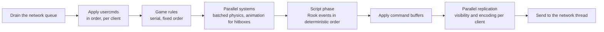
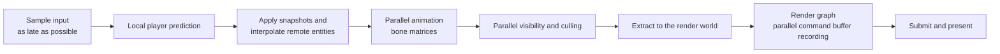
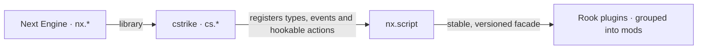

# 01 — Architecture

## 1. Layered view

The code is divided into **layers**. A layer may depend only on the layers below it.
Lateral dependencies (between modules of the same layer) are forbidden, unless explicitly
declared in this table.

```mermaid
flowchart TB
    subgraph L6[Application]
        APP_L[nextLauncher · updates the client, then starts it]
        APP_C[next · client]
        APP_S[nextds · dedicated server]
        TOOLS[nxbake · rook · tools]
    end
    subgraph L5[Game]
        CS_SV[cs.server]
        CS_CL[cs.client]
        CS_SH[cs.shared · pmove, weapons, shared rules]
    end
    subgraph L4[Game framework]
        GAME[nx.game · world, map entities, triggers]
        SCRIPT[nx.script · Rook VM host and bindings]
    end
    subgraph L3[Subsystems]
        RENDER[nx.render]
        AUDIO[nx.audio]
        NET[nx.net]
        COLL[nx.collision]
        UI[nx.ui]
        ASSETS[nx.assets]
    end
    subgraph L2[Runtime foundation]
        ECS[nx.ecs]
        RHI[nx.rhi + backends]
        PLAT[nx.platform]
        DATA[nx.data · TOML schemas]
    end
    subgraph L1[Core]
        JOBS[nx.jobs]
        META[nx.meta · reflection]
        MATH[nx.math]
        CONSOLE[nx.console · cvars, commands, .cfg]
    end
    subgraph L0[Base]
        CORE[nx.core · memory, errors, strong types, log, time]
    end
    L6 --> L5 --> L4 --> L3 --> L2 --> L1 --> L0
```



### 1.1 Module catalog

| C++ module | Layer | Responsibility | Depends on |
|------------|--------|------------------|------------|
| `nx.core` | 0 | `nx::Failure<E>`/`nx::Result`, contracts, strong types and units, explicit conversions, `EnumArray`/`Flags`, type and enum names, the text of diagnostics, numbers stored in bytes, allocators, log, time, hashing, IDs | `std` |
| `nx.math` | 1 | Vectors, matrices, quaternions, GoldSrc angles, AABB, planes, SIMD | core |
| `nx.console` | 1 | Typed cvars, commands, aliases, `+`/`-` buttons, command buffer and `.cfg` parser, shared by client and server ([12 §5.3](12-ui-hud-and-console.md#53-the-nxconsole-module)) | core |
| `nx.meta` | 1 | Static reflection facade (P2996 + annotations), with a fallback | core |
| `nx.jobs` | 1 | Job System, counters, graphs, `std::execution` scheduler | core |
| `nx.platform` | 2 | Window and input (SDL3, kept out of its interface), native file system, the path of the running program, the user's Steam folders, clocks, OS threads | core |
| `nx.ecs` | 2 | World, archetypes, queries, systems, scheduler, command buffers, events | core, jobs (meta with reflected component registration) |
| `nx.data` | 2 | Data and configuration files: TOML read into described structs, with typed failures that name the file, line, column and key ([§8](#8-configuration-and-data)) | core, meta |
| `nx.rhi` | 2 | Graphics hardware interface (abstract) | core, math |
| `nx.rhi.vulkan` | 2 | Vulkan 1.3 backend | rhi, platform |
| `nx.rhi.d3d11` | 2 | DirectX 11 backend (future) | rhi, platform |
| `nx.assets` | 3 | VFS, content sources, GoldSrc and modern importers, cache, handles, streaming | core, math, jobs, meta, data, platform |
| `nx.collision` | 3 | Traces against BSP hulls, entity collision, hitboxes. Today: the hulls of a map's brush models and their traces | core, math, jobs, assets (today: core, math, assets; the hulls come from the map as its compiler wrote them) |
| `nx.render` | 3 | Render graph, BSP world, studio models, sprites, particles, GPU skinning. Today: the camera and the BSP world | rhi, ecs, assets, jobs (today: core, math, rhi, assets) |
| `nx.audio` | 3 | Mixer, spatialization, DSP, streaming, voice | assets, jobs, platform |
| `nx.net` | 3 | UDP transport, encryption, channels, snapshots, replication | core, meta, jobs, ecs |
| `nx.ui` | 3 | Sprite-based HUD, menu toolkit, console (a view over `nx.console`), fonts | render, assets, platform, console |
| `nx.game` | 4 | Map entities, triggers, movers, spawn, generic rules | ecs, collision, assets, net |
| `nx.script` | 4 | Rook VM host, generated bindings, isolates, permissions | ecs, meta, jobs, game |
| `cs.shared` | 5 | Movement, weapons and rules shared for prediction | game, collision |
| `cs.server` | 5 | Server rules: rounds, economy, objectives, admin | cs.shared, script, net |
| `cs.client` | 5 | HUD, menus, effects, prediction, interpolation | cs.shared, render, audio, ui |
| `nx.update` | 3 | Updates of the client and the server products: signed release metadata, content-addressed chunks, atomic installs and rollback ([21](21-launcher-and-updates.md)). Planned (M4) | core, jobs, platform, net |
| `app.client` / `app.server` | 6 | Bootstrap, command line, main loop | everything above |
| `app.launcher` | 6 | The program players open: updates itself and the client, then starts `next`. Planned (M4) | update, platform |
| `tool.nxcheck` | 6 | `nxcheck`: reads every file of the Counter-Strike 1.6 installation through the VFS with the readers of `nx.assets`, joins included, and reports each failure ([18](18-testing-and-quality.md#real-content)) | core, jobs, assets (platform in the program) |

The dependency rules **MUST** be checked automatically. They are, when CMake configures: every
module library declares its layer (`nxAddModuleLibrary(... LAYER <n> ...)`), and once every
module exists (`cmake/nxLayers.cmake`, at the end of the configuration, whatever order the
modules are added in) a dependency on a project module of the same or of a higher layer fails
the configuration, locally and in every CI build. The `LayerCheck.*` tests run that check on a
fixture of empty modules. A strict layer order also rules out cycles. The same-layer
dependencies this table declares (`nx.rhi.vulkan` on `nx.rhi` and `nx.platform`, `nx.render` and
`nx.collision` on `nx.assets`, …) are declared `LATERAL` where the module is built (`nxAddModuleLibrary`): the check
accepts a same-layer dependency only when it is declared, and a `LATERAL` module only when it is of
the same layer.

## 2. Structural principles

### 2.1 No global state

No singletons and no global `extern`s. Each subsystem receives its dependencies through its
constructor. There is a single composition point: `app.*` creates an `EngineContext` with
explicit references.

There are two sanctioned exceptions, because they are process-wide services by nature: the
**contract violation handler** (`nx::setContractViolationHandler`, mirroring the C++26 global
handler) and the **default logger** (`nx::log::setDefaultLogger`). Both have a safe default
(abort / write to the console), are replaced only by the application and have an RAII scope
for tests. A thread's identity is not global state: the worker a thread is, which `nx.jobs`
records once when the worker starts ([04 §7](04-job-system.md#7-usage-rules)).

```cpp
export module app.server;

import nx.core;
import nx.jobs;
import nx.ecs;
import nx.net;
import nx.script;
import cs.server;

export namespace app {

struct ServerServices {
    nx::jobs::JobSystem&     jobs;
    nx::assets::AssetSystem& assets;
    nx::net::ServerTransport& transport;
    nx::script::ScriptHost&  scripts;
};

[[nodiscard]] auto runDedicatedServer(const ServerLaunchOptions& options)
    -> std::expected<ExitStatus, nx::Failure<ServerError>>;

} // namespace app
```

### 2.2 Interfaces through concepts and facades

- Within a layer, static polymorphism comes from **concepts**.
- Between layers, or when the implementation varies at runtime (RHI backends, transports,
  file systems), a **small virtual interface** or *type erasure* (`std::function_ref`,
  `std::move_only_function`) is used.
- Facades: plugins never see `nx.ecs` directly. `nx.script` exposes a stable, versioned
  facade ([15](15-mod-api.md)).

### 2.3 Communication between subsystems

| Mechanism | When to use |
|-----------|-------------|
| Direct call through an interface | Downward, synchronous dependency (render → rhi) |
| Typed ECS events (`Events<T>`) | Notification within the simulation world (player died → HUD, plugins, statistics) |
| Lock-free SPSC/MPSC queues | Boundary between long-lived threads (networking ↔ simulation, simulation ↔ audio) |
| Extraction (*extract*) | Simulation → render: an immutable copy of the state needed to draw the frame |

Callbacks through which a lower layer **notifies** a higher one (observers, listeners, "on
change" hooks) are **forbidden**. The higher layer queries; the lower layer does not know the
higher one. Running work that a higher layer hands down to be run (a job in `nx.jobs`, a system
in `nx.ecs`, the handler of a command in `nx.console`) is not such a callback: the higher layer
decides what runs, the lower one only when ([ADR-0018](adr/0018-work-handed-down-is-not-a-callback.md)).

## 3. Execution modes

| Mode | Process | Active components |
|------|----------|--------------------|
| Connected client | `next` | cs.client, render, audio, UI, networking (client), prediction |
| Listen server | `next` | Everything in the client **plus** a `cs.server` on its own thread, connected through a *loopback* transport without packet serialization |
| Dedicated server | `nextds` | cs.server, networking (server), script host. **No** render, audio or UI (*headless* build) |
| Launcher | `nextLauncher` | `nx.update`: updates the launcher and the client, then starts `next`; the dedicated server updates itself through `nx.update` too ([21](21-launcher-and-updates.md)) |
| Tools | `nxbake`, `rook` | Only the libraries they need |

The server of the listen server is **the same code** as the dedicated one. The loopback only
avoids serializing and encrypting packets, so the network behavior (delay, order,
snapshots) stays the same.

## 4. Thread model

| Thread | Count | Responsibility | Constraints |
|--------|------------|------------------|------------|
| Main | 1 | OS events, input, frame orchestration | Does no heavy work, only enqueues jobs |
| Workers | `N = cores − 1` (cvar `jobs_workers`) | Run jobs | No blocking. Waits help run other jobs |
| I/O | 1–2 | Asynchronous file I/O and decompression | Low priority |
| Network | 1 | `recv`/`send`, encryption, (de)fragmentation | Delivers messages through a lock-free queue |
| Audio | 1 | Real-time mixing callback | No allocation, no lock, no I/O |
| Listen server simulation | 1 (+ workers) | Tick of the embedded server | Shares the workers through priorities |

## 5. Frame cycle

### 5.1 Server (per tick)



- The server tick is fixed (`sv_tickrate`, default 100 Hz).
- The usercmds of each player are processed in arrival order, as in the original. Player
  movement is serial because players collide with each other and the order affects the
  result.
- What runs in parallel: animation and hitbox setup, batched physics of non-player
  entities, per-client visibility (PVS), per-client snapshot assembly and encoding,
  parallel Rook systems without access conflicts, and packet compression/encryption.

### 5.2 Client (per render frame)



- **Fixed-rate user commands:** the client generates usercmds with a fixed `msec` (the
  default is equivalent to 100 FPS) regardless of the render FPS. This way, movement
  reproduces the classic competitive setup (`fps_max 100`) on any machine. The predicted
  state is interpolated to the real display FPS ([07](07-simulation-and-physics.md)).
- **Pipelining:** rendering frame N may overlap the simulation of frame N+1
  (`r_pipelined 1`). The low-latency mode (`r_pipelined 0` + a limiter before input
  sampling) favors latency over throughput.

## 6. Simulation world × render world

- The **simulation world** (ECS) holds the authoritative state (server) or the predicted and
  interpolated state (client).
- The **render world** is a flat structure, rebuilt or updated by *extract* every frame,
  holding only what is needed to draw: instances, matrices, lights and particles.
- Separating the two allows recording the render in parallel without stalling the
  simulation, and keeps `nx.render` decoupled from game logic.

## 7. Engine × game × mods boundary



- The engine does not know the rules of Counter-Strike.
- The `cstrike` game is statically linked (no game DLL) and is the only game: there is no
  game-module interface and no Half-Life or other GoldSrc game
  ([ADR-0017](adr/0017-counter-strike-only.md)).
- Rook plugins extend the game **only** through the API exposed in `nx.script`. There is no
  access to memory, offsets or internals.

## 8. Configuration and data

| Type | Format | Example |
|------|---------|---------|
| Legacy configuration | `.cfg` (console commands) | `server.cfg`, `autoexec.cfg`, `config.cfg` |
| Legacy lists | text | `mapcycle.txt`, `motd.txt`, `listip.cfg`, `banned.cfg` |
| New configuration | TOML with a schema | `plugins.toml`, `admins.toml`, `masterServers.toml` |
| Game data | TOML with a schema validated at load time | `data/cstrike/weapons/ak47.toml`, `economy.toml` |
| Mod manifest | TOML | `mod.toml` |

Every TOML file has a **schema** derived by reflection from a C++ struct. An unknown key, a
wrong type or an out-of-range value produces a typed error with the file, line and column.

`nx.data` implements it: `nx::data::parseToml<T>(text, fileName)` reads a TOML file into a
struct with an `nx.meta` description. The keys of a table are the fields of its struct
(nested tables are described structs too), every field that is not `std::optional` is
required, and a value must have the field's type: booleans, integers, `float` and `double`,
quantities and durations (as their number), text, enums (the enumerator's name with a
lowercase first letter, `GoldsrcInstall` → `"goldsrcInstall"`), tables and arrays of them. A
`nx::data::Range` annotation bounds a number; a Range on a field without numbers, with its
minimum above its maximum, or with inexact bounds on a whole-number field does not compile, and
whole numbers compare against it exactly. The first problem is the failure
(`DataError::Syntax`, `UnknownKey`, `MissingKey`, `WrongType`, `OutOfRange`, `UnknownName`), with
the detail `"<file>:<line>:<column>: <key path>: <problem>"`, for example
`server.toml:3:14: maxPlayers: expected a whole number in [1, 64], got 65`; a number beyond its
field's type keeps the conversion failure as its cause. The TOML library (toml++, built without
exceptions) stays behind `nx::data::Document` and its views.

## 9. Observability

- **Structured logging** (`nx::log`) with categories and levels, with output to the console,
  a file and JSON lines (server).
- **Tracy profiler** in development builds: zones per job, per ECS system and per
  Rook callback.
- **Server metrics:** tick time (p50/p99), bandwidth per client, entities per
  snapshot, job queues, memory per plugin. They are available through the `stats` command
  and an optional endpoint in the Prometheus format.
- **Crash reports** with a minidump and a log of the last N lines, without personal data.
