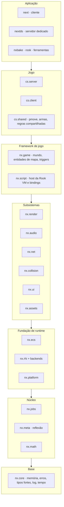
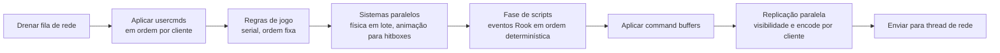
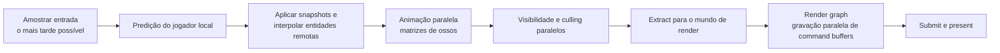
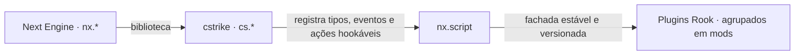

# 01 — Arquitetura

## 1. Visão em camadas

O código é dividido em **camadas**. Uma camada só pode depender das camadas abaixo dela.
Dependências laterais (entre módulos da mesma camada) são proibidas, salvo quando
declaradas explicitamente nesta tabela.



### 1.1 Catálogo de módulos

| Módulo C++ | Camada | Responsabilidade | Depende de |
|------------|--------|------------------|------------|
| `nx.core` | 0 | `nx::Failure<E>`/`nx::Result`, contratos, tipos fortes e unidades, conversões explícitas, `EnumArray`/`Flags`, nomes de tipo e enum, alocadores, log, tempo, hashing, IDs | `std` |
| `nx.math` | 1 | Vetores, matrizes, quaternions, ângulos GoldSrc, AABB, planos, SIMD | core |
| `nx.meta` | 1 | Fachada de reflexão estática (P2996 + anotações), com fallback | core |
| `nx.jobs` | 1 | Job System, contadores, grafos, scheduler `std::execution` | core |
| `nx.platform` | 2 | Janela, entrada, sistema de arquivos nativo, relógios, threads do SO (SDL3) | core, math |
| `nx.ecs` | 2 | Mundo, arquétipos, queries, sistemas, agendador, command buffers, eventos | core, meta, jobs |
| `nx.rhi` | 2 | Interface de hardware gráfico (abstrata) | core, math |
| `nx.rhi.vulkan` | 2 | Backend Vulkan 1.3 | rhi, platform |
| `nx.rhi.d3d11` | 2 | Backend DirectX 11 (futuro) | rhi, platform |
| `nx.assets` | 3 | VFS, importadores GoldSrc e modernos, cache, handles, streaming | core, jobs, meta, platform |
| `nx.collision` | 3 | Traces em hulls de BSP, colisão de entidades, hitboxes | core, math, jobs |
| `nx.render` | 3 | Render graph, mundo BSP, modelos de estúdio, sprites, partículas, GPU skinning | rhi, ecs, assets, jobs |
| `nx.audio` | 3 | Mixer, espacialização, DSP, streaming, voz | assets, jobs, platform |
| `nx.net` | 3 | Transporte UDP, criptografia, canais, snapshots, replicação | core, meta, jobs, ecs |
| `nx.ui` | 3 | HUD por sprites, toolkit de menus, console, fontes | render, assets, platform |
| `nx.game` | 4 | Entidades de mapa, triggers, movers, spawn, regras genéricas | ecs, collision, assets, net |
| `nx.script` | 4 | Rook VM host, bindings gerados, isolates, permissões | ecs, meta, jobs, game |
| `cs.shared` | 5 | Movimento, armas e regras compartilhadas para predição | game, collision |
| `cs.server` | 5 | Regras de servidor: rounds, economia, objetivos, admin | cs.shared, script, net |
| `cs.client` | 5 | HUD, menus, efeitos, predição, interpolação | cs.shared, render, audio, ui |
| `app.client` / `app.server` | 6 | Bootstrap, linha de comando, laço principal | tudo acima |

As regras de dependência **DEVEM** ser verificadas automaticamente no CI (grafo de alvos
do CMake mais um script que falha em ciclos ou em arestas não declaradas).

## 2. Princípios estruturais

### 2.1 Sem estado global

Nada de singletons nem `extern` globais. Cada subsistema recebe as dependências por
construtor. O ponto de composição é único: `app.*` cria um `EngineContext` com referências
explícitas.

```cpp
export module app.server;

import nx.core;
import nx.jobs;
import nx.ecs;
import nx.net;
import nx.script;
import cs.server;

export namespace app {

struct ServerServices {
    nx::jobs::JobSystem&     jobs;
    nx::assets::AssetSystem& assets;
    nx::net::ServerTransport& transport;
    nx::script::ScriptHost&  scripts;
};

[[nodiscard]] auto runDedicatedServer(const ServerLaunchOptions& options)
    -> std::expected<ExitStatus, nx::Failure<ServerError>>;

} // namespace app
```

### 2.2 Interfaces por conceitos e por fachadas

- Dentro de uma camada, o polimorfismo estático vem de **concepts**.
- Entre camadas, ou quando a implementação varia em tempo de execução (backends de RHI,
  transportes, sistemas de arquivos), usa-se uma **interface virtual pequena** ou um
  *type-erasure* (`std::function_ref`, `std::move_only_function`).
- Fachadas: os plugins nunca veem `nx.ecs` diretamente. `nx.script` expõe uma fachada estável
  e versionada ([15](15-api-de-mods.md)).

### 2.3 Comunicação entre subsistemas

| Mecanismo | Quando usar |
|-----------|-------------|
| Chamada direta via interface | Dependência descendente e síncrona (render → rhi) |
| Eventos tipados do ECS (`Events<T>`) | Notificação dentro do mundo de simulação (jogador morreu → HUD, plugins, estatísticas) |
| Filas SPSC/MPSC sem lock | Fronteira entre threads de longa duração (rede ↔ simulação, simulação ↔ áudio) |
| Extração (*extract*) | Simulação → render: cópia imutável do estado necessário para desenhar o frame |

Callbacks registrados por subsistemas de camada inferior para chamar camadas superiores
são **proibidos**. A camada superior consulta, a inferior não conhece a superior.

## 3. Modos de execução

| Modo | Processo | Componentes ativos |
|------|----------|--------------------|
| Cliente conectado | `next` | cs.client, render, áudio, UI, rede (cliente), predição |
| Listen server | `next` | Tudo do cliente **mais** um `cs.server` em thread própria, ligado por transporte *loopback* sem serialização de pacote |
| Servidor dedicado | `nextds` | cs.server, rede (servidor), script host. **Sem** render, áudio e UI (build *headless*) |
| Ferramentas | `nxbake`, `rook` | Apenas as bibliotecas necessárias |

O servidor do listen server é **o mesmo código** do dedicado. O loopback só evita
serializar e criptografar pacotes, então o comportamento de rede (atraso, ordem,
snapshots) continua o mesmo.

## 4. Modelo de threads

| Thread | Quantidade | Responsabilidade | Restrições |
|--------|------------|------------------|------------|
| Principal | 1 | Eventos do SO, entrada, orquestração do frame | Não faz trabalho pesado, só enfileira jobs |
| Workers | `N = núcleos − 1` (cvar `jobs_workers`) | Executar jobs | Sem bloqueio. Esperas ajudam a executar outros jobs |
| E/S | 1–2 | E/S assíncrona de arquivos e descompressão | Prioridade baixa |
| Rede | 1 | `recv`/`send`, criptografia, (des)fragmentação | Entrega mensagens por fila sem lock |
| Áudio | 1 | Callback de mixagem em tempo real | Sem alocação, sem lock, sem E/S |
| Simulação do listen server | 1 (+ workers) | Tick do servidor embutido | Compartilha os workers via prioridades |

## 5. Ciclo de frame

### 5.1 Servidor (por tick)



- O tick do servidor é fixo (`sv_tickrate`, padrão 100 Hz).
- Os usercmds de cada jogador são processados em ordem de chegada, como no original. O
  movimento de jogadores é serial porque jogadores colidem entre si e a ordem afeta o
  resultado.
- O que é paralelo: animação e montagem de hitboxes, física de entidades não-jogador em
  lote, visibilidade (PVS) por cliente, montagem e codificação de snapshots por cliente,
  sistemas Rook paralelos sem conflito de acesso e compressão/criptografia de pacotes.

### 5.2 Cliente (por frame de render)



- **Comandos de usuário a taxa fixa:** o cliente gera usercmds com `msec` fixo (padrão
  equivalente a 100 FPS) independentemente do FPS de render. Assim o movimento reproduz a
  configuração competitiva clássica (`fps_max 100`) em qualquer máquina. O estado
  predito é interpolado para o FPS real de exibição ([07](07-simulacao-e-fisica.md)).
- **Pipelining:** o render do frame N pode sobrepor a simulação do frame N+1
  (`r_pipelined 1`). O modo de baixa latência (`r_pipelined 0` + limitador antes da
  amostragem de entrada) prioriza latência sobre vazão.

## 6. Mundo de simulação × mundo de render

- O **mundo de simulação** (ECS) contém o estado autoritativo (servidor) ou predito e
  interpolado (cliente).
- O **mundo de render** é uma estrutura plana, reconstruída ou atualizada por *extract* a
  cada frame, contendo apenas o necessário para desenhar: instâncias, matrizes, luzes e
  partículas.
- Separar os dois permite gravar o render em paralelo sem travar a simulação e mantém
  `nx.render` desacoplado da lógica de jogo.

## 7. Fronteira engine × jogo × mods



- A engine não conhece regras de Counter-Strike.
- O jogo `cstrike` é linkado estaticamente na v1 (sem DLL de jogo). A interface
  `nx::game::GameModule` existe para que, no futuro, outros jogos GoldSrc (ex.: HL
  Deathmatch) usem a mesma engine.
- Plugins Rook estendem o jogo **apenas** pela API exposta em `nx.script`. Não existe acesso
  a memória, offsets ou internals.

## 8. Configuração e dados

| Tipo | Formato | Exemplo |
|------|---------|---------|
| Configuração legada | `.cfg` (comandos de console) | `server.cfg`, `autoexec.cfg`, `config.cfg` |
| Listas legadas | texto | `mapcycle.txt`, `motd.txt`, `listip.cfg`, `banned.cfg` |
| Configuração nova | TOML com esquema | `plugins.toml`, `admins.toml`, `masterServers.toml` |
| Dados de jogo | TOML com esquema validado na carga | `data/cstrike/weapons/ak47.toml`, `economy.toml` |
| Manifesto de mod | TOML | `mod.toml` |

Todo arquivo TOML tem um **esquema** derivado por reflexão de uma struct C++. Chave
desconhecida, tipo errado ou valor fora do intervalo geram um erro tipado com arquivo,
linha e coluna.

## 9. Observabilidade

- **Log estruturado** (`nx::log`) com categorias e níveis, saída para console, arquivo e
  JSON lines (servidor).
- **Profiler Tracy** em builds de desenvolvimento: zonas por job, por sistema ECS e por
  callback Rook.
- **Métricas do servidor:** tempo de tick (p50/p99), banda por cliente, entidades por
  snapshot, filas de jobs, memória por plugin. Ficam disponíveis via comando `stats` e
  endpoint opcional no formato Prometheus.
- **Crash reports** com minidump e log das últimas N linhas, sem dados pessoais.
