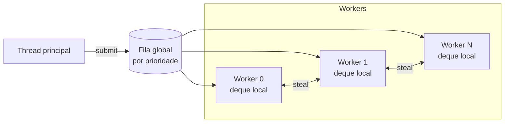

# 04 — Job System e multithreading

> Decisão registrada em [ADR-0003](adr/0003-job-system-work-stealing.md).

## 1. Objetivos

- Usar **todos os núcleos** de forma previsível, sem threads criadas ad-hoc pelo código.
- Jobs **não bloqueantes**: nenhuma thread fica parada esperando outra enquanto há
  trabalho na fila.
- Dependências explícitas e verificáveis, sem *sleep* e sem *busy-wait* cego.
- Prioridades para que o trabalho do frame atual não espere streaming de assets.
- Integração com `std::execution` (C++26) para compor trabalho assíncrono.

## 2. Modelo



- **Workers:** `N = hardware_concurrency − 1` por padrão (`jobs_workers`), fixados por
  afinidade quando o SO permite.
- **Deques locais** (Chase-Lev): o worker empilha e desempilha no fundo, ladrões roubam
  do topo.
- **Fila global** por prioridade, para submissões externas (thread principal, rede, E/S).
- **Prioridades:** `Critical` (frame atual), `Normal`, `Low` (streaming, compressão) e
  `Background` (pré-cálculo, cache). Um worker só pega `Low` se não houver `Critical` ou
  `Normal` visível.

## 3. API

```cpp
export namespace nx::jobs {

enum class Priority : std::uint8_t { Critical, Normal, Low, Background };

struct JobDesc {
    std::function_ref<void(JobContext&)> function;
    Priority         priority = Priority::Normal;
    std::string_view label;            // Tracy zone name and debugging
};

class JobSystem {
public:
    [[nodiscard]] static auto create(const JobSystemConfig& config)
        -> nx::Result<std::unique_ptr<JobSystem>, JobSystemError>;

    [[nodiscard]] auto submit(JobDesc desc, std::span<const JobHandle> dependsOn = {}) -> JobHandle;

    template <std::ranges::random_access_range Range, class Fn>
    [[nodiscard]] auto parallelFor(Range&& range, Grain grain, Fn&& fn, Priority = Priority::Critical) -> JobHandle;

    /// Executes other jobs while waiting; never parks a worker while work is available.
    void wait(JobHandle handle);

    [[nodiscard]] auto scheduler(Priority priority = Priority::Normal) noexcept -> Scheduler;
};

} // namespace nx::jobs
```

### 3.1 Contadores e handles

- Cada `JobHandle` aponta para um **contador atômico** de jobs pendentes, com geração
  para detectar uso após conclusão.
- Um job com dependências só entra na fila quando o contador de todas elas chega a zero:
  as continuações são enfileiradas pelo último job a terminar, sem polling.
- `wait(handle)` executa outros jobs enquanto espera (*help-while-waiting*). Na thread
  principal ele é usado apenas nos pontos de sincronização do frame.

### 3.2 Granularidade

- `Grain::automatic()` divide o range em cerca de `4 × workers` lotes, com mínimo de
  elementos por lote ajustável por tipo de carga.
- `Grain::fixed(n)` existe para quando o custo por item é conhecido (ex.: 1 chunk do ECS
  por job).
- Jobs muito pequenos (< 5 µs) são agrupados. O profiler marca jobs abaixo do limiar.

### 3.3 Memória dos jobs

- Jobs recebem um `JobContext` com acesso à `FrameArena` da thread. Memória temporária
  do job vem dela, sem `malloc` no caminho quente.
- Descritores de job vêm de um pool sem lock, reciclado por frame.
- Capturas de lambda que excedem o buffer inline do descritor são erro de compilação
  (`static_assert` com mensagem), forçando a passagem de dados por arena.

## 4. Integração com `std::execution`

`JobSystem::scheduler()` modela `std::execution::scheduler`, o que permite compor
pipelines assíncronos com senders:

```cpp
namespace ex = std::execution;

auto loadAndUpload = ex::schedule(jobs.scheduler(nx::jobs::Priority::Low))
                   | ex::then([&] { return assets.decodeTexture(path); })
                   | ex::continues_on(renderUploadScheduler)
                   | ex::then([&](nx::Result<DecodedTexture, TextureError> decoded) {
                         return decoded.and_then([&](auto& texture) { return uploader.upload(texture); });
                     });

scope.spawn(std::move(loadAndUpload));  // async scope bound to the asset system lifetime
```

- Senders são usados em fluxos **assíncronos de longa duração**: streaming de assets,
  E/S, compilação de shaders e carregamento de mapas.
- O frame (ECS, render) usa a API direta de `JobHandle`, por previsibilidade e menor
  overhead.
- Até a biblioteca padrão do compilador oferecer `std::execution` completo, a
  implementação de referência `stdexec` é usada atrás da fachada `nx.jobs`
  ([02 §1.2](02-padroes-de-codigo.md#12-política-de-toolchain-e-fallbacks)).

## 5. Threads dedicadas (fora do pool)

| Thread | Por que não é um job |
|--------|----------------------|
| Áudio | Callback de tempo real com prazo rígido (não pode esperar a fila) |
| Rede | Bloqueia em `recv`/espera de eventos do SO. Latência de pacote não pode depender da carga do frame |
| E/S | Chamadas de SO bloqueantes. Entrega resultados como jobs `Low` |
| Principal | Exigência do SO para janela e entrada (SDL3) |

Toda comunicação entre essas threads e os jobs usa **filas sem lock** (SPSC/MPSC) de
`nx.core`, com capacidade nomeada e erro tipado se ficarem cheias
(`QueueError::Full` gera métrica e log com *rate limit*).

## 6. Como o frame usa o Job System

### 6.1 Servidor (tick)

| Etapa | Paralelismo |
|-------|-------------|
| Aplicar usercmds | Serial por jogador (ordem significativa) |
| Regras e hooks Rook síncronos | Serial (ordem significativa) |
| Animação e hitboxes para compensação de lag | `parallelFor` por entidade animada |
| Física de entidades não-jogador | Por chunk |
| PVS/PAS e relevância por cliente | `parallelFor` por cliente |
| Montagem e codificação delta de snapshots | `parallelFor` por cliente |
| Compressão e criptografia | Na thread de rede ou em jobs `Normal`, conforme a carga |

### 6.2 Cliente (frame)

| Etapa | Paralelismo |
|-------|-------------|
| Interpolação de entidades remotas | Por chunk |
| Avaliação de animação (bones) | Por entidade visível |
| Culling (PVS do BSP, frustum, oclusão de portais) | Por região/lote |
| Partículas e tempents | Por emissor |
| Gravação de command buffers | Por passe do render graph e por lote de draws |
| Mixagem de vozes (decode Opus) | Jobs `Normal` alimentando o mixer |

## 7. Regras de uso

- **Proibido** criar `std::thread`/`std::jthread` fora de `nx.platform` e `nx.jobs`.
- **Proibido** bloquear em job: sem `mutex.lock()` disputado, sem E/S síncrona, sem
  `sleep`. Esperas por outros jobs só via dependência ou `wait`.
- Dados escritos por jobs paralelos precisam ser **disjuntos por construção** (por chunk,
  por cliente, por índice). Reduções usam acumuladores por job, combinados depois.
- `thread_local` só para caches sem semântica (ex.: buffers de scratch), nunca para
  estado que o código espera reencontrar.
- Todo job tem `label` para o profiler.

## 8. Determinismo

- O resultado de um frame **não pode depender** da quantidade de workers nem da ordem em
  que os jobs rodaram.
- Por isso, as saídas de jobs paralelos são escritas em posições determinadas pelo índice
  do item, e as reduções combinam os parciais em ordem de índice.
- Teste obrigatório: a mesma demo de entrada roda com `jobs_workers 0`, `1`, `3` e `15` e
  produz *hash* de estado idêntico a cada tick
  ([18](18-testes-e-qualidade.md#determinismo)).

## 9. Diagnóstico

- Zonas Tracy por job (`label`) e por espera (`wait`), com *fibers view* dos workers.
- Comando `jobs_stats`: jobs/s, tempo médio por prioridade, roubos e ociosidade por worker.
- Modo `jobs_serial 1` (desenvolvimento): executa tudo na thread que submete, útil para
  isolar bugs de concorrência.

## 10. Fora do escopo da v1

- **Fibers:** permitiriam `wait` no meio de um job sem *help-while-waiting*, mas
  complicam depuração, `thread_local` e ferramentas. Serão reavaliadas se o profiler
  mostrar perda significativa por esperas (registrado no ADR-0003).
