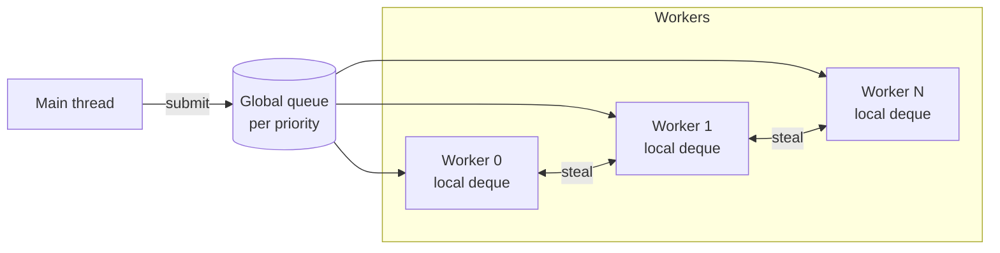

# 04 — Job System and multithreading

> Decision recorded in [ADR-0003](adr/0003-work-stealing-job-system.md).

## 1. Goals

- Use **every core** predictably, without threads created ad hoc by the code.
- **Non-blocking** jobs: no thread sits waiting for another while there is work in the
  queue.
- Explicit, verifiable dependencies, without *sleep* and without blind *busy-wait*.
- Priorities, so that the current frame's work does not wait for asset streaming.
- Integration with `std::execution` (C++26) to compose asynchronous work.

## 2. Model



- **Workers:** `N = hardware_concurrency − 1` by default (`JobSystemConfig::workerCount`, at
  most `kMaxWorkerCount`; a `jobs_workers` cvar is planned). CPU affinity, if a benchmark
  shows a gain, needs control over OS threads in a layer `nx.jobs` may use (its own or
  `nx.core`): `nx.platform` is in layer 2, above it ([01 §1.1](01-architecture.md#11-module-catalog)).
- **Local deques** (Chase-Lev, `WorkStealingDeque`): one per priority in each worker. The
  owner pushes and pops at the bottom, thieves steal from the top. The deque grows on
  demand, so a *push* never fails.
- **Global queue** per priority (`IntrusiveQueue`), for submissions from threads that are
  not workers (main thread, network, I/O). Producers never wait: a *push* is an atomic
  exchange (Vyukov's intrusive MPSC queue). Consumers take turns through a *try-lock*; one
  that finds another consuming looks for work elsewhere instead of waiting.
- **Priorities:** `Critical` (current frame), `Normal`, `Low` (streaming, compression) and
  `Background` (precomputation, cache). A thread looking for work tries the priorities from
  the most urgent down: its own deque, the global queue and the other workers' deques of one
  priority before the next. Visibility is momentary: a global queue another thread is taking
  from at that instant is skipped, so a less urgent job can start while a more urgent one is
  being handed out. A thread inside `wait` helps with whatever it finds, so the main thread
  may run a `Background` job while it waits for a `Critical` one; long jobs belong to the
  workers' lower priorities, not to code that waits on the frame.
- **Idleness:** a thread without work does a few rounds of searching
  (`kIdleRoundsBeforeSleep`) and then sleeps in `std::atomic::wait` on a signal that changes
  with every enqueued job. No fixed-time *sleep* and no endless *busy-wait*.

## 3. API

```cpp
export namespace nx::jobs {

enum class Priority : std::uint8_t { Critical, Normal, Low, Background, Count };

struct JobDesc {
    JobLabel                   label;      // required; built only from constant expressions
    Priority                   priority = Priority::Normal;
    std::span<const JobHandle> dependsOn = {};
};

class JobSystem {
public:
    [[nodiscard]] static auto create(const JobSystemConfig& config = {})
        -> nx::Result<std::unique_ptr<JobSystem>, JobSystemError>;

    template <JobFunction Function>  // void(JobContext&) or void()
    [[nodiscard]] auto submit(const JobDesc& desc, Function&& function) -> JobHandle;

    template <std::ranges::random_access_range Range, class Function>  // sized and borrowed
    [[nodiscard]] auto parallelFor(const JobDesc& desc, Range&& range, Grain grain, Function&& function)
        -> JobHandle;

    /// Runs other jobs while waiting; sleeps only while no job is visible.
    void wait(JobHandle handle);
    [[nodiscard]] auto isComplete(JobHandle handle) const noexcept -> bool;
    [[nodiscard]] auto stats() const -> JobSystemStats;
};

} // namespace nx::jobs
```

```cpp
const nx::jobs::JobHandle animate =
    jobs.parallelFor({.label = "animate", .priority = nx::jobs::Priority::Critical}, visibleModels,
                     nx::jobs::Grain::automatic(), [&](ModelInstance& model) { model.evaluatePose(now); });

const std::array afterAnimation{animate};
const nx::jobs::JobHandle hitboxes = jobs.submit({.label = "hitboxes", .dependsOn = afterAnimation},
                                                 [&] { lagCompensation.recordHitboxes(visibleModels); });
jobs.wait(hitboxes);
```

### 3.1 Counters and handles

- A `JobHandle` is the index of an **atomic counter** of pending jobs plus its
  **generation**. The generation and the continuation list live in the same 64-bit atomic
  word: registering a continuation fails atomically if the counter has already finished or
  was reused, and an old handle reads as complete. Keeping handles after completion is
  harmless; waiting on an invalid handle (`JobHandle{}`) is a contract violation.
  Generations are 32 bits: a handle kept while its counter is reused 2^32 times (hours of
  continuous submission to the most reused counter) reads that newest incarnation instead,
  which only delays a wait or a continuation and never touches freed memory.
- A job with dependencies only enters the queue when all of them finish: each dependency
  still pending receives a continuation link, and the last job of each counter enqueues the
  continuations that became ready, without polling.
- `parallelFor` uses one counter for all batches: the handle completes when the last batch
  finishes, and never before its dependencies: an empty range with dependencies runs one empty
  batch after them; without dependencies, its handle is complete at once.
- `wait(handle)` runs other jobs while it waits (*help-while-waiting*) and only sleeps
  when there is no visible work. The completion of a counter that someone is waiting on
  wakes the sleepers. On the main thread, `wait` is used only at the frame's
  synchronization points.

### 3.2 Granularity

- `Grain::automatic(minimum)` splits the range into about `kBatchesPerThread × threads`
  batches (4 per thread; the threads are the workers plus the waiting one), with a minimum
  number of elements per batch that is adjustable per workload type.
- `Grain::fixed(n)` produces batches of exactly `n` elements, for when the cost per item is
  known (e.g. 1 ECS chunk per job). It is the choice for reductions, because the split of
  `automatic` depends on the number of workers (§8).
- Grouping very small jobs (< 5 µs) and marking them in the profiler depends on measurement:
  it comes with Tracy and the benchmarks. Until then, the per-batch minimum of `automatic`
  plays that role.

### 3.3 Job memory

- Job descriptors, counters and continuation links come from lock-free pools
  (`ConcurrentPool`): blocks that never change address, a Treiber free list with an ABA
  *tag*, and recycling as soon as the job finishes. After warm-up, submitting a job does
  not call `malloc`. Nodes are addressed by a strong `PoolIndex`, and the lists threaded
  through them store a `PoolLink` (`None` or a node); a link and its 32-bit tag share one
  word (`TaggedLink`), which the pool's free list and each counter's continuation list
  replace with one compare-exchange.
- The lambda captures live inside the descriptor (`kJobCaptureCapacity`, 96 bytes).
  A larger capture is a compile error (`static_assert` with a message), which forces large
  data to be passed by reference or through an arena. The captures are destroyed right after
  the job runs, before the handle completes.
- The `label` is a `JobLabel`, which can only be built from a constant expression (literal,
  type name) and therefore never points to freed memory.
- The `JobContext` gives access to the `JobSystem` (to submit and wait on more jobs) and to
  the `label`. The per-job scratch arena (the thread's `FrameArena`) comes when the first
  consumer needs it.

## 4. Integration with `std::execution`

> **Status:** not implemented yet. The first consumer is asset streaming (M2), and the
> scheduler comes with it, together with the `stdexec` dependency.

`JobSystem::scheduler()` models `std::execution::scheduler`, which allows composing
asynchronous pipelines with senders:

```cpp
namespace ex = std::execution;

auto loadAndUpload = ex::schedule(jobs.scheduler(nx::jobs::Priority::Low))
                   | ex::then([&] { return assets.decodeTexture(path); })
                   | ex::continues_on(renderUploadScheduler)
                   | ex::then([&](nx::Result<DecodedTexture, TextureError> decoded) {
                         return decoded.and_then([&](auto& texture) { return uploader.upload(texture); });
                     });

scope.spawn(std::move(loadAndUpload));  // async scope bound to the asset system lifetime
```

- Senders are used in **long-running asynchronous** flows: asset streaming, I/O, shader
  compilation and map loading.
- The frame (ECS, render) uses the direct `JobHandle` API, for predictability and lower
  overhead.
- Until the compiler's standard library offers a complete `std::execution`, the `stdexec`
  reference implementation is used behind the `nx.jobs` facade
  ([02 §1.2](02-coding-standards.md#12-toolchain-and-fallback-policy)).

## 5. Dedicated threads (outside the pool)

| Thread | Why it is not a job |
|--------|---------------------|
| Audio | Real-time callback with a hard deadline (cannot wait for the queue) |
| Network | Blocks on `recv`/waits for OS events. Packet latency cannot depend on the frame load |
| I/O | Blocking OS calls. Delivers results as `Low` jobs |
| Main | OS requirement for the window and input (SDL3) |

All communication between these threads and the jobs uses **lock-free queues** (SPSC/MPSC)
from `nx.core`, with a named capacity and a typed error if they fill up
(`QueueError::Full` produces a metric and a log with a *rate limit*).

## 6. How the frame uses the Job System

### 6.1 Server (tick)

| Step | Parallelism |
|------|-------------|
| Apply usercmds | Serial per player (order matters) |
| Rules and synchronous Rook hooks | Serial (order matters) |
| Animation and hitboxes for lag compensation | `parallelFor` per animated entity |
| Non-player entity physics | Per chunk |
| PVS/PAS and per-client relevance | `parallelFor` per client |
| Snapshot assembly and delta encoding | `parallelFor` per client |
| Compression and encryption | On the network thread or in `Normal` jobs, depending on the load |

### 6.2 Client (frame)

| Step | Parallelism |
|------|-------------|
| Remote entity interpolation | Per chunk |
| Animation evaluation (bones) | Per visible entity |
| Culling (BSP PVS, frustum, portal occlusion) | Per region/batch |
| Command buffer recording | Per render graph pass and per draw batch |
| Voice mixing (Opus decode) | `Normal` jobs feeding the mixer |

## 7. Usage rules

- **Forbidden** to create `std::thread`/`std::jthread` outside `nx.platform` and `nx.jobs`.
- **Forbidden** to block in a job: no contended `mutex.lock()`, no synchronous I/O, no
  `sleep`. Waits on other jobs only through a dependency or `wait`.
- Data written by parallel jobs must be **disjoint by construction** (per chunk,
  per client, per index). Reductions use per-job accumulators, combined afterwards.
- `thread_local` only for caches without semantics (e.g. scratch buffers), never for
  state the code expects to find again. The one identity a thread carries is which worker it
  is: `nx.jobs` sets it once when the worker starts, so `submit` from inside a job pushes to
  that worker's deque. It is not global state: no thread changes another's, and jobs never
  write it ([01 §2.1](01-architecture.md#21-no-global-state)).
- Every job has a `label` for the profiler: `JobDesc` does not compile without it.

## 8. Determinism

- The result of a frame **must not depend** on the number of workers or on the order in
  which the jobs ran.
- That is why the outputs of parallel jobs are written at positions determined by the item
  index, and reductions combine the partial results in index order.
- `Grain::automatic()` splits the range according to the number of threads, so it only fits
  when each element writes its own output. Reductions use `Grain::fixed(n)`, so that
  the partial results are the same on any machine. The `JobSystemDeterminismTest` test
  compares the *hash* of the result with 0, 1, 3 and 15 workers.
- Mandatory test: the same input demo runs with `jobs_workers 0`, `1`, `3` and `15` and
  produces an identical state *hash* on every tick
  ([18](18-testing-and-quality.md#determinism)).

## 9. Diagnostics

- Tracy zones per job (`label`) and per wait (`wait`), with the workers' *fibers view*,
  once Tracy comes in as a dependency.
- `JobSystem::stats()`: jobs executed, steals and times slept, per worker, and jobs
  executed by threads inside `wait`. A `jobs_stats` command that shows these numbers is
  planned in `nx.console` ([TODO](TODO.md)); the average time per priority comes with Tracy.
- `jobs_serial 1` mode (development, planned with `jobs_stats`) is equivalent to
  `jobs_workers 0`: without workers, each job runs inside `wait` on the waiting thread, in
  priority and submission order. Useful to isolate concurrency bugs. Today the same mode is
  `JobSystemConfig::workerCount = 0`.

## 10. Out of scope for v1

- **Fibers:** they would allow a `wait` in the middle of a job without *help-while-waiting*,
  but they complicate debugging, `thread_local` and tools. They will be reevaluated if the
  profiler shows a significant loss to waits (recorded in ADR-0003).
