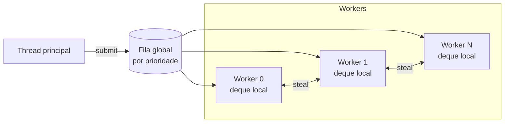

# 04 — Job System e multithreading

> Decisão registrada em [ADR-0003](adr/0003-job-system-work-stealing.md).

## 1. Objetivos

- Usar **todos os núcleos** de forma previsível, sem threads criadas ad-hoc pelo código.
- Jobs **não bloqueantes**: nenhuma thread fica parada esperando outra enquanto há
  trabalho na fila.
- Dependências explícitas e verificáveis, sem *sleep* e sem *busy-wait* cego.
- Prioridades para que o trabalho do frame atual não espere streaming de assets.
- Integração com `std::execution` (C++26) para compor trabalho assíncrono.

## 2. Modelo



- **Workers:** `N = hardware_concurrency − 1` por padrão (`jobs_workers`,
  `JobSystemConfig::workerCount`, no máximo `kMaxWorkerCount`). A afinidade de CPU entra
  com o `nx.platform`, se um benchmark mostrar ganho.
- **Deques locais** (Chase-Lev, `WorkStealingDeque`): um por prioridade em cada worker. O
  dono empilha e desempilha no fundo, ladrões roubam do topo. O deque cresce sob demanda,
  então um *push* nunca falha.
- **Fila global** por prioridade (`IntrusiveQueue`), para submissões de threads que não são
  workers (thread principal, rede, E/S). Produtores nunca esperam: um *push* é uma troca
  atômica (fila MPSC intrusiva de Vyukov). Consumidores se revezam por *try-lock*; quem
  encontra outro consumindo procura trabalho em outro lugar em vez de esperar.
- **Prioridades:** `Critical` (frame atual), `Normal`, `Low` (streaming, compressão) e
  `Background` (pré-cálculo, cache). Um worker só pega `Low` se não houver `Critical` ou
  `Normal` visível.
- **Ociosidade:** uma thread sem trabalho faz algumas rodadas de busca
  (`kIdleRoundsBeforeSleep`) e depois dorme em `std::atomic::wait` sobre um sinal que muda
  a cada job enfileirado. Nada de *sleep* com tempo fixo nem *busy-wait* sem fim.

## 3. API

```cpp
export namespace nx::jobs {

enum class Priority : std::uint8_t { Critical, Normal, Low, Background, Count };

struct JobDesc {
    JobLabel                   label;      // required; built only from constant expressions
    Priority                   priority = Priority::Normal;
    std::span<const JobHandle> dependsOn = {};
};

class JobSystem {
public:
    [[nodiscard]] static auto create(const JobSystemConfig& config = {})
        -> nx::Result<std::unique_ptr<JobSystem>, JobSystemError>;

    template <JobFunction Function>  // void(JobContext&) or void()
    [[nodiscard]] auto submit(const JobDesc& desc, Function&& function) -> JobHandle;

    template <std::ranges::random_access_range Range, class Function>  // sized and borrowed
    [[nodiscard]] auto parallelFor(const JobDesc& desc, Range&& range, Grain grain, Function&& function)
        -> JobHandle;

    /// Runs other jobs while waiting; sleeps only while no job is visible.
    void wait(JobHandle handle);
    [[nodiscard]] auto isComplete(JobHandle handle) const noexcept -> bool;
    [[nodiscard]] auto stats() const -> JobSystemStats;
};

} // namespace nx::jobs
```

```cpp
const nx::jobs::JobHandle animate =
    jobs.parallelFor({.label = "animate", .priority = nx::jobs::Priority::Critical}, visibleModels,
                     nx::jobs::Grain::automatic(), [&](ModelInstance& model) { model.evaluatePose(now); });

const std::array afterAnimation{animate};
const nx::jobs::JobHandle hitboxes = jobs.submit({.label = "hitboxes", .dependsOn = afterAnimation},
                                                 [&] { lagCompensation.recordHitboxes(visibleModels); });
jobs.wait(hitboxes);
```

### 3.1 Contadores e handles

- Um `JobHandle` é o índice de um **contador atômico** de jobs pendentes mais a sua
  **geração**. A geração e a lista de continuações ficam na mesma palavra atômica de
  64 bits: registrar uma continuação falha atomicamente se o contador já terminou ou foi
  reaproveitado, e um handle antigo lê como concluído. Guardar handles depois da conclusão
  é inofensivo; esperar um handle inválido (`JobHandle{}`) viola contrato.
- Um job com dependências só entra na fila quando todas terminam: cada dependência ainda
  pendente recebe um elo de continuação, e o último job de cada contador enfileira as
  continuações que ficaram prontas, sem polling.
- `parallelFor` usa um contador para todos os lotes: o handle conclui quando o último lote
  termina.
- `wait(handle)` executa outros jobs enquanto espera (*help-while-waiting*) e só dorme
  quando não há trabalho visível. A conclusão de um contador que alguém espera acorda quem
  dorme. Na thread principal, `wait` é usado apenas nos pontos de sincronização do frame.

### 3.2 Granularidade

- `Grain::automatic(minimo)` divide o range em cerca de `kBatchesPerThread × threads`
  lotes (4 por thread; as threads são os workers mais a que espera), com mínimo de
  elementos por lote ajustável por tipo de carga.
- `Grain::fixed(n)` gera lotes de exatamente `n` elementos, para quando o custo por item é
  conhecido (ex.: 1 chunk do ECS por job). É a escolha para reduções, porque a divisão do
  `automatic` depende da quantidade de workers (§8).
- Agrupar jobs muito pequenos (< 5 µs) e marcá-los no profiler depende de medição: entra
  com o Tracy e os benchmarks. Até lá, o mínimo por lote do `automatic` faz esse papel.

### 3.3 Memória dos jobs

- Descritores de job, contadores e elos de continuação vêm de pools sem lock
  (`ConcurrentPool`): blocos que nunca mudam de endereço, lista livre de Treiber com *tag*
  contra ABA e reciclagem assim que o job termina. Depois do aquecimento, submeter um job
  não chama `malloc`.
- As capturas da lambda ficam dentro do descritor (`kJobCaptureCapacity`, 96 bytes).
  Captura maior é erro de compilação (`static_assert` com mensagem), o que força a passagem
  de dados grandes por referência ou por arena. As capturas são destruídas logo depois que
  o job roda, antes de o handle concluir.
- O `label` é um `JobLabel`, que só se constrói a partir de expressão constante (literal,
  nome de tipo) e por isso nunca aponta para memória já liberada.
- O `JobContext` dá acesso ao `JobSystem` (para submeter e esperar mais jobs) e ao
  `label`. A arena de rascunho por job (`FrameArena` da thread) entra quando o primeiro
  consumidor precisar dela.

## 4. Integração com `std::execution`

> **Status:** ainda não implementado. O primeiro consumidor é o streaming de assets (M2), e
> o scheduler entra junto com ele, com a dependência do `stdexec`.

`JobSystem::scheduler()` modela `std::execution::scheduler`, o que permite compor
pipelines assíncronos com senders:

```cpp
namespace ex = std::execution;

auto loadAndUpload = ex::schedule(jobs.scheduler(nx::jobs::Priority::Low))
                   | ex::then([&] { return assets.decodeTexture(path); })
                   | ex::continues_on(renderUploadScheduler)
                   | ex::then([&](nx::Result<DecodedTexture, TextureError> decoded) {
                         return decoded.and_then([&](auto& texture) { return uploader.upload(texture); });
                     });

scope.spawn(std::move(loadAndUpload));  // async scope bound to the asset system lifetime
```

- Senders são usados em fluxos **assíncronos de longa duração**: streaming de assets,
  E/S, compilação de shaders e carregamento de mapas.
- O frame (ECS, render) usa a API direta de `JobHandle`, por previsibilidade e menor
  overhead.
- Até a biblioteca padrão do compilador oferecer `std::execution` completo, a
  implementação de referência `stdexec` é usada atrás da fachada `nx.jobs`
  ([02 §1.2](02-padroes-de-codigo.md#12-política-de-toolchain-e-fallbacks)).

## 5. Threads dedicadas (fora do pool)

| Thread | Por que não é um job |
|--------|----------------------|
| Áudio | Callback de tempo real com prazo rígido (não pode esperar a fila) |
| Rede | Bloqueia em `recv`/espera de eventos do SO. Latência de pacote não pode depender da carga do frame |
| E/S | Chamadas de SO bloqueantes. Entrega resultados como jobs `Low` |
| Principal | Exigência do SO para janela e entrada (SDL3) |

Toda comunicação entre essas threads e os jobs usa **filas sem lock** (SPSC/MPSC) de
`nx.core`, com capacidade nomeada e erro tipado se ficarem cheias
(`QueueError::Full` gera métrica e log com *rate limit*).

## 6. Como o frame usa o Job System

### 6.1 Servidor (tick)

| Etapa | Paralelismo |
|-------|-------------|
| Aplicar usercmds | Serial por jogador (ordem significativa) |
| Regras e hooks Rook síncronos | Serial (ordem significativa) |
| Animação e hitboxes para compensação de lag | `parallelFor` por entidade animada |
| Física de entidades não-jogador | Por chunk |
| PVS/PAS e relevância por cliente | `parallelFor` por cliente |
| Montagem e codificação delta de snapshots | `parallelFor` por cliente |
| Compressão e criptografia | Na thread de rede ou em jobs `Normal`, conforme a carga |

### 6.2 Cliente (frame)

| Etapa | Paralelismo |
|-------|-------------|
| Interpolação de entidades remotas | Por chunk |
| Avaliação de animação (bones) | Por entidade visível |
| Culling (PVS do BSP, frustum, oclusão de portais) | Por região/lote |
| Partículas e tempents | Por emissor |
| Gravação de command buffers | Por passe do render graph e por lote de draws |
| Mixagem de vozes (decode Opus) | Jobs `Normal` alimentando o mixer |

## 7. Regras de uso

- **Proibido** criar `std::thread`/`std::jthread` fora de `nx.platform` e `nx.jobs`.
- **Proibido** bloquear em job: sem `mutex.lock()` disputado, sem E/S síncrona, sem
  `sleep`. Esperas por outros jobs só via dependência ou `wait`.
- Dados escritos por jobs paralelos precisam ser **disjuntos por construção** (por chunk,
  por cliente, por índice). Reduções usam acumuladores por job, combinados depois.
- `thread_local` só para caches sem semântica (ex.: buffers de scratch), nunca para
  estado que o código espera reencontrar.
- Todo job tem `label` para o profiler: o `JobDesc` não compila sem ele.

## 8. Determinismo

- O resultado de um frame **não pode depender** da quantidade de workers nem da ordem em
  que os jobs rodaram.
- Por isso, as saídas de jobs paralelos são escritas em posições determinadas pelo índice
  do item, e as reduções combinam os parciais em ordem de índice.
- `Grain::automatic()` divide o range conforme a quantidade de threads, então só serve
  quando cada elemento escreve a própria saída. Reduções usam `Grain::fixed(n)`, para que
  os parciais sejam os mesmos em qualquer máquina. O teste `JobSystemDeterminismTest`
  compara o *hash* do resultado com 0, 1, 3 e 15 workers.
- Teste obrigatório: a mesma demo de entrada roda com `jobs_workers 0`, `1`, `3` e `15` e
  produz *hash* de estado idêntico a cada tick
  ([18](18-testes-e-qualidade.md#determinismo)).

## 9. Diagnóstico

- Zonas Tracy por job (`label`) e por espera (`wait`), com *fibers view* dos workers,
  quando o Tracy entrar como dependência.
- `JobSystem::stats()`: jobs executados, roubos e vezes que dormiu, por worker, e jobs
  executados por threads dentro de `wait`. O comando `jobs_stats` mostra esses números
  quando o console existir; o tempo médio por prioridade vem com o Tracy.
- Modo `jobs_serial 1` (desenvolvimento) equivale a `jobs_workers 0`: sem workers, cada
  job roda dentro de `wait` na thread que espera, em ordem de prioridade e de submissão.
  Útil para isolar bugs de concorrência.

## 10. Fora do escopo da v1

- **Fibers:** permitiriam `wait` no meio de um job sem *help-while-waiting*, mas
  complicam depuração, `thread_local` e ferramentas. Serão reavaliadas se o profiler
  mostrar perda significativa por esperas (registrado no ADR-0003).
