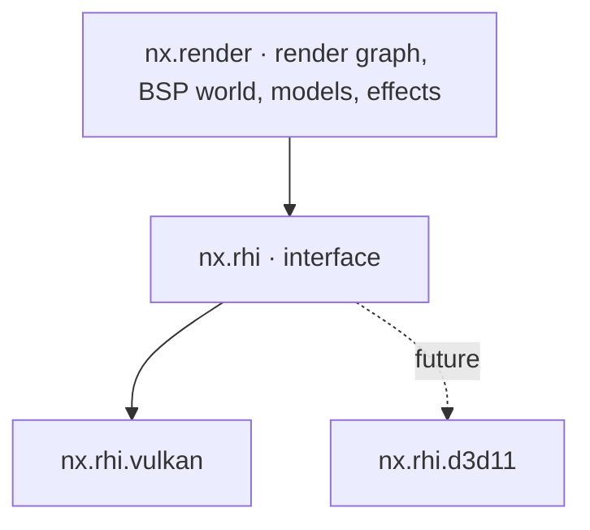
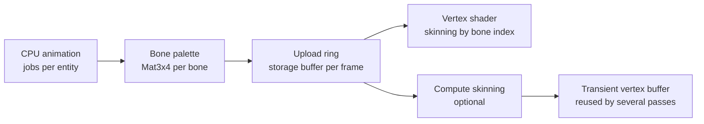

# 05 — Rendering

> Decision recorded in [ADR-0004](adr/0004-vulkan-first-abstract-rhi.md).

## 1. Goals

1. **Original look by default:** lightmaps, gamma, filters, render modes and effects
   identical to CS 1.6 (`r_fidelity legacy`).
2. **High, stable performance:** hundreds to thousands of FPS on modest hardware,
   parallel command recording and no CPU↔GPU *stall* on the frame path.
3. **Low input latency:** late input sampling, configurable frames in flight and a
   low-latency mode.
4. **GPU skinning** for every animated model.
5. **Portable:** Vulkan now, DirectX 11 in the future, without rewriting the renderer.

## 2. Layers



`nx.render` **MUST NOT** include Vulkan or D3D headers. All interaction with the GPU
goes through `nx.rhi`.

## 3. RHI (Render Hardware Interface)

### 3.1 Model

The RHI follows an explicit, modern model, but restricted to what **DirectX 11 can also
express**. The vocabulary is close to WebGPU's.

| RHI concept | Vulkan | DirectX 11 (future) |
|-------------|--------|---------------------|
| `Device` | `VkDevice` + VMA | `ID3D11Device` |
| `Queue` | `VkQueue` (graphics, optional transfer) | Immediate context |
| `CommandList` | `VkCommandBuffer` (parallel recording) | *Deferred context* (parallel recording) |
| `Buffer`, `Texture`, `Sampler` | `VkBuffer`, `VkImage`, `VkSampler` | `ID3D11Buffer`, `ID3D11Texture2D`, `ID3D11SamplerState` |
| `BindGroupLayout` / `BindGroup` | `VkDescriptorSetLayout` / `VkDescriptorSet` | Slot table emulated in the backend |
| `RenderPipeline` / `ComputePipeline` | `VkPipeline` | Set of states + shaders |
| Render pass | *Dynamic rendering* | `OMSetRenderTargets` |
| Synchronization | Barriers generated by the render graph + *timeline semaphores* | Implicit in the driver (barriers become no-ops) |
| `QuerySet` | Timestamps/occlusion | `ID3D11Query` |

### 3.2 RHI design rules

- **Bind groups** are the binding unit: the renderer never assumes *bindless*.
  *Bindless* exists as an **optional tier** (`RhiFeature::BindlessTextures`), used only to
  optimize paths that have an alternative.
- Resources are created with **typed descriptors** (structs with designated initialization).
  Formats, usages and states are `enum class`.
- Resource handles are **generational** (`TextureHandle`), validated in development
  builds. Destruction is deferred until the GPU finishes the frame that used the resource.
- Every creation error returns `nx::Result<T, RhiError>`
  (`OutOfDeviceMemory`, `UnsupportedFormat`, `DeviceLost`, `SurfaceLost`…).
- Debug names are mandatory (`.label`), propagated to RenderDoc and the validation layers.
- A device is created for the window it presents to (or for none): the swapchain then needs only
  a size and a present mode, so `nx.rhi` knows nothing of `nx.platform`. One window, one device.
- The swapchain is 8-bit UNORM, not sRGB: the `Gamma` pass writes the values of the GoldSrc curves
  as they are ([§11](#11-visual-fidelity)).

**Today** (`engine/rhi`, `engine/rhiVulkan`): the device and its frames in flight
(`beginFrame` waits for the frame's slot and gives its `CommandList`, `submitFrame` submits and
presents), the swapchain with its recreation on resize and while minimized, generational texture
handles (`HandlePool`, a stale handle is a contract violation), transitions between texture states
and render passes that clear. The validation layers, when installed and asked for, log every
message and count every error (`Device::validationErrors`), which the tests require to be zero.
Buffers, the renderer's own textures, samplers, bind groups and pipelines come with the first
shaders.

```cpp
auto lightmapAtlas = device.createTexture(nx::rhi::TextureDesc{
    .label     = "bsp.lightmap_atlas",
    .dimension = nx::rhi::TextureDimension::D2,
    .format    = nx::rhi::Format::Rgba8Unorm,
    .extent    = atlasExtent,
    .mipLevels = kLightmapMipLevels,
    .usage     = nx::rhi::TextureUsage::Sampled | nx::rhi::TextureUsage::CopyDestination,
});
if (!lightmapAtlas) {
    return nx::fail(WorldRenderError::LightmapAllocation, std::move(lightmapAtlas.error()));
}
```

## 4. Vulkan backend

| Item | Decision |
|------|----------|
| Minimum version | Vulkan **1.3** (dynamic rendering, synchronization2, timeline semaphores, maintenance4) |
| Loader | `volk` |
| Memory | Vulkan Memory Allocator (VMA) |
| Frames in flight | 2 (default) or 3, configurable (`r_frames_in_flight`) |
| Present | `vid_vsync 0/1`, `r_present_mode immediate/mailbox/fifo` |
| Pipeline cache | Persisted on disk per GPU/driver, invalidated by UUID |
| Parallel recording | One `VkCommandPool` per worker per frame in flight |
| Validation | Validation layers + sync validation in development builds (`--validation` in `nxview`; always in the tests) |
| *Device lost* | Typed error. The renderer tries to recreate the device and resources once and, if that fails, produces a crash report |
| Upload | Persistent mapped staging ring. A dedicated transfer queue when available |

## 5. DirectX 11 (future)

- The D3D11 backend implements the same interface, without touching the renderer.
- Restrictions that apply **from now on** because of D3D11:
  - no mandatory *bindless*, *mesh shaders* or *ray tracing* on the main path;
  - per-stage slot limits respected by the bind group layouts (validated at layout
    creation time);
  - compute shaders only with SM 5.0-compatible resources.
- RHI conformance tests run on every backend
  ([18](18-testing-and-quality.md)).

## 6. Shaders

- Language: **Slang**.
  - Vulkan: Slang → SPIR-V.
  - D3D11: Slang → HLSL → DXBC (SM 5.0, via FXC).
- Compiled at build time (`nxbake shaders`). The result is packaged and, for the minimal
  fallback shaders (error screen, console), embedded in the binary with `#embed`.
- Shader reflection generates the bind group layouts, checked against the ones declared in
  C++ at build time.
- Shader *hot reload* in development (`r_shader_reload`).
- Controlled permutations: each permutation is declared. There is no automatic
  combinatorial explosion.

## 7. Render graph

- Each frame declares **passes** with the resources they read and write. The graph derives:
  - barriers and layout transitions (Vulkan);
  - *aliasing* of transient resources;
  - elimination of passes whose result is not consumed;
  - execution order and parallel recording points.
- Passes record command lists in **parallel jobs**. The render thread submits them in
  order.

### 7.1 Frame passes (legacy mode)

| # | Pass | Content |
|---|------|---------|
| 1 | `Upload` | Bone palettes, instances, light styles, particles (staging ring) |
| 2 | `SkinningCompute` | Optional (`r_skinning compute`) |
| 3 | `WorldOpaque` | Opaque and masked (`{`) BSP surfaces, solid brush entities |
| 4 | `Sky` | 6-face skybox |
| 5 | `StudioOpaque` | Opaque studio models (players, weapons in the world, hostages) |
| 6 | `Decals` | World and model decals |
| 7 | `Translucent` | Water, translucent render modes, sprites, beams, particles, sorted according to the original's rules |
| 8 | `ViewModel` | First-person weapon (its own FOV and depth range) |
| 9 | `ScreenEffects` | Flashbang, fade, *screen shake* (applied to the camera), NVG tint |
| 10 | `Gamma` | `gamma`/`brightness`/`texgamma`/`lightgamma` curves |
| 11 | `Hud` | Sprite HUD, crosshair, text, menus ([12](12-ui-hud-and-console.md)) |
| 12 | `Present` | Copy to the swapchain |

## 8. BSP world

- **Visibility:** the camera's leaf, PVS data decompressed and cached per leaf, frustum
  culling per node and per surface. Runs in jobs.
- **Batching:** visible surfaces grouped by (texture, lightmap atlas page, render mode)
  into index buffers generated per frame.
- **Lightmaps:** packed into an atlas at map load. Each BSP30 face has up to 4
  *lightstyles*, combined **in the shader** from an intensity buffer updated every frame.
  GoldSrc re-uploaded the lightmaps on the CPU; here there is no such cost and the number of
  styles has no fixed ceiling.
- **Animated textures** (`+0..+9`, `+a..+j`), **water** with distortion (`!`), **sky**,
  **mask transparency** (`{`), **external and embedded WAD textures**.
- **Brush entities** (doors, platforms, `func_breakable`, `func_illusionary`) with
  their own transforms and render modes.
- **Future:** GPU culling (*GPU-driven*) when new maps without BSP limits justify
  it.

## 9. Studio models and GPU skinning

### 9.1 Pipeline



1. **Animation evaluation (CPU, parallel):** sequence, frame, *blending* between
   sequences, *blend controllers* (aim pitch), *bone controllers*, *gait sequence*
   (player legs) and *attachments*. The code is the same one the server uses for hitboxes
   (`cs.shared`), and the GPU is **never** authoritative.
2. **Bone palette:** `Mat3x4` (48 bytes) per bone, written straight into the persistent
   mapped upload ring. Each instance keeps a `paletteOffset`.
3. **Vertex shader:** fetches `bones[paletteOffset + vertex.boneIndex]`. The MDL v10 format
   binds each vertex to **one** bone and each normal to its own bone, so both indices
   are preserved.
4. **Modern formats (glTF)** use up to 4 influences (`joints: u8x4/u16x4`,
   `weights: unorm8x4`), in the same pipeline with another permutation.
5. **Compute skinning** (`r_skinning compute`): pre-transforms vertices once per frame
   when the same model is drawn in several passes or with many instances.

### 9.2 MDL format features to support

- *Chrome* textures (view-dependent coordinates in the shader), *flatshade*,
  *additive*, *masked* and *fullbright*.
- External texture files (`*T.mdl`) and sequence groups (`*01.mdl`).
- *Body parts* and submodels (selection **per part**, without `body` packed into a few
  bits), *skin families*, hitboxes and *hitgroups*.
- **Unlimited attachments** (the original uses only 4 per entity), accessed by name or
  index, for the muzzle, shell, aim, flashlight and plugin effects.
- No fixed ceilings on bones, vertices, controllers and blends in the internal representation
  ([06 §3.4](06-assets-and-resources.md#34-removed-content-limits)).
- Animation events (sound, *muzzle flash*, shell ejection) dispatched to the client.
- GoldSrc-style lighting: a lightmap sample under the model (ambient and directional
  light), *elights* and *dlights*. The sample is computed in a per-entity job and passed
  as instance data.

### 9.3 Instancing

Instances are grouped by (model, submesh, skin, render mode). Twenty players with the
same model become one draw call per submesh.

## 10. Effects

| Effect | Note |
|--------|------|
| Sprites (SPR) | Orientations *parallel*, *parallel upright*, *facing upright*, *oriented*, *parallel oriented*. Formats *normal*, *additive*, *indexalpha*, *alphatest* |
| High-quality sprites (`.nxspr`) | RGBA with smooth alpha, any resolution the GPU supports, mipmaps, KTX2 compression, per-DPI variants for the HUD, the same orientations and render modes as SPR |
| Beams | Segments, noise, attachments to entities |
| Particles | System compatible with the GoldSrc effects (blood, sparks, smoke). Simulation in jobs, upload as instances |
| Temp entities | Ephemeral effects (shrapnel, shells, explosions) without a fixed ceiling. Configurable budget with a diagnostic error when exceeded |
| Decals | Decal atlas from `decals.wad` and player sprays. No fixed ceiling (configurable per-map budget and LRU recycling) |
| Dynamic lights | *dlights* and *elights* without a fixed ceiling, with a per-frame budget |
| Grenade smoke | Visual parity with the original (smoke sprites), with configurable density |

## 11. Visual fidelity

| Aspect | `r_fidelity legacy` (default) | `r_fidelity enhanced` |
|--------|-------------------------------|-----------------------|
| Texture filter | Same as the original (`gl_texturemode`) | Anisotropic |
| Antialiasing | Off | Configurable MSAA or FXAA |
| Gamma | Emulation of the GoldSrc curves | Same, with optional HDR output |
| Texture resolution | Original | Optional high-resolution packs (mods) |
| Lightmaps | Original sampling and scale | Optional bicubic filter |

Every visual improvement is **optional** and **does not change gameplay** (visibility through
smoke, for example, must be identical).

## 12. Latency and frame pacing

- `fps_max` with a precise limiter (`nx::platform::SleepTimer`: a high-resolution timer on
  Windows and an absolute sleep on the monotonic clock on Linux, without *spin*). No limit
  when `0`.
- In low-latency mode, the limiter waits **before** sampling input, so that the frame is
  built with the most recent input.
- Exposed metrics: CPU time per phase, GPU time per pass (timestamps) and estimated latency
  from input to *present*.

## 13. Debugging tools

- RenderDoc integration (`r_capture`).
- `r_speeds` (draws, triangles, time per pass), `r_drawentities`, `r_wireframe`,
  `r_showtris`, `r_lightmap`, `r_fullbright`, `r_drawviewmodel` and overdraw visualization.
- ImGui overlay with the frame's render graph (passes, resources, aliasing).
