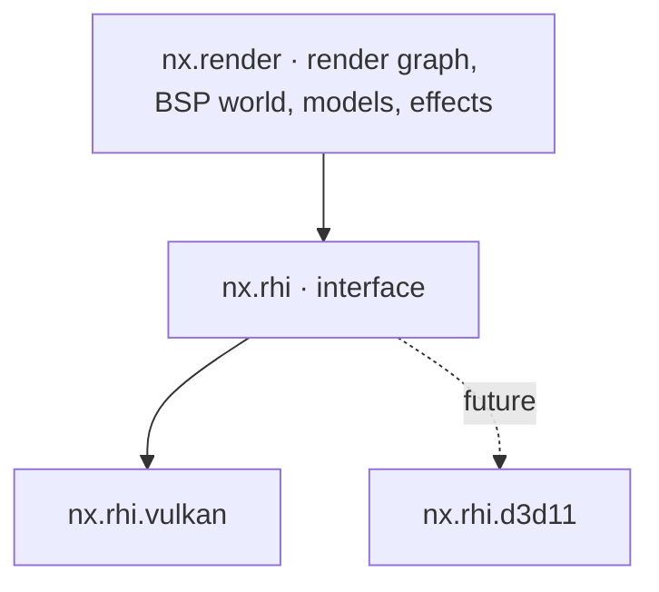
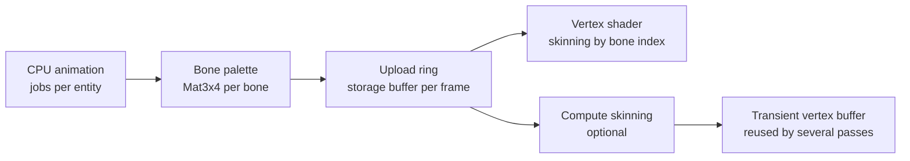

# 05 — Rendering

> Decision recorded in [ADR-0004](adr/0004-vulkan-first-abstract-rhi.md).

## 1. Goals

1. **Original look by default:** lightmaps, gamma, filters, render modes and effects
   identical to CS 1.6 (`r_fidelity legacy`).
2. **High, stable performance:** hundreds to thousands of FPS on modest hardware,
   parallel command recording and no CPU↔GPU *stall* on the frame path.
3. **Low input latency:** late input sampling, configurable frames in flight and a
   low-latency mode.
4. **GPU skinning** for every animated model.
5. **Portable:** Vulkan now, DirectX 11 in the future, without rewriting the renderer.

## 2. Layers



`nx.render` **MUST NOT** include Vulkan or D3D headers. All interaction with the GPU
goes through `nx.rhi`.

## 3. RHI (Render Hardware Interface)

### 3.1 Model

The RHI follows an explicit, modern model, but restricted to what **DirectX 11 can also
express**. The vocabulary is close to WebGPU's.

| RHI concept | Vulkan | DirectX 11 (future) |
|-------------|--------|---------------------|
| `Device` | `VkDevice` + VMA | `ID3D11Device` |
| `Queue` | `VkQueue` (graphics, optional transfer) | Immediate context |
| `CommandList` | `VkCommandBuffer` (parallel recording) | *Deferred context* (parallel recording) |
| `Buffer`, `Texture`, `Sampler` | `VkBuffer`, `VkImage`, `VkSampler` | `ID3D11Buffer`, `ID3D11Texture2D`, `ID3D11SamplerState` |
| `BindGroupLayout` / `BindGroup` | `VkDescriptorSetLayout` / `VkDescriptorSet` | Slot table emulated in the backend |
| `RenderPipeline` / `ComputePipeline` | `VkPipeline` | Set of states + shaders |
| Render pass | *Dynamic rendering* | `OMSetRenderTargets` |
| Synchronization | Barriers generated by the render graph + *timeline semaphores* | Implicit in the driver (barriers become no-ops) |
| `QuerySet` | Timestamps/occlusion | `ID3D11Query` |

### 3.2 RHI design rules

- **Bind groups** are the binding unit: the renderer never assumes *bindless*.
  *Bindless* exists as an **optional tier** (`RhiFeature::BindlessTextures`), used only to
  optimize paths that have an alternative.
- Resources are created with **typed descriptors** (structs with designated initialization).
  Formats, usages and states are `enum class`.
- Resource handles are **generational** (`TextureHandle`), validated in development
  builds. Each resource has an owner (`rhi::Owned`: `OwnedBuffer`, `OwnedTexture`...), which the
  device's create functions give and which destroys it when it lets it go or ends; destruction is
  deferred until the GPU finishes the frame that used the resource.
- Every creation error returns `nx::Result<T, RhiError>`
  (`OutOfDeviceMemory`, `UnsupportedFormat`, `DeviceLost`, `SurfaceLost`…).
- Debug names are mandatory (`.label`), propagated to RenderDoc and the validation layers.
- A device is created for the window it presents to (or for none): the swapchain then needs only
  a size and a present mode, so `nx.rhi` knows nothing of `nx.platform`. One window, one device.
- The swapchain is 8-bit UNORM, not sRGB: the `Gamma` pass writes the values of the GoldSrc curves
  as they are ([§11](#11-visual-fidelity)).

- Clip space is DirectX's on every backend: x to the right, y up, depth from 0 (near) to 1 (far);
  a viewport's rectangle counts from the top-left corner of its target. Vulkan gets there with a
  viewport of negative height.

**Today** (`engine/rhi`, `engine/rhiVulkan`): the device and its frames in flight
(`beginFrame` waits for the frame's slot and gives its `CommandList`, `submitFrame` submits and
presents), the swapchain with its recreation on resize and while minimized, and generational
handles (`HandlePool`: a stale handle is a contract violation) to buffers (device memory, or mapped
memory to upload and read back, through VMA), textures (with mip levels, and arrays of layers that
shaders sample as `Texture2DArray`), samplers, shaders, bind group layouts and
bind groups (descriptor pools added as they fill, so their number has no ceiling) and render
pipelines (dynamic rendering, dynamic viewport and scissor). A destroyed resource lives until the
GPU has finished every frame that may use it. The command list transitions textures and buffers,
copies between them, and draws. The validation layers, when installed and asked for, log their
warnings and errors and count every error (`Device::validationErrors`), which the tests require to
be zero; the tests draw offscreen and read the pixels back, on lavapipe in CI.

```cpp
auto lightmapAtlas = device.createTexture(nx::rhi::TextureDesc{
    .label     = "bsp.lightmap_atlas",
    .dimension = nx::rhi::TextureDimension::D2,
    .format    = nx::rhi::Format::Rgba8Unorm,
    .extent    = atlasExtent,
    .mipLevels = kLightmapMipLevels,
    .usage     = nx::rhi::TextureUsage::Sampled | nx::rhi::TextureUsage::CopyDestination,
});
if (!lightmapAtlas) {
    return nx::fail(WorldRenderError::LightmapAllocation, std::move(lightmapAtlas.error()));
}
```

## 4. Vulkan backend

| Item | Decision |
|------|----------|
| Minimum version | Vulkan **1.3** (dynamic rendering, synchronization2, timeline semaphores, maintenance4) |
| Loader | `volk` |
| Memory | Vulkan Memory Allocator (VMA) |
| Frames in flight | 2 (default) or 3, configurable (`r_frames_in_flight`) |
| Present | `vid_vsync 0/1`, `r_present_mode immediate/mailbox/fifo` |
| Pipeline cache | Persisted on disk per GPU/driver, invalidated by UUID |
| Parallel recording | One `VkCommandPool` per worker per frame in flight |
| Validation | Validation layers + sync validation in development builds (`--validation` in `nxview`; always in the tests) |
| *Device lost* | Typed error. The renderer tries to recreate the device and resources once and, if that fails, produces a crash report |
| Upload | Persistent mapped staging ring. A dedicated transfer queue when available |

## 5. DirectX 11 (future)

- The D3D11 backend implements the same interface, without touching the renderer.
- Restrictions that apply **from now on** because of D3D11:
  - no mandatory *bindless*, *mesh shaders* or *ray tracing* on the main path;
  - per-stage slot limits respected by the bind group layouts (validated at layout
    creation time);
  - compute shaders only with SM 5.0-compatible resources.
- RHI conformance tests run on every backend
  ([18](18-testing-and-quality.md)).

## 6. Shaders

- Language: **Slang**.
  - Vulkan: Slang → SPIR-V.
  - D3D11: Slang → HLSL → DXBC (SM 5.0, via FXC).
- Compiled at build time: `nxAddShaders` runs `slangc` (the vcpkg `shader-slang` port's host tool)
  on each source of `shaders/`, which becomes one SPIR-V module in `bin/shaders/` with every entry
  point under its own name; its dependency file recompiles what imports a changed module. Bindings
  are explicit (`[[vk::binding(binding, group)]]`). Packaging (`nxbake shaders`) and the minimal
  fallback shaders embedded in the binary with `#embed` (error screen, console) come later.
- Shader reflection generates the bind group layouts, checked against the ones declared in
  C++ at build time (planned; today the C++ layouts follow the explicit bindings by hand).
- Shader *hot reload* in development (`r_shader_reload`, planned).
- Controlled permutations: each permutation is declared. There is no automatic
  combinatorial explosion.

## 7. Render graph

- Each frame declares **passes** with the resources they read and write. The graph derives:
  - barriers and layout transitions (Vulkan);
  - *aliasing* of transient resources;
  - elimination of passes whose result is not consumed;
  - execution order and parallel recording points.
- Passes record command lists in **parallel jobs**. The render thread submits them in
  order.

### 7.1 Frame passes (legacy mode)

| # | Pass | Content |
|---|------|---------|
| 1 | `Upload` | Bone palettes, instances, light styles, particles (staging ring) |
| 2 | `SkinningCompute` | Optional (`r_skinning compute`) |
| 3 | `WorldOpaque` | Opaque and masked (`{`) BSP surfaces, solid brush entities |
| 4 | `Sky` | 6-face skybox |
| 5 | `StudioOpaque` | Opaque studio models (players, weapons in the world, hostages) |
| 6 | `Decals` | World and model decals |
| 7 | `Translucent` | Water, translucent render modes, sprites, beams, particles, sorted according to the original's rules |
| 8 | `ViewModel` | First-person weapon (its own FOV and depth range) |
| 9 | `ScreenEffects` | Flashbang, fade, *screen shake* (applied to the camera), NVG tint |
| 10 | `Gamma` | Output curve of `r_fidelity enhanced` (HDR); the GoldSrc curves are applied where the original applies them (§11) |
| 11 | `Hud` | Sprite HUD, crosshair, text, menus ([12](12-ui-hud-and-console.md)) |
| 12 | `Present` | Copy to the swapchain |

## 8. BSP world

- **Visibility:** the camera's leaf, PVS data decompressed and cached per leaf, frustum
  culling per node and per surface. Runs in jobs.
- **Batching:** visible surfaces grouped by (texture, lightmap atlas page, render mode)
  into index buffers generated per frame.
- **Lightmaps:** packed into an atlas at map load. Each BSP30 face has up to 4
  *lightstyles*, combined **in the shader** from an intensity buffer updated every frame.
  GoldSrc re-uploaded the lightmaps on the CPU; here there is no such cost and the number of
  styles has no fixed ceiling.
- **Animated textures** (`+0..+9`, `+a..+j`), **water** with distortion (`!`), **sky**,
  **mask transparency** (`{`), **external and embedded WAD textures**.
- **Brush entities** (doors, platforms, `func_breakable`, `func_illusionary`) with
  their own transforms and render modes.
- **Future:** GPU culling (*GPU-driven*) when new maps without BSP limits justify
  it.

**Today** (`nx.render:world`, `nxview --map`): every face of the world and of the brush
entities (placed at their `origin`) in one vertex buffer; the textures of the map and of the WADs
its `wad` key names, by file name at the root of the VFS as the original looks them up, with their
four mips, a checkerboard for a name no WAD has, or whose first WAD that has it cannot read it (logged
with its failure); masked textures; animated textures (`+0name` to
`+9name`, and `+aname` to `+jname`, of any case, in a sequence of their own), whose faces all show the
same frame, ten a second (`R_TextureAnimation`), where the original would refuse a sequence with a
missing number the frames it has play in order; turbulent faces (water and lasers: `!`, Quake's `*`,
and names that start with `water` or `laser`), unlit, cut along the axial planes every 64 units
(`GL_SubdivideSurface`), their texture coordinates in texels without the texture's shift and warped
at each corner of the pieces, a cell of 64 texels a texture, as `EmitWaterPolys` warps them
(the waves of a `func_water`'s `scale` come with moving entities); triggers and the compiler's tool
textures (`AAATRIGGER`, `CLIP`...) not drawn. The lightmaps are packed into one atlas of four
layers, each face's lightmaps (one per light style, up to its first unused one) at the same place
of each layer; a face's extent in luxels of 16 units is computed in double precision, as the
compilers compute it.

The light is the original's to the bit (`R_BuildLightMap`): each luxel sums its samples times their
style's brightness in the frame, in integers, multiplies by `lightscale` and shifts out 14 bits,
holds the result to 1023 and reads it from the light table (§11); the face then blends the four
luxels around each point, as the original's bilinear filter blends its light texture. A face
without lightmaps is fully bright, as the original draws a face without samples. The styles'
brightness comes with each draw (`nx.render:lightStyle`): 22 for each letter of a style's pattern
after `a` (264 at `m`, the normal one), ten letters a second, 256 for a style the game left unset,
and 264 for the styles above the 64 the game sets. `nxview` sets the world's patterns (flicker,
candles, strobes, pulses...) as Quake's world.qc sets them, under the names the Half-Life FGDs give
the styles (style 12, which has no public pattern, stays unset), and the switchable lights' from
their entities, `a` for those that start off, else `m` or their `pattern`.

The camera (`nx.render:camera`) writes reversed depth, 1 at the near plane and 0 at
infinity, compared with `Greater`: nearly uniform precision across a whole map; `fov` is the
original's horizontal angle of a 4:3 view, kept vertical on wider screens (Hor+).

The faces of the `sky` texture are drawn last, with their depth, each pixel showing the side of
the sky its direction from the camera points at, as the original projects it: the side of the
largest axis (ties broken as the original breaks them), at the point that direction reaches, each
side clamped at its edges. The sides are the six layers of one texture, `gfx/env/<skyname>` with
the suffixes `rt`, `bk`, `lf`, `ft`, `up`, `dn` toward +X, +Y, -X, -Y, up and down; from the
middle of the sky each is seen upright and unmirrored, the top and bottom ones facing +X. They are
drawn as their files have them, through no gamma curve, as in the original, which falls back to
`desert` when the worldspawn's `skyname` names a sky the installation lacks; without any, the
sky is gray. Drawing the sky's own faces rather than a box behind the world gives the same picture
for the world and hides what lies behind them, as the sky's brushes seal the map.

Each frame gathers what the camera sees, as the original culls it, into the index buffer of its
frame in flight, in a batch per texture and then the sky's: the leaves the camera's leaf may see
(its potentially visible set, decompressed again only when the camera enters another leaf; every
leaf from inside a wall), those whose bounds are in front of the four side planes of the view, and
their faces that face the camera: from the side of its plane the eye is on, the plane itself in
front (`R_RecursiveWorldNode`). A brush entity is drawn where the game puts and turns it that
frame (`WorldFrame::placements`; one the game does not place, where the map's entity of it says,
unturned), its model's faces moved and turned there by the vertex shader, when its bounds are in
view (turned, a cube as wide as its farthest corner about its origin), its faces from at
least `BACKFACE_EPSILON` past their planes (`R_DrawBrushModel`), as its `rendermode` says
(`R_SetRenderMode`): after the sky, first the opaque ones, normal (lit, masked textures cut where
they have no alpha, the original's alpha test at 0) and solid (`kRenderTransAlpha`, lit, cut at an
alpha of 0.25 or less); and the blended ones, unlit and back to front
(`R_TransEntityCompare`: by the squared distance to their middles, then by mode): `rendercolor`
for `kRenderTransColor`, writing its depth; the textures for `kRenderTransTexture` (its faces back to
front, `R_SurfaceCompare`) and `kRenderGlow`; the textures added to what is behind for
`kRenderTransAdd`, each as opaque as `renderamt` says. A blended entity at a `renderamt` of 0 is not
drawn (`R_AddEntity`); a mode the original does not know draws as its default does, as Glow.

On the Steam installation, de_dust2 is 5358 faces (1356 of them sky) in 41 textures and a 1024x404
atlas, built in half a second; from the terrorists' spawn a frame draws 382 of them, in 83 leaves.

## 9. Studio models and GPU skinning

### 9.1 Pipeline



1. **Animation evaluation (CPU, parallel):** sequence, frame, *blending* between
   sequences, *blend controllers* (aim pitch), *bone controllers*, *gait sequence*
   (player legs) and *attachments*. The code is the same one the server uses for hitboxes
   (`cs.shared`), and the GPU is **never** authoritative.
   **Today** (`cs.shared:studio`, `cs::poseBones`): the bones posed at a frame of a sequence as the
   original's engine poses them: each axis's rest value plus its animation value times its scale,
   interpolated towards the next frame (a position on the raw values, the angles through the
   quaternions of the original's `AngleQuaternion` and its `QuaternionSlerp`, unnormalized), plus
   what its bone controller adds (its setting mapped onto its range, a cyclic one turning past it,
   the mouth's from 0 to 64); the first two blends mixed by the first blending; the motion bone's
   motion kept (the server's hitboxes) or removed (the client's drawing); each bone placed in its
   parent, the roots in the entity's transform. `nxcheck` poses every sequence of every model of the
   installation ([18](18-testing-and-quality.md#real-content)). The nine aim blends and the gait of
   the players' models, the transitions between sequences and the jobs come with player animation.
2. **Bone palette:** `Mat3x4` (48 bytes) per bone, written straight into the persistent
   mapped upload ring. Each instance keeps a `paletteOffset`.
3. **Vertex shader:** fetches `bones[paletteOffset + vertex.boneIndex]`. The MDL v10 format
   binds each vertex to **one** bone and each normal to its own bone, so both indices
   are preserved.
4. **Modern formats (glTF)** use up to 4 influences (`joints: u8x4/u16x4`,
   `weights: unorm8x4`), in the same pipeline with another permutation.
5. **Compute skinning** (`r_skinning compute`): pre-transforms vertices once per frame
   when the same model is drawn in several passes or with many instances.

### 9.2 MDL format features to support

- *Chrome* textures (view-dependent coordinates in the shader), *flatshade*,
  *additive*, *masked* and *fullbright*.
- External texture files (`*T.mdl`) and sequence groups (`*01.mdl`).
- *Body parts* and submodels (selection **per part**, without `body` packed into a few
  bits), *skin families*, hitboxes and *hitgroups*.
- **Unlimited attachments** (the original uses only 4 per entity), accessed by name or
  index, for the muzzle, shell, aim, flashlight and plugin effects.
- No fixed ceilings on bones, vertices, controllers and blends in the internal representation
  ([06 §3.4](06-assets-and-resources.md#34-removed-content-limits)).
- Animation events (sound, *muzzle flash*, shell ejection) dispatched to the client.
- GoldSrc-style lighting: a lightmap sample under the model (ambient and directional
  light), *elights* and *dlights*. The sample is computed in a per-entity job and passed
  as instance data.

### 9.3 Instancing

Instances are grouped by (model, submesh, skin, render mode). Twenty players with the
same model become one draw call per submesh.

## 10. Effects

| Effect | Note |
|--------|------|
| Sprites (SPR) | Orientations *parallel*, *parallel upright*, *facing upright*, *oriented*, *parallel oriented*. Formats *normal*, *additive*, *indexalpha*, *alphatest* |
| High-quality sprites (`.nxspr`) | RGBA with smooth alpha, any resolution the GPU supports, mipmaps, KTX2 compression, per-DPI variants for the HUD, the same orientations and render modes as SPR |
| Beams | Segments, noise, attachments to entities |
| Particles | System compatible with the GoldSrc effects (blood, sparks, smoke). Simulation in jobs, upload as instances |
| Temp entities | Ephemeral effects (shrapnel, shells, explosions) without a fixed ceiling. Configurable budget with a diagnostic error when exceeded |
| Decals | Decal atlas from `decals.wad` and player sprays. No fixed ceiling (configurable per-map budget and LRU recycling) |
| Dynamic lights | *dlights* and *elights* without a fixed ceiling, with a per-frame budget |
| Grenade smoke | Visual parity with the original (smoke sprites), with configurable density |

## 11. Visual fidelity

| Aspect | `r_fidelity legacy` (default) | `r_fidelity enhanced` |
|--------|-------------------------------|-----------------------|
| Texture filter | Same as the original (`gl_texturemode`) | Anisotropic |
| Antialiasing | Off | Configurable MSAA or FXAA |
| Gamma | Emulation of the GoldSrc curves | Same, with optional HDR output |
| Texture resolution | Original | Optional high-resolution packs (mods) |
| Lightmaps | Original sampling and scale | Optional bicubic filter |

Every visual improvement is **optional** and **does not change gameplay** (visibility through
smoke, for example, must be identical).

**Today** (`nx.render:gamma`): the original's picture, each curve where the original applies it.
`texgamma` maps the palette of a texture when it loads (`pow(value, texgamma / gamma)`, truncated);
the light of a luxel, its lightmaps' samples each scaled by its style's brightness (264 at the
normal `m`), summed, and scaled by `lightscale` (2^(1/`lightgamma`) in 8.8 fixed point, shifted
right 14 bits) to the original's 10-bit light (§8), indexes
a table of 1024 entries, built as the original builds `lightgammatable`: `lightgamma`, then
`brightness` (a multiplier above 1, and the knee that lifts the shadows), then 1/`gamma`, of which
the upper 8 bits are drawn. The color is the texture's times that light, never brighter
(`gl_overbright 0`). The defaults are what CS 1.6 ships: `gamma 2.5`, `brightness 1`, `texgamma 2`,
`lightgamma 2.5`; each setting is held to the original's range. The tables match those the
Xash3D-FWGS project records from the original for its tests.

## 12. Latency and frame pacing

- `fps_max` with a precise limiter (`nx::platform::SleepTimer`: a high-resolution timer on
  Windows and an absolute sleep on the monotonic clock on Linux, without *spin*). No limit
  when `0`.
- In low-latency mode, the limiter waits **before** sampling input, so that the frame is
  built with the most recent input.
- Exposed metrics: CPU time per phase, GPU time per pass (timestamps) and estimated latency
  from input to *present*.

## 13. Debugging tools

- RenderDoc integration (`r_capture`).
- `r_speeds` (draws, triangles, time per pass), `r_drawentities`, `r_wireframe`,
  `r_showtris`, `r_lightmap`, `r_fullbright`, `r_drawviewmodel` and overdraw visualization.
- ImGui overlay with the frame's render graph (passes, resources, aliasing).
