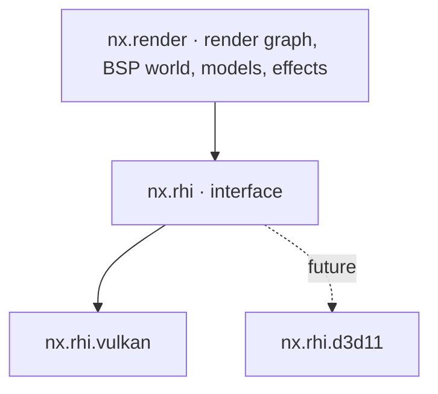
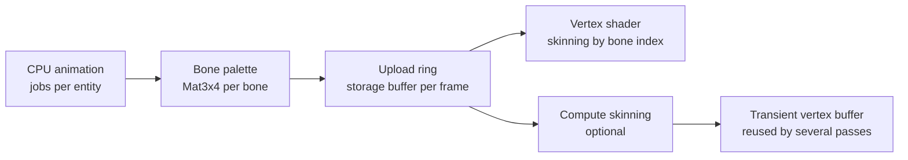

# 05 — Rendering

> Decision recorded in [ADR-0004](adr/0004-vulkan-first-abstract-rhi.md).

## 1. Goals

1. **Original look by default:** lightmaps, gamma, filters, render modes and effects
   identical to CS 1.6 (`r_fidelity legacy`).
2. **High, stable performance:** hundreds to thousands of FPS on modest hardware,
   parallel command recording and no CPU↔GPU *stall* on the frame path.
3. **Low input latency:** late input sampling, configurable frames in flight and a
   low-latency mode.
4. **GPU skinning** for every animated model.
5. **Portable:** Vulkan now, DirectX 11 in the future, without rewriting the renderer.

## 2. Layers



`nx.render` **MUST NOT** include Vulkan or D3D headers. All interaction with the GPU
goes through `nx.rhi`.

## 3. RHI (Render Hardware Interface)

### 3.1 Model

The RHI follows an explicit, modern model, but restricted to what **DirectX 11 can also
express**. The vocabulary is close to WebGPU's.

| RHI concept | Vulkan | DirectX 11 (future) |
|-------------|--------|---------------------|
| `Device` | `VkDevice` + VMA | `ID3D11Device` |
| `Queue` | `VkQueue` (graphics, optional transfer) | Immediate context |
| `CommandList` | `VkCommandBuffer` (parallel recording) | *Deferred context* (parallel recording) |
| `Buffer`, `Texture`, `Sampler` | `VkBuffer`, `VkImage`, `VkSampler` | `ID3D11Buffer`, `ID3D11Texture2D`, `ID3D11SamplerState` |
| `BindGroupLayout` / `BindGroup` | `VkDescriptorSetLayout` / `VkDescriptorSet` | Slot table emulated in the backend |
| `RenderPipeline` / `ComputePipeline` | `VkPipeline` | Set of states + shaders |
| Render pass | *Dynamic rendering* | `OMSetRenderTargets` |
| Synchronization | Barriers generated by the render graph + *timeline semaphores* | Implicit in the driver (barriers become no-ops) |
| `QuerySet` | Timestamps/occlusion | `ID3D11Query` |

### 3.2 RHI design rules

- **Bind groups** are the binding unit: the renderer never assumes *bindless*.
  *Bindless* exists as an **optional tier** (`RhiFeature::BindlessTextures`), used only to
  optimize paths that have an alternative.
- Resources are created with **typed descriptors** (structs with designated initialization).
  Formats, usages and states are `enum class`.
- Resource handles are **generational** (`TextureHandle`), validated in development
  builds. Each resource has an owner (`rhi::Owned`: `OwnedBuffer`, `OwnedTexture`...), which the
  device's create functions give and which destroys it when it lets it go or ends; destruction is
  deferred until the GPU finishes the frame that used the resource.
- Every creation error returns `nx::Result<T, RhiError>`
  (`OutOfDeviceMemory`, `UnsupportedFormat`, `DeviceLost`, `SurfaceLost`…).
- Debug names are mandatory (`.label`), propagated to RenderDoc and the validation layers.
- A device is created for the window it presents to (or for none): the swapchain then needs only
  a size and a present mode, so `nx.rhi` knows nothing of `nx.platform`. One window, one device.
- The swapchain is 8-bit UNORM, not sRGB: the `Gamma` pass writes the values of the GoldSrc curves
  as they are ([§11](#11-visual-fidelity)).

- Clip space is DirectX's on every backend: x to the right, y up, depth from 0 (near) to 1 (far);
  a viewport's rectangle counts from the top-left corner of its target. Vulkan gets there with a
  viewport of negative height.

**Today** (`engine/rhi`, `engine/rhiVulkan`): the device and its frames in flight
(`beginFrame` waits for the frame's slot and gives its `CommandList`, `submitFrame` submits and
presents), the swapchain with its recreation on resize and while minimized, and generational
handles (`HandlePool`: a stale handle is a contract violation) to buffers (device memory, or mapped
memory to upload and read back, through VMA), textures (with mip levels, and arrays of layers that
shaders sample as `Texture2DArray`), samplers, shaders, bind group layouts and
bind groups (descriptor pools added as they fill, so their number has no ceiling) and render
pipelines (dynamic rendering, dynamic viewport and scissor). A destroyed resource lives until the
GPU has finished every frame that may use it. The command list transitions textures and buffers,
copies between them, and draws. The validation layers, when installed and asked for, log their
warnings and errors and count every error (`Device::validationErrors`), which the tests require to
be zero; the tests draw offscreen and read the pixels back, on lavapipe in CI.

```cpp
auto lightmapAtlas = device.createTexture(nx::rhi::TextureDesc{
    .label     = "bsp.lightmap_atlas",
    .dimension = nx::rhi::TextureDimension::D2,
    .format    = nx::rhi::Format::Rgba8Unorm,
    .extent    = atlasExtent,
    .mipLevels = kLightmapMipLevels,
    .usage     = nx::rhi::TextureUsage::Sampled | nx::rhi::TextureUsage::CopyDestination,
});
if (!lightmapAtlas) {
    return nx::fail(WorldRenderError::LightmapAllocation, std::move(lightmapAtlas.error()));
}
```

## 4. Vulkan backend

| Item | Decision |
|------|----------|
| Minimum version | Vulkan **1.3** (dynamic rendering, synchronization2, timeline semaphores, maintenance4) |
| Loader | `volk` |
| Memory | Vulkan Memory Allocator (VMA) |
| Frames in flight | 2 (default) or 3, configurable (`r_frames_in_flight`) |
| Present | `vid_vsync 0/1`, `r_present_mode immediate/mailbox/fifo` |
| Pipeline cache | Persisted on disk per GPU/driver, invalidated by UUID. Today: `next` gives the device what its GPU learned last time (`vulkan::DeviceDesc::pipelineCache`, from `pipelineCache.bin` in the cache folder, `nx::platform::cacheDirectory`: `%LOCALAPPDATA%\Modern-Client.v2`, or `$XDG_CACHE_HOME`/`~/.cache` `modern-client.v2`), kept only when its header names the same vendor, device and cache UUID, and writes what it learned there as it ends (`Device::pipelineCache`, written whole or not at all) |
| Parallel recording | One `VkCommandPool` per worker per frame in flight |
| Validation | Validation layers + sync validation in development builds (`--validation` in `next` and `nxview`; always in the tests) |
| *Device lost* | Typed error. The renderer tries to recreate the device and resources once and, if that fails, produces a crash report |
| Upload | Persistent mapped staging ring. A dedicated transfer queue when available |

## 5. DirectX 11 (future)

- The D3D11 backend implements the same interface, without touching the renderer.
- Restrictions that apply **from now on** because of D3D11:
  - no mandatory *bindless*, *mesh shaders* or *ray tracing* on the main path;
  - per-stage slot limits respected by the bind group layouts (validated at layout
    creation time);
  - compute shaders only with SM 5.0-compatible resources.
- RHI conformance tests run on every backend
  ([18](18-testing-and-quality.md)).

## 6. Shaders

- Language: **Slang**.
  - Vulkan: Slang → SPIR-V.
  - D3D11: Slang → HLSL → DXBC (SM 5.0, via FXC).
- Compiled at build time: `nxAddShaders` runs `slangc` (the vcpkg `shader-slang` port's host tool)
  on each source of `shaders/`, which becomes one SPIR-V module in `bin/shaders/` with every entry
  point under its own name; its dependency file recompiles what imports a changed module. Bindings
  are explicit (`[[vk::binding(binding, group)]]`). Packaging (`nxbake shaders`) and the minimal
  fallback shaders embedded in the binary with `#embed` (error screen, console) come later.
- Shader reflection generates the bind group layouts, checked against the ones declared in
  C++ at build time (planned; today the C++ layouts follow the explicit bindings by hand).
- Shader *hot reload* in development (`r_shader_reload`, planned).
- Controlled permutations: each permutation is declared. There is no automatic
  combinatorial explosion.

## 7. Render graph

- Each frame declares **passes** with the resources they read and write. The graph derives:
  - barriers and layout transitions (Vulkan);
  - *aliasing* of transient resources;
  - elimination of passes whose result is not consumed;
  - execution order and parallel recording points.
- Passes record command lists in **parallel jobs**. The render thread submits them in
  order.

### 7.1 Frame passes (legacy mode)

| # | Pass | Content |
|---|------|---------|
| 1 | `Upload` | Bone palettes, instances, light styles, particles (staging ring) |
| 2 | `SkinningCompute` | Optional (`r_skinning compute`) |
| 3 | `WorldOpaque` | Opaque and masked (`{`) BSP surfaces, solid brush entities |
| 4 | `Sky` | 6-face skybox |
| 5 | `StudioOpaque` | Opaque studio models (players, weapons in the world, hostages) |
| 6 | `Decals` | World and model decals |
| 7 | `Translucent` | Water, translucent render modes, sprites, beams, particles, sorted according to the original's rules |
| 8 | `ViewModel` | First-person weapon (its own FOV and depth range) |
| 9 | `ScreenEffects` | Flashbang, fade, *screen shake* (applied to the camera), NVG tint |
| 10 | `Gamma` | Output curve of `r_fidelity enhanced` (HDR); the GoldSrc curves are applied where the original applies them (§11) |
| 11 | `Hud` | Sprite HUD, crosshair, text, menus ([12](12-ui-hud-and-console.md)) |
| 12 | `Present` | Copy to the swapchain |

**Today** (`nx.render:blendedOrder`): until the render graph comes, a frame is one render pass drawn
in the original's order (`R_DrawEntitiesOnList`, as Xash3D-FWGS reconstructs it). Each renderer
(`BspWorld`, `StudioRenderer`, `SpriteRenderer`) is prepared for the frame, writing what it draws to
its slot of the frame in flight, once a frame; then `drawInOrder` records the solid things of each in
turn (the world, its sky and its normal brush entities; the normal studio models; the normal sprites),
then the blended things of all of them in one list: the brush entities drawn `kRenderTransAlpha`
first, then the farthest middle of its bounds first, at one distance by mode (`R_TransEntityCompare`,
`R_RankForRenderMode`: the others, then TransTexture, TransAdd and Glow), those still tied in the
order of their renderers, then in their own. The view's own model is drawn after them, by a renderer
of its own.

**Today** (`nx.render:screen`, the `Hud` pass): `ScreenRenderer` draws rectangles in pixels of the
target from its top left, over everything the frame drew, its depth neither tested nor written: a
part of a picture stretched over a rectangle, times a color, or a color alone, in the order given,
those in a row drawn alike in one draw. As the original draws its HUD, a rectangle is drawn as it is
(`SPR_Draw`, a texel with no alpha left out), added to what is there as much as its alpha says
(`SPR_DrawAdditive`; `FillRGBA` adds too, which the crosshair shows), or blended over it
(`FillRGBABlend`). Its pictures are the images of a sprite's frames, the first of a group (the HUD's
sprites), and the pictures and console fonts of the WADs, their palettes through the texture gamma
as the original's textures go; a masked picture, a font always, shows through at index 255. Texels
are sampled at the nearest, so a picture stays sharp at any whole scale, or filtered linearly:
`spriteQuad` draws a rectangle of a HUD sprite as the original does, over a pixel more than its size
each way, filtered linearly ([12 §3.2](12-ui-hud-and-console.md#32-scale-and-resolution)).
`appendText` lays out a font's characters one after another, each its own width wide. `loadImage`
puts an RGBA picture on the GPU as it is, for what the interface makes itself (its glyph atlases,
[12 §2.1](12-ui-hud-and-console.md#21-fonts)). A rectangle with a clip draws only the pixels of the
clip, those of the panel a text scrolls in: the rectangles in a row drawn alike share a scissor, and
the scissor covers the whole target again after them.

**Today** (`cs.client:frame`, `FrameRenderer`): `next` and `nxview` draw a frame the same way, through
one renderer that owns the screen's renderer, the depth the passes share, and the enhanced look's post
renderer (made with the first frame of a scene of that look). In the legacy look the scene, its
muzzle flashes added over it, and the screen's pictures go to the target in one pass with the frame's
depth. In the enhanced look the next reflection probe is baked, the scene goes to the post renderer's
target and its flashes to the effects' layer, both over the frame's depth, the bloom is recorded, and
the tone curve goes to the target in a pass that has the frame's depth too, so that the screen's
pictures are drawn over it there: the tone pipeline declares the depth (`PostRendererDesc::depthFormat`)
as the screen's does, neither testing nor writing it, as a render pass and the pipelines drawn in it
must agree on their attachments.

## 8. BSP world

- **Visibility:** the camera's leaf, PVS data decompressed and cached per leaf, frustum
  culling per node and per surface. Runs in jobs.
- **Batching:** visible surfaces grouped by (texture, lightmap atlas page, render mode)
  into index buffers generated per frame.
- **Lightmaps:** packed into an atlas at map load. Each BSP30 face has up to 4
  *lightstyles*, combined **in the shader** from an intensity buffer updated every frame.
  GoldSrc re-uploaded the lightmaps on the CPU; here there is no such cost and the number of
  styles has no fixed ceiling.
- **Animated textures** (`+0..+9`, `+a..+j`), **water** with distortion (`!`), **sky**,
  **mask transparency** (`{`), **external and embedded WAD textures**.
- **Brush entities** (doors, platforms, `func_breakable`, `func_illusionary`) with
  their own transforms and render modes.
- **Future:** GPU culling (*GPU-driven*) when new maps without BSP limits justify
  it.

**Today** (`nx.render:world`, which `next` and `nxview` draw): every face of the world and of the brush
entities (placed at their `origin`) in one vertex buffer; the textures of the map and of the WADs
its `wad` key names, by file name at the root of the VFS as the original looks them up, with their
four mips, a checkerboard for a name no WAD has, or whose first WAD that has it cannot read it (logged
with its failure); masked textures; animated textures (`+0name` to
`+9name`, and `+aname` to `+jname`, of any case, in a sequence of their own), whose faces all show the
same frame, ten a second (`R_TextureAnimation`), where the original would refuse a sequence with a
missing number the frames it has play in order; the faces of a brush entity whose frame is not 0
(`ModelPlacement::showsAlternateTextures`: a button in, a `func_wall` used) show their sequence's
alternate instead, `+a` for `+0` and back, when it has one (the original's `alternate_anims`);
turbulent faces (water and lasers: `!`, Quake's `*`,
and names that start with `water` or `laser`), unlit, cut along the axial planes every 64 units
(`GL_SubdivideSurface`), their texture coordinates in texels without the texture's shift and warped
at each corner of the pieces, a cell of 64 texels a texture, as `EmitWaterPolys` warps them, and
on a brush entity with waves (its `scale`, `ModelPlacement::waveHeight`: a `func_water`'s an eighth of
its `WaveHeight`) each corner raised by two sines of the warp's table, each lifted above 0, read at
160 entries a second along x + y and at 171 along 5x - y (four fifths of it), times the height, and
lowered instead when the face's first corner (the first of the last piece cut, the head of the
original's list of them) is at or above the eye, in its model's space as the original compares them;
triggers and the compiler's tool
textures (`AAATRIGGER`, `CLIP`...) not drawn. The lightmaps are packed into one atlas of four
layers, each face's lightmaps (one per light style, up to its first unused one) at the same place
of each layer; a face's extent in luxels of 16 units is computed in double precision, as the
compilers compute it.

The light is the original's to the bit (`R_BuildLightMap`): each luxel sums its samples times their
style's brightness in the frame, in integers, multiplies by `lightscale` and shifts out 14 bits,
holds the result to 1023 and reads it from the light table (§11); the face then blends the four
luxels around each point, as the original's bilinear filter blends its light texture. A face
without lightmaps is fully bright, as the original draws a face without samples. The styles'
brightness comes with each draw (`nx.render:lightStyle`): 22 for each letter of a style's pattern
after `a` (264 at `m`, the normal one), ten letters a second, 256 for a style the game left unset,
and 264 for the styles above the 64 the game sets. The client (`cs.client`) sets the world's patterns (flicker,
candles, strobes, pulses...) from `data/cstrike/lightStyles.toml` (`cs::WorldLightStyles`, each style
once, in letters from `a` to `z`), as Quake's world.qc sets them, under the names the Half-Life FGDs
give the styles (style 12, which has no public pattern, stays unset), and the switchable lights' from
their entities, `a` for those that start off, else `m` or their `pattern`.

The camera (`nx.render:camera`) writes reversed depth, 1 at the near plane and 0 at
infinity, compared with `Greater`: nearly uniform precision across a whole map; `fov` is the
original's horizontal angle of a 4:3 view, kept vertical on wider screens (Hor+).

The faces of the `sky` texture are drawn last, with their depth, each pixel showing the side of
the sky its direction from the camera points at, as the original projects it: the side of the
largest axis (ties broken as the original breaks them), at the point that direction reaches, each
side clamped at its edges. The sides are the six layers of one texture, `gfx/env/<skyname>` with
the suffixes `rt`, `bk`, `lf`, `ft`, `up`, `dn` toward +X, +Y, -X, -Y, up and down; from the
middle of the sky each is seen upright and unmirrored, the top and bottom ones facing +X. They are
drawn as their files have them, through no gamma curve, as in the original, which falls back to
`desert` when the worldspawn's `skyname` names a sky the installation lacks; without any, the
sky is gray. Drawing the sky's own faces rather than a box behind the world gives the same picture
for the world and hides what lies behind them, as the sky's brushes seal the map.

Each frame gathers what the camera sees, as the original culls it, into the index buffer of its
frame in flight, in a batch per texture and then the sky's: the leaves the camera's leaf may see
(its potentially visible set, decompressed again only when the camera enters another leaf; every
leaf from inside a wall), those whose bounds are in front of the four side planes of the view, and
their faces that face the camera: from the side of its plane the eye is on, the plane itself in
front (`R_RecursiveWorldNode`). A brush entity is drawn where the game puts and turns it that
frame (`WorldFrame::placements`; one the game does not place, where the map's entity of it says,
unturned), its model's faces moved and turned there by the vertex shader, when its bounds are in
view (turned, a cube as wide as its farthest corner about its origin), its faces from at
least `BACKFACE_EPSILON` past their planes (`R_DrawBrushModel`), as its `rendermode` says
(`R_SetRenderMode`): the normal ones after the sky (lit, masked textures cut where they have no
alpha, the original's alpha test at 0); the others among everything the frame draws blended, by the
squared distance to their middles (§7.1): the solid ones (`kRenderTransAlpha`, lit, cut at an alpha
of 0.25 or less) before every other, and the blended ones, unlit: `rendercolor` for
`kRenderTransColor`, writing its depth; the textures for `kRenderTransTexture` (its faces back to
front, `R_SurfaceCompare`) and `kRenderGlow`; the textures added to what is behind for
`kRenderTransAdd`, each as opaque as `renderamt` says. A blended entity at a `renderamt` of 0 is not
drawn (`R_AddEntity`); a mode the original does not know draws as its default does, as Glow.

Decals (`nx.render:decals`, Xash3D's `R_DecalShoot` and its clipping, GPL, consulted:
[20 §3](20-legal-and-licensing.md#3-clean-room)) are images of `decals.wad` stamped on the faces of
the world or of a brush entity near a point. The image is made as the original's engine makes it of its mip texture, its
first level alone, its palette through `texgamma`: when the palette's last color is not pure blue
(every decal of the game's), each texel that color, as opaque as its index, index 255 clear;
otherwise each texel its palette's color, opaque, index 255 clear. It is mipmapped from that level
and sampled clamped at its edges. A shot of one of them (a `DecalImageIndex`; `BspWorld::shootDecal`,
`DecalPool::shoot`) is aimed
at a model (`DecalTarget`): the world's, or a brush entity's, the point taken into the model's space
where the game has the entity then (`R_DecalShoot`), so that the decal goes wherever the game moves
it. It walks that model's tree from its root, within half the image's larger side of each node's
plane, and tries the faces of the nodes whose plane passes within 4 units of the point: those that take decals (neither
the sky, nor water, nor a conveyor, nor masked, and drawn), whose luxels the decal's box may reach.
On each, the decal is a square in the face's own texture directions, a texel a unit at scale 1 (the
scale held to 0.01 to 16), its middle at the point, and the face's outline is cut to it, side after
side (Sutherland-Hodgman), lit by the face's lightmaps as the face's own vertices are. A face takes a
slot of the pool for it before it is cut, as the original's does: the pool's next one, whose decal
goes, unless 6 or more of the face's decals are each over 60% covered by the new one, which then
replaces the one of them it covers least. One pool holds the decals of every model: it takes a
decal in the first `r_decals` of its slots, 4096 at most (`DecalPool::setLimit`,
`BspWorld::setDecalLimit`), reading the limit at each decal as the original's `R_DecalAlloc` does,
so that decals past a lowered limit stay until their slots come back into the ring, and 0 stamps
no more. The world's decals are drawn right after the world's
faces, oldest first so that the newest lies over the others, each texel lit as the face is there and
blended over the lit face as opaque as its alpha: the original draws them over the face's texture
before it multiplies both by the lightmap, which comes out the same. Their depth is tested against
the faces' pulled toward the eye by the original's polygon offset (2 units of the depth's least
step, plus the slope), and not written. A brush entity's decals are drawn with it, where it is drawn,
on its faces drawn that frame: a normal one's after all of its faces, as one batch
(`DrawDecalsBatch`); another's after each face (`DrawSurfaceDecals`), as its render mode leaves the
original's color: lit as the world's for `kRenderTransAlpha`; unlit, as opaque as `renderamt` makes
them, for `kRenderTransTexture` and `kRenderGlow`; times `rendercolor` and as opaque as `renderamt`
for `kRenderTransColor`, writing their depth; times `renderamt` and blended for `kRenderTransAdd`.
A `kRenderTransTexture` entity's face seen from behind that has decals shows them, newest first, its
own polygon culled, as the original keeps such a face for them (`R_SortBrushModelSurfaces`), so that
the cracks of a window show from both sides. In `next`, each shot leaves its mark where it meets the
world or a brush entity (docs/10 §7.3). Its game is one of more than one player, as a
Counter-Strike server's: as it starts, `r_decals` is held to `mp_decals` (`enterMultiplayerGame`,
as the original's client holds it when it enters such a game, which Xash3D documents: 300 with the
original's settings), and each frame's marks take the limit `r_decals` has then; `nxview` draws
with the original's default settings in such a game, 300.

A map stamps its own decals for good as its game starts (`DecalLife::Permanent`, the original's
`FDECAL_PERMANENT`): the pool's ring passes over a slot taken for good while it has another
(`R_DecalAlloc`, the last one tried once every slot is), the overlap rule never replaces such a
decal, and the slot stays taken even when its decal misses the face, as the original keeps its
flags. They are the map's `infodecal`s (`nx::game::staticDecalsOf`, ReGameDLL_CS's `CDecal`, GPL,
consulted): each its `texture` at its `origin`, on the brush entity a line through what is solid
meets from 5 units below the origin on each axis to 5 above (`UTIL_TraceLine`), the world when none,
where the game has it at rest; those with a `targetname` wait to be used, and those marked not for
deathmatch (spawnflag 2048) are left out, Counter-Strike's game being one. The level resolves them
among its decals of decals.wad (`cs::Level::mapDecals`), the names of those decals.wad lacks logged,
as the original's server drops them, and the scene stamps them as it is made, as the original's
client stamps the static decals the server sends as it connects: de_cbble's bombsites show their
`{siteA` and `{siteB` on its walls and crates. The decals of masked faces (which the original cuts
with a stencil) come with what cuts them.

On the Steam installation, de_dust2 is 5358 faces (1356 of them sky) in 41 textures and a 1024x404
atlas, built in half a second; from the terrorists' spawn a frame draws 382 of them, in 83 leaves.

## 9. Studio models and GPU skinning

### 9.1 Pipeline



1. **Animation evaluation (CPU, parallel):** sequence, frame, *blending* between
   sequences, *blend controllers* (aim pitch), *bone controllers*, *gait sequence*
   (player legs) and *attachments*. The code is the same one the server uses for hitboxes
   (`cs.shared`), and the GPU is **never** authoritative.
   **Today** (`cs.shared:studio`, `cs::poseBones`): the bones posed at a frame of a sequence as the
   original's engine poses them: each axis's rest value plus its animation value times its scale,
   interpolated towards the next frame (a position on the raw values, the angles through the
   quaternions of the original's `AngleQuaternion` and its `QuaternionSlerp`, unnormalized), plus
   what its bone controller adds (its setting mapped onto its range, a cyclic one turning past it,
   the mouth's from 0 to 64); the first two blends mixed by the first blending; the motion bone's
   motion kept (the server's hitboxes) or removed (the client's drawing); each bone placed in its
   parent, the roots in the entity's transform. `nxcheck` poses every sequence of every model of the
   installation ([18](18-testing-and-quality.md#real-content)). The nine aim blends and the gait of
   the players' models, the transitions between sequences and the jobs come with player animation.
2. **Bone palette:** `Mat3x4` (48 bytes) per bone, written straight into the persistent
   mapped upload ring. Each instance keeps a `paletteOffset`.
3. **Vertex shader:** fetches `bones[paletteOffset + vertex.boneIndex]`. The MDL v10 format
   binds each vertex to **one** bone and each normal to its own bone, so both indices
   are preserved.
   **Today** (`nx.render:studio`, `shaders/studio.slang`): a `StudioRenderer` loads a model's meshes,
   of every choice of every body part, into one vertex and one index buffer, each corner a vertex
   with its position's bone and its normal's, strips and fans made triangles as the original's GL
   winds them; its textures through `texgamma`, a masked one's index 255 transparent, with mip levels
   each the mean of the four texels above it (`GL_MipMap`), unless the texture has none. A frame's
   models write their bones, every model's one after another, to a storage buffer of the frame in
   flight, and each its light, its first bone and its depth mapping to a uniform of its own; each
   mesh is a draw call, with the texture its skin gives it (the first skin when the model lacks the
   one asked for). The vertex shader places each vertex by its bone, turns its normal by its own, and
   lights it as `R_StudioLighting` does: fully bright, or the model's ambient light plus its shade
   as far as the normal faces against the light's way (`SHADE_LAMBERT`, 1.4953241; 0.8 of the shade
   when flat shaded), held to 255, read from the whole light curve at four times it, times the
   light's color and stored a byte a channel. Chrome takes its coordinates from the normal against
   the viewer and its right (`R_StudioSetupChrome`); a masked mesh is cut where its alpha is 0.5 or
   less, an additive one adds itself without writing its depth; the triangles the original culls
   (`GL_FRONT`) are culled. The view's own model is drawn in the nearest 0.3 of the depths, as the
   original keeps it out of walls (`VIEWMODEL_DEPTH_RANGE`). The client draws the weapon in the
   player's hand: its view model, as its data names it (`cs::Weapon`), in the sequence the player's
   weapons play since they started it (`cs::Inventory`: drawn, then idling,
   [10 §7.3](10-counter-strike-gameplay.md#73-behaviors)), posed by `cs::poseBones` at the frame
   `cs::sequenceFrameAt` gives, where the player looks from, lit by the world there and by the sky
   the map's `light_environment` sets. Its main weapon data can select a static `view.skin` and
   `view.bodyChoices`; `cs::ViewModel` validates and owns those values, and `cs::Scene` passes them
   to `StudioInstance`. Their defaults keep skin zero and each body part's first choice. Appearance
   indexes are checked against the actual model and its textures file before GPU upload; alternate
   views cannot override them ([10 §7.2](10-counter-strike-gameplay.md#72-weapon-data-datacstrikeweaponsweapontoml-datacstrikeammotoml)).
   A view model modeled in the other hand than the player's (its
   `viewHand`; the player's is `cl_righthand`'s, the right at its default of 1, the left at 0,
   `SceneView::hand`, read each frame) is drawn
   mirrored, its left turned to its right (`StudioInstance::isMirrored`), the other faces culled as
   its triangles turn over: Counter-Strike's guns are modeled in the left hand and its knife in the
   right, and the original draws them all in the right (observed on it; Xash3D's
   `R_AllowFlipViewModel`, GPL, consulted: [20 §3](20-legal-and-licensing.md#3-clean-room)). The
   view model's client events (5000 and above) fire as a frame passes them, a sequence played anew
   from its first frame (`R_StudioClientEvents`); a muzzle flash's (5001, 5011, 5021, 5031: the
   first to fourth attachment, as GoldSrc's model events are documented) shows a sprite at that
   attachment, added in full, as its style says (`cs.client:muzzleFlash`). The flashes are drawn
   after the view's own model and in its depths (`DepthLayer::ViewModel`, a sprite renderer of their
   own): over what of the weapon is behind them, under what is in front, and never hidden by a wall
   or a crate the muzzle is pushed against, where the original draws them among the world's blended
   sprites, which such a wall hides. A flash is anchored to its attachment (`cs::MuzzleFlashAnchor`): each
   frame shows it where that frame's bones put the attachment, so that it stays at the muzzle as the
   weapon moves, however long it lasts; each event shows a flash of its own, as the original makes a
   temporary entity of each, and flashes overlapping at a muzzle add up (Counter-Strike Online's, which
   play longer than a shot's cycle, burn brighter as it fires, yellow, then white); those of a weapon the
   player no longer holds are forgotten (`cs::MuzzleFlashes`). Its style is
   the event's options, then each value of the weapon's `view.muzzleFlash` over them ([10 §7.2](10-counter-strike-gameplay.md#72-weapon-data-datacstrikeweaponsweapontoml-datacstrikeammotoml)).
   The original's options, a number, show one of `sprites/muzzleflash1.spr` to 3, chosen by its
   units, a tenth of its tens in size, half with none, at a frame and rolled at random (by 20 degrees
   at most for the first sprite), for 0.01 seconds (`R_MuzzleFlash`). Counter-Strike Online's, keys
   and their values after a `#` (`#I341 S0.16 R2 F0 P30 T999 A1 L0 O0 X0`, as its models are
   observed), show `sprites/muzzleflash<I>.spr` (its sprites of version 3, §10) at scale `S`, played
   once from frame `F` at `P` frames a second, for `T` seconds at most, turning counter-clockwise `R`
   degrees a frame of it (the Drakar III's `R2` turns smoothly that way in Counter-Strike Online; the
   rate is the project's estimate until it is measured); the keys whose meaning is unknown are not
   read, and a key an option lacks is the original's of 0. A flash is over past its
   time or past its sprite's last frame. A flash is added as the original adds it, in both looks: its
   display colors, times its style's `brightness` (1 as made), each channel stopping at white, so
   that an overexposed flame turns yellow, then white, as it was authored to (`Scene::drawEffects`):
   in the legacy look onto the screen, after the weapon; in the enhanced look to the effects' layer,
   which the tone pass adds over the scene once it is mapped to the screen, the layer's light glowing
   in the bloom (`nx.render:post`); added as light and mapped with the scene, a flash would keep its
   texture's orange where the original's turns yellow. In the enhanced look its `light` lights the
   weapon in hand from the flash (a `StudioLight`, after the key light), dimming to nothing over its
   own time, the lights of a muzzle's flashes added into one. The sprites a view model's flashes show are read
   with it, by their paths (`cs::MuzzleFlashSprites`, `Level::updateViewModels`), and put on the GPU
   with it (`Scene::loadWeapons`), so that no file is read as a frame plays: one missing is logged
   and its flashes are not shown. A sound's (5004) plays the sound its options name
   ([11 §2](11-audio.md#2-architecture)). `cs::ViewModelEvents` follows the play from a frame to the
   next, for the scene and the sound alike. The original's light of a shot on the world and its
   models (`EF_MUZZLEFLASH`) comes with the dynamic lights, the shells with the temporary entities. A
   model's render mode blends it as `GL_StudioSetRenderMode` and `R_StudioDrawPoints` set it:
   Normal solid; TransAdd unlit, its vertices' light its `renderamt`, added and not writing its depth;
   any other blended over what is behind, lit, as opaque as `renderamt` says, writing its depth, its
   additive meshes added as their alpha says. The solid models are drawn with the solid things of the frame, the
   others but those at a `renderamt` of 0 among everything it draws blended, by the middle of their
   bounds (§7.1). A `StudioRenderer` is prepared once a frame: the client's scene (`cs::Scene`) draws the view's
   own model with one of its own, last. The client shows the maps' studio models as the game makes them: the
   `cycler_sprite` of a model (ReGameDLL's `CCyclerSprite`), its sequence at its `framerate` from
   when the map starts, as the client estimates it; and the `hostage_entity` (`CHostage`), its model
   the map's or `scientist.mdl`, its first idle sequence at its own speed (the game picks one of them
   at random by weight), its head's controllers straight ahead (`SetController` of 0 degrees,
   `cs::controllerSettingOf`), dropped to the floor ([07 §5](07-simulation-and-physics.md)); each turned by
   its entity's angles, the pitch negated as the engine's studio transform negates it, lit where it
   is. The render effects, the players' colors, the bob of the view's model and instancing come with
   their consumers.
4. **Modern formats (glTF)** use up to 4 influences (`joints: u8x4/u16x4`,
   `weights: unorm8x4`), in the same pipeline with another permutation.
5. **Compute skinning** (`r_skinning compute`): pre-transforms vertices once per frame
   when the same model is drawn in several passes or with many instances.

### 9.2 MDL format features to support

The enhanced look (`r_fidelity enhanced`, read when the map loads; `nxview --look enhanced` for
captures that do not depend on the GPU's speed) shades each texture of a model by the material the
file beside the model gives it (`<model>.material.toml`, `cs.client:modelMaterials`), texture by
texture, a skin family's swap included:

```toml
[[textures]]
texture = "gun_v01.bmp"                            # in any case, named once
fullbright = true                                  # the map's light and its color left out
metallicRoughness = { metallic = 1.0, roughness = 0.35 }

[[textures]]
texture = "gun_v02.bmp"
baseColorMap = "models/texture/gun_v02_1024.tga"  # its texels, TGA or BMP, of any size
[textures.painted]
roughness = 0.35                                  # of the reflection added over the painting
specularColor = [0.04, 0.04, 0.04]                # the reflection's color head on, in linear light
specularWeight = 0.5                              # how much of it is added, grazing angles included
specularMap = "models/gun_v02_specular.tga"       # by texel: rgb its color, alpha times its weight
light = { map = "models/studioLight.tga", gain = 1.0 }

[[textures]]
texture = "gun_glow.bmp"
emissive = 3.0                                    # its color times this: beyond 1 it blooms
emissiveMask = "models/gun_glow_mask.tga"         # where it emits; none: everywhere
blend = "additive"                                # opaque, masked or additive, in place of its flags
```

A texture has one surface at most (`nx::render::StudioSurface`, a variant); without one it is drawn
as the original draws it, what it emits added. `metallicRoughness` is glTF 2.0's: its texels are its
color, a dielectric's lit by the original's light, a metal's what it reflects. `painted` is for
textures with their light painted in, as Counter-Strike Online paints its weapons: the painting stays,
lit by the original's light and by its painted `light`, and the reflection its material gives is added
over it, an artist's layer rather than a conductor that conserves energy. The painted light is an
image of all around, equirectangular (across, the longitude `atan2(y, x) / 2π + 1/2`; down, the
latitude `acos(z) / π`), of display colors as textures are, sampled as light toward the direction the
surface reflects. A specular map is data, through neither `texgamma` nor sRGB; where its weight is 0
neither the surroundings' reflection, at grazing angles too, nor highlights are added. Fullbright
leaves out the map's light and its color alike; what a texture emits is light of its own. What a
surface reflects is the map from the two reflection probes nearest the model, or the sky, times GGX's
reflection integrated over the directions it gathers (Filament, sections 5.3.4 and 9.5). The two probes
are blended by `nx::render::probeBlendOf`: each weighs (d3 − d) / d, d its distance and d3 the third
nearest's, so that a probe counts in full where it stands and for nothing as the third overtakes it,
and the reflection changes as smoothly as the model moves, never at once. The lights of the map near a model
give it highlights. A file fails with a typed error (`cs::ModelMaterialError`): `FileInvalid` for its
schema (an unknown key, a key of the other surface, a `specularColor` that is not three shares from 0
to 1), `TextureUnknown`, `TextureRepeated`, `SurfaceAmbiguous` for both surfaces, and
`ImageUnreadable`. Nothing is inferred from the names of textures but Counter-Strike Online's
`#WWWHHH` sizes.

The renderers take how their colors reach the target (`nx::render::ColorEncoding`): `Display`, as the
original draws them, or `Linear`, which the enhanced look's scene is drawn in. Drawn as linear light,
the textures' colors, through their palettes' `texgamma`, are stored as sRGB, which the GPU decodes
before it filters, and their mip levels average light; the light and colors the original gives as
display colors are made light; masks, lightmaps and data stay as they are. The world, the models and
the sprites blend into a target of half floats, the probes capture and blur light, the bloom keeps a
constant image's light, and the shoulder scales a color's channels by one gain from its brightest, so
that a bright gold stays gold. The additive effects (the weapon's muzzle flashes) are drawn apart, to
a layer of display colors over the scene's depths, which the tone pass adds over the mapped scene,
each channel stopping at white, as the original adds them, and whose own light the bloom spreads
about them, as about any light. The colors are encoded for the screen once, before the HUD
(`shaders/colorEncoding.slang` holds the display's gamma every shader converts by). The enhanced
look's model textures are filtered anisotropically, by up to 16 texels as the device allows; the
original's look keeps its own filtering.

- *Chrome* textures (view-dependent coordinates in the shader), *flatshade*,
  *additive*, *masked* and *fullbright*.
- External texture files (`*T.mdl`) and sequence groups (`*01.mdl`).
- *Body parts* and submodels (selection **per part**, without `body` packed into a few
  bits), *skin families*, hitboxes and *hitgroups*.
- **Unlimited attachments** (the original uses only 4 per entity), accessed by name or
  index, for the muzzle, shell, aim, flashlight and plugin effects.
- No fixed ceilings on bones, vertices, controllers and blends in the internal representation
  ([06 §3.4](06-assets-and-resources.md#34-removed-content-limits)).
- Animation events (sound, *muzzle flash*, shell ejection) dispatched to the client.
- GoldSrc-style lighting: a lightmap sample under the model (ambient and directional
  light), *elights* and *dlights*. The sample is computed in a per-entity job and passed
  as instance data.

**Today** (`nx.render:light`, `WorldLight`): the light a model is drawn with, as the original finds it
(`R_LightVec`, `R_StudioDynamicLight`) and as Xash3D-FWGS reconstructs it, without that project's
extensions (`r_lighting_extended`: the light of brush entities and of the ceiling). A segment walks the
world's tree, the nearer side of each node first, on a stack of its own rather than in recursion
however deep a file's tree; at each node it crosses, the first face that is not special (sky, water)
and whose extent has the crossing point gives the light of its luxel nearest that point: each lightmap's
sample times its style's brightness, summed, divided by 256 and held to 255; a face without samples
is black, and a map without light fully bright. A model's light comes from 8 units above its origin:
the sky's when the sky has a color (the game sets it from the map's `light_environment`) and the first
face met against its way, 8192 units, is the sky's (`SurfaceAtPoint`, whose coordinates are whole
texels); else the light 2048 units down, going the way it grows dimmer across four points 16 units
about the origin, and down. Its brightest channel is its whole light, `direct` (0.9, held from 0.75 to
1) of it shade and the rest ambient, ambient held to 128 and the two to 255; its color is the light
over its brightest channel. On de_dust2, a terrorist spawn in the sun is 191 under a model, a
counter-terrorist one indoors 15 to 37. The *elights* and *dlights* come with the effects.

### 9.3 Instancing

Instances are grouped by (model, submesh, skin, render mode). Twenty players with the
same model become one draw call per submesh.

## 10. Effects

| Effect | Note |
|--------|------|
| Sprites (SPR) | Orientations *parallel*, *parallel upright*, *facing upright*, *oriented*, *parallel oriented*. Formats *normal*, *additive*, *indexalpha*, *alphatest* |
| High-quality sprites (`.nxspr`) | RGBA with smooth alpha, any resolution the GPU supports, mipmaps, KTX2 compression, per-DPI variants for the HUD, the same orientations and render modes as SPR |
| Beams | Segments, noise, attachments to entities |
| Particles | System compatible with the GoldSrc effects (blood, sparks, smoke). Simulation in jobs, upload as instances |
| Temp entities | Ephemeral effects (shrapnel, shells, explosions) without a fixed ceiling. Configurable budget with a diagnostic error when exceeded |
| Decals | Decal atlas from `decals.wad` and player sprays. No fixed ceiling (configurable per-map budget and LRU recycling). Today: the world's decals, in the original's pool of 4096 at most (§8) |
| Dynamic lights | *dlights* and *elights* without a fixed ceiling, with a per-frame budget |
| Grenade smoke | Visual parity with the original (smoke sprites), with configurable density |

**Today** (`nx.render:sprite`, `shaders/sprite.slang`): sprites drawn as the original's
`R_DrawSpriteModel` draws them, as Xash3D-FWGS reconstructs it. Each image of a sprite is a texture
with its mip levels (`GL_MipMap`), its palette as its format makes it (`Mod_LoadSpriteModel`): normal
and additive ones through `texgamma`, index-alpha ones the last color with the index as alpha,
alpha-tested ones their own palette with index 255 transparent; an image of Counter-Strike Online's
sprites of version 3 is its BC3 blocks decoded as their author made them, `texgamma` being what
GoldSrc gives the palettes of its 8-bit images. Each sprite is a quad the CPU turns as
its orientation says (`R_DrawSpriteModel`: parallel, parallel upright and not drawn within a degree of
looking straight up or down, facing upright, oriented and nudged 0.01 toward its viewer, parallel
oriented by its roll, which a parallel sprite with a roll becomes), the image of its frame (the frame
cut to a whole number and held to the sprite's; a group's image by its loop's time,
`R_GetSpriteFrame`) times `rendercolor` (black is white), as opaque as `renderamt` makes it, its
fragments not above the alpha test discarded; times its brightness too, once its color is encoded
for its target: 1 but for an effect made brighter, each channel past white where its target holds it
(`SpriteInstance::brightness`, a muzzle flash's, §9). The render modes blend as `R_DrawSpriteModel` sets
them: Normal opaque, TransColor and TransTexture blended and writing their depth, TransAlpha blended
without it, TransAdd added, Glow added over everything; a glow off the screen or hidden by the game is
not drawn, and unless `renderfx` is NoDissipation it dims to 19000 over its squared distance (held from
0.05 to 1) and grows by its distance over 200. An alpha-tested sprite drawn opaque enough (`renderamt`
above 127, Normal, TransAlpha or TransTexture) is cut at an alpha of a third and lit: drawn again where
it was, its light from the world under it (`R_LightPoint`) multiplying what is there. The solid sprites
are drawn after the solid models, the others among everything the frame draws blended, by their
origins (§7.1), before the view's own model; those the view's own model shows (its muzzle flashes)
are drawn after it, in its depths (`SpriteDraw::depth`, the layer `nx.render:camera` maps for both). The client shows the sprites of `env_sprite`, `env_glow` and the `cycler_sprite`s of a
sprite as the game makes them (ReGameDLL's `CSprite`, `CGlow`, `CCyclerSprite`): an `env_sprite`'s yaw
alone is its roll, a named one that does not start on is off, and each animates ten times a second,
its last frame index the end of its loop (one that plays once turning off past it); a glow the
player's line of sight stops 8 units or more short of, through glass and models, is hidden
(`R_SpriteGlowBlend`). The other render effects, sprites that follow an entity and the HUD's come with
their consumers.

## 11. Visual fidelity

| Aspect | `r_fidelity legacy` (default) | `r_fidelity enhanced` |
|--------|-------------------------------|-----------------------|
| Texture filter | Same as the original (`gl_texturemode`) | Anisotropic |
| Antialiasing | Off | Configurable MSAA or FXAA |
| Gamma | Emulation of the GoldSrc curves | Same, with optional HDR output |
| Texture resolution | Original | Optional high-resolution packs (mods) |
| Lightmaps | Original sampling and scale | Optional bicubic filter |

Every visual improvement is **optional** and **does not change gameplay** (visibility through
smoke, for example, must be identical).

**Proposed** ([ADR-0025](adr/0025-enhanced-rendering.md)): `enhanced` as a physically based pipeline,
forward rendered on the RHI's baseline, the same look on every card it runs on: a linear HDR scene
in 4 bytes a pixel with a fixed exposure and a tone curve; an energy-conserving bloom; materials
from data beside each model (metallic-roughness, normal maps, emissive per pixel, KTX2), derived
from the GoldSrc flags when a model has none; reflections from probes baked from the map as it
loads; highlights from the map's own lights. Its cost is bounded by design, within 2 ms a frame at
1920×1080 on an integrated GPU.

**Today** (`nx.render:gamma`): the original's picture, each curve where the original applies it.
`texgamma` maps the palette of a texture when it loads (`pow(value, texgamma / gamma)`, truncated);
the light of a luxel, its lightmaps' samples each scaled by its style's brightness (264 at the
normal `m`), summed, and scaled by `lightscale` (2^(1/`lightgamma`) in 8.8 fixed point, shifted
right 14 bits) to the original's 10-bit light (§8), indexes
a table of 1024 entries, built as the original builds `lightgammatable`: `lightgamma`, then
`brightness` (a multiplier above 1, and the knee that lifts the shadows), then 1/`gamma`, of which
the upper 8 bits are drawn. The color is the texture's times that light, never brighter
(`gl_overbright 0`). The defaults are what CS 1.6 ships: `gamma 2.5`, `brightness 1`, `texgamma 2`,
`lightgamma 2.5`; each setting is held to the original's range. The tables match those the
Xash3D-FWGS project records from the original for its tests.

## 12. Latency and frame pacing

- `fps_max` with a precise limiter (`nx::platform::SleepTimer`: a high-resolution timer on
  Windows and an absolute sleep on the monotonic clock on Linux, without *spin*). No limit
  when `0`.
- In low-latency mode, the limiter waits **before** sampling input, so that the frame is
  built with the most recent input.
- No empty window while the client loads: `next` opens its window hidden and shows it with its first
  image (`WindowDesc::isShown`, `Window::show`). A map's scene, its textures and models on the GPU, is
  made with the first image of it, and its game plays from the frame after: the player hears what
  they see (the knife drawn as the map shows, not over a black window), and the loading is no time of
  the game's. The CPU makes a texture's mip levels in place, the chain sized once, never a byte at a
  time.
- Exposed metrics: CPU time per phase, GPU time per pass (timestamps) and estimated latency
  from input to *present*.

## 13. Debugging tools

- RenderDoc integration (`r_capture`).
- `r_speeds` (draws, triangles, time per pass), `r_drawentities`, `r_wireframe`,
  `r_showtris`, `r_lightmap`, `r_fullbright`, `r_drawviewmodel` and overdraw visualization.
- ImGui overlay with the frame's render graph (passes, resources, aliasing).
