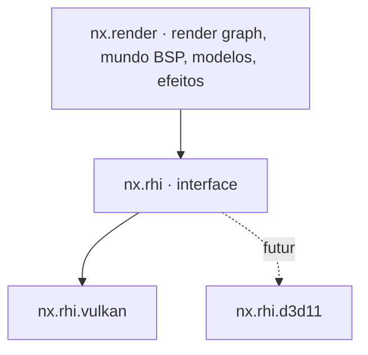
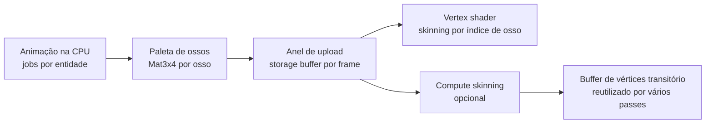

# 05 — Renderização

> Decisão registrada em [ADR-0004](adr/0004-vulkan-primeiro-rhi-abstrata.md).

## 1. Objetivos

1. **Visual original por padrão:** lightmaps, gamma, filtros, render modes e efeitos
   idênticos ao CS 1.6 (`r_fidelity legacy`).
2. **Desempenho alto e estável:** centenas a milhares de FPS em hardware modesto,
   gravação de comandos em paralelo e nenhum *stall* de CPU↔GPU no caminho do frame.
3. **Baixa latência de entrada:** amostragem tardia de entrada, frames em voo
   configuráveis e modo de baixa latência.
4. **GPU skinning** para todos os modelos animados.
5. **Portável:** Vulkan agora, DirectX 11 no futuro, sem reescrever o renderer.

## 2. Camadas



`nx.render` **NÃO PODE** incluir headers de Vulkan nem de D3D. Toda interação com a GPU
passa por `nx.rhi`.

## 3. RHI (Render Hardware Interface)

### 3.1 Modelo

A RHI segue um modelo explícito e moderno, mas restrito ao que o **DirectX 11 também
consegue expressar**. O vocabulário é próximo ao do WebGPU.

| Conceito RHI | Vulkan | DirectX 11 (futuro) |
|--------------|--------|---------------------|
| `Device` | `VkDevice` + VMA | `ID3D11Device` |
| `Queue` | `VkQueue` (graphics, transfer opcional) | Contexto imediato |
| `CommandList` | `VkCommandBuffer` (gravação paralela) | *Deferred context* (gravação paralela) |
| `Buffer`, `Texture`, `Sampler` | `VkBuffer`, `VkImage`, `VkSampler` | `ID3D11Buffer`, `ID3D11Texture2D`, `ID3D11SamplerState` |
| `BindGroupLayout` / `BindGroup` | `VkDescriptorSetLayout` / `VkDescriptorSet` | Tabela de slots emulada no backend |
| `RenderPipeline` / `ComputePipeline` | `VkPipeline` | Conjunto de estados + shaders |
| Passe de render | *Dynamic rendering* | `OMSetRenderTargets` |
| Sincronização | Barreiras geradas pelo render graph + *timeline semaphores* | Implícita no driver (barreiras viram no-op) |
| `QuerySet` | Timestamps/occlusion | `ID3D11Query` |

### 3.2 Regras de desenho da RHI

- **Bind groups** são a unidade de binding: o renderer nunca assume *bindless*.
  *Bindless* existe como **tier opcional** (`RhiFeature::BindlessTextures`), usado só para
  otimizar caminhos que tenham alternativa.
- Recursos são criados com **descritores tipados** (structs com inicialização designada).
  Formatos, usos e estados são `enum class`.
- Handles de recurso são **geracionais** (`TextureHandle`), validados em builds de
  desenvolvimento. Destruição é adiada até a GPU terminar o frame que usava o recurso.
- Todo erro de criação retorna `nx::Result<T, RhiError>`
  (`OutOfDeviceMemory`, `UnsupportedFormat`, `DeviceLost`, `SurfaceLost`…).
- Nomes de debug obrigatórios (`.label`), propagados para RenderDoc e validation layers.

```cpp
auto lightmapAtlas = device.createTexture(nx::rhi::TextureDesc{
    .label     = "bsp.lightmap_atlas",
    .dimension = nx::rhi::TextureDimension::D2,
    .format    = nx::rhi::Format::Rgba8Unorm,
    .extent    = atlasExtent,
    .mipLevels = kLightmapMipLevels,
    .usage     = nx::rhi::TextureUsage::Sampled | nx::rhi::TextureUsage::CopyDestination,
});
if (!lightmapAtlas) {
    return nx::fail(WorldRenderError::LightmapAllocation, std::move(lightmapAtlas.error()));
}
```

## 4. Backend Vulkan

| Item | Decisão |
|------|---------|
| Versão mínima | Vulkan **1.3** (dynamic rendering, synchronization2, timeline semaphores, maintenance4) |
| Loader | `volk` |
| Memória | Vulkan Memory Allocator (VMA) |
| Frames em voo | 2 (padrão) ou 3, configurável (`r_frames_in_flight`) |
| Present | `vid_vsync 0/1`, `r_present_mode immediate/mailbox/fifo` |
| Pipeline cache | Persistido em disco por GPU/driver, invalidado por UUID |
| Gravação paralela | Um `VkCommandPool` por worker por frame em voo |
| Validação | Validation layers + sync validation em builds de desenvolvimento |
| *Device lost* | Erro tipado. O renderer tenta recriar device e recursos uma vez e, se falhar, gera crash report |
| Upload | Anel de staging persistente mapeado. Fila de transferência dedicada quando houver |

## 5. DirectX 11 (futuro)

- O backend D3D11 implementa a mesma interface, sem tocar no renderer.
- Restrições que valem **desde já** por causa do D3D11:
  - nada de *bindless* obrigatório, *mesh shaders* ou *ray tracing* no caminho principal;
  - limites de slots por estágio respeitados pelos layouts de bind group (validado em
    tempo de criação do layout);
  - compute shaders apenas com recursos compatíveis com SM 5.0.
- Testes de conformidade da RHI rodam em todos os backends
  ([18](18-testes-e-qualidade.md)).

## 6. Shaders

- Linguagem: **Slang**.
  - Vulkan: Slang → SPIR-V.
  - D3D11: Slang → HLSL → DXBC (SM 5.0, via FXC).
- Compilados no build (`nxbake shaders`). O resultado é empacotado e, para os shaders
  mínimos de fallback (tela de erro, console), embutido no binário com `#embed`.
- Reflexão de shader gera os layouts de bind group, conferidos contra os declarados no
  C++ em tempo de build.
- *Hot reload* de shaders em desenvolvimento (`r_shader_reload`).
- Permutações controladas: cada permutação é declarada. Não existe explosão combinatória
  automática.

## 7. Render graph

- Cada frame declara **passes** com os recursos que lê e escreve. O grafo deriva:
  - barreiras e transições de layout (Vulkan);
  - *aliasing* de recursos transitórios;
  - eliminação de passes cujo resultado não é consumido;
  - ordem de execução e pontos de gravação paralela.
- Passes gravam command lists em **jobs paralelos**. A submissão é feita em ordem pela
  thread de render.

### 7.1 Passes do frame (modo legacy)

| # | Passe | Conteúdo |
|---|-------|----------|
| 1 | `Upload` | Paletas de ossos, instâncias, estilos de luz, partículas (anel de staging) |
| 2 | `SkinningCompute` | Opcional (`r_skinning compute`) |
| 3 | `WorldOpaque` | Superfícies BSP opacas e com máscara (`{`), entidades brush sólidas |
| 4 | `Sky` | Skybox de 6 faces |
| 5 | `StudioOpaque` | Modelos de estúdio opacos (jogadores, armas no mundo, reféns) |
| 6 | `Decals` | Decals de mundo e de modelos |
| 7 | `Translucent` | Água, render modes translúcidos, sprites, beams, partículas, ordenados conforme as regras do original |
| 8 | `ViewModel` | Arma em primeira pessoa (FOV e faixa de profundidade próprios) |
| 9 | `ScreenEffects` | Flashbang, fade, *screen shake* (aplicado na câmera), tint da NVG |
| 10 | `Gamma` | Curvas de `gamma`/`brightness`/`texgamma`/`lightgamma` |
| 11 | `Hud` | HUD por sprites, crosshair, textos, menus ([12](12-interface-hud-e-console.md)) |
| 12 | `Present` | Cópia para a swapchain |

## 8. Mundo BSP

- **Visibilidade:** leaf da câmera, dados de PVS descomprimidos e cacheados por leaf,
  frustum culling por nó e por superfície. Roda em jobs.
- **Agrupamento:** superfícies visíveis agrupadas por (textura, página do atlas de
  lightmap, render mode) em buffers de índice gerados por frame.
- **Lightmaps:** empacotadas em atlas na carga do mapa. Cada face BSP30 tem até 4
  *lightstyles*, combinados **no shader** a partir de um buffer de intensidades
  atualizado por frame. A GoldSrc refazia o upload das lightmaps na CPU; aqui não há esse
  custo e o número de estilos não tem teto fixo.
- **Texturas animadas** (`+0..+9`, `+a..+j`), **água** com distorção (`!`), **céu**,
  **transparência por máscara** (`{`), **texturas de WAD externo e embutido**.
- **Entidades brush** (portas, plataformas, `func_breakable`, `func_illusionary`) com
  transformações próprias e render modes.
- **Futuro:** culling na GPU (*GPU-driven*) quando mapas novos sem limites de BSP o
  justificarem.

## 9. Modelos de estúdio e GPU skinning

### 9.1 Pipeline



1. **Avaliação de animação (CPU, paralela):** sequência, frame, *blending* entre
   sequências, *blend controllers* (pitch de mira), *bone controllers*, *gait sequence*
   (pernas do jogador) e anexos (*attachments*). O código é o mesmo usado pelo
   servidor para hitboxes (`cs.shared`), e a GPU **nunca** é autoritativa.
2. **Paleta de ossos:** `Mat3x4` (48 bytes) por osso, escrita direto no anel de upload
   persistente mapeado. Cada instância guarda `paletteOffset`.
3. **Vertex shader:** busca `bones[paletteOffset + vertex.boneIndex]`. O formato MDL v10
   liga cada vértice a **um** osso e cada normal a um osso próprio, então os dois índices
   são preservados.
4. **Formatos modernos (glTF)** usam até 4 influências (`joints: u8x4/u16x4`,
   `weights: unorm8x4`), no mesmo pipeline com outra permutação.
5. **Compute skinning** (`r_skinning compute`): pré-transforma vértices uma vez por frame
   quando o mesmo modelo é desenhado em vários passes ou com muitas instâncias.

### 9.2 Recursos do formato MDL a suportar

- Texturas *chrome* (coordenadas dependentes da visão no shader), *flatshade*,
  *additive*, *masked* e *fullbright*.
- Arquivos de textura externos (`*T.mdl`) e grupos de sequência (`*01.mdl`).
- *Body parts* e submodelos (seleção **por parte**, sem o `body` empacotado em poucos
  bits), *skin families*, hitboxes e *hitgroups*.
- **Attachments ilimitados** (o original usa só 4 por entidade), acessados por nome ou
  índice, para muzzle, cápsula, mira, lanterna e efeitos de plugins.
- Sem tetos fixos de ossos, vértices, controllers e blends na representação interna
  ([06 §3.4](06-assets-e-recursos.md#34-limites-de-conteúdo-removidos)).
- Eventos de animação (som, *muzzle flash*, ejeção de cápsula) despachados para o cliente.
- Iluminação no estilo GoldSrc: amostra de lightmap sob o modelo (luz ambiente e
  direcional), *elights* e *dlights*. A amostra é calculada em job por entidade e passada
  como dado de instância.

### 9.3 Instancing

Instâncias são agrupadas por (modelo, submesh, skin, render mode). Vinte jogadores com o
mesmo modelo viram uma chamada de draw por submesh.

## 10. Efeitos

| Efeito | Observação |
|--------|------------|
| Sprites (SPR) | Orientações *parallel*, *parallel upright*, *facing upright*, *oriented*, *parallel oriented*. Formatos *normal*, *additive*, *indexalpha*, *alphatest* |
| Sprites de alta qualidade (`.nxspr`) | RGBA com alpha suave, qualquer resolução suportada pela GPU, mipmaps, compressão KTX2, variantes por DPI para HUD, mesmas orientações e render modes do SPR |
| Beams | Segmentos, ruído, anexos em entidades |
| Partículas | Sistema compatível com os efeitos GoldSrc (sangue, faíscas, fumaça). Simulação em jobs, upload como instâncias |
| Temp entities | Efeitos efêmeros (estilhaços, cápsulas, explosões) sem teto fixo. Orçamento configurável com erro de diagnóstico ao exceder |
| Decals | Atlas de decals do `decals.wad` e sprays de jogadores. Sem teto fixo (orçamento por mapa configurável e reciclagem LRU) |
| Luzes dinâmicas | *dlights* e *elights* sem teto fixo, com orçamento por frame |
| Fumaça de granada | Paridade visual com o original (sprites de fumaça), com densidade configurável |

## 11. Fidelidade visual

| Aspecto | `r_fidelity legacy` (padrão) | `r_fidelity enhanced` |
|---------|------------------------------|-----------------------|
| Filtro de textura | Igual ao original (`gl_texturemode`) | Anisotrópico |
| Antialiasing | Desligado | MSAA ou FXAA configurável |
| Gamma | Emulação das curvas GoldSrc | Igual, com HDR de saída opcional |
| Resolução de texturas | Original | Pacotes de alta resolução opcionais (mods) |
| Lightmaps | Amostragem e escala originais | Filtro bicúbico opcional |

Toda melhoria visual é **opcional** e **não altera gameplay** (visibilidade através de
fumaça, por exemplo, deve ser idêntica).

## 12. Latência e ritmo de frame

- `fps_max` com limitador preciso (`nx::platform::SleepTimer`: timer de alta resolução no
  Windows e sleep absoluto no relógio monotônico no Linux, sem *spin*). Sem limite quando `0`.
- No modo de baixa latência, o limitador espera **antes** de amostrar a entrada, para que
  o frame seja montado com a entrada mais recente.
- Métricas expostas: tempo de CPU por fase, tempo de GPU por passe (timestamps) e latência
  estimada de entrada até o *present*.

## 13. Ferramentas de depuração

- Integração com RenderDoc (`r_capture`).
- `r_speeds` (draws, triângulos, tempo por passe), `r_drawentities`, `r_wireframe`,
  `r_showtris`, `r_lightmap`, `r_fullbright`, `r_drawviewmodel` e visualização de overdraw.
- Overlay ImGui com o render graph do frame (passes, recursos, aliasing).
