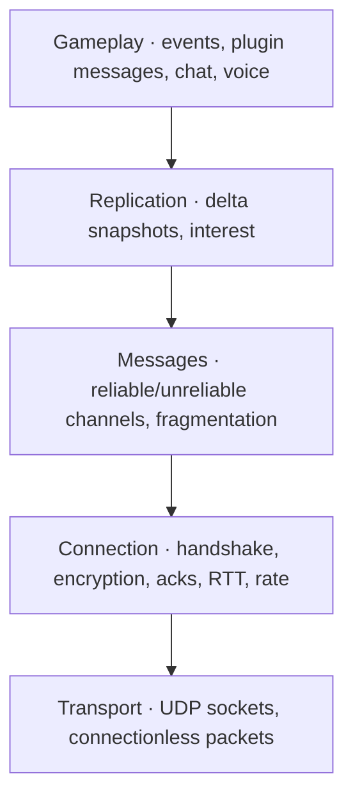
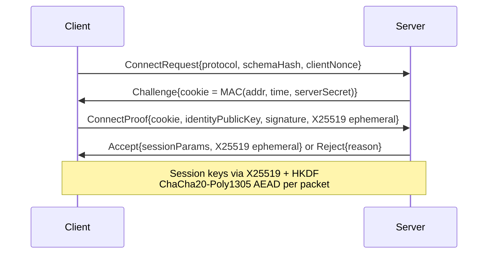

# 08 — Networking

> Decision recorded in [ADR-0008](adr/0008-own-network-protocol.md).

## 1. Goals

- **The same feel as the original:** movement and weapon prediction, interpolation and lag
  compensation with the same well-known cvars (`rate`, `cl_updaterate`, `cl_cmdrate`,
  `ex_interp`, `sv_unlag`…).
- **No network entity ceiling:** per-client interest management and budget, with priorities
  instead of a fixed limit of entities per packet.
- **Scale from 1 to 1024 players**, with parallel snapshot building.
- **Secure by default:** encrypted sessions, protection against spoofing and amplification,
  and every piece of input data validated.
- **Typed messages** of any size, including those defined by plugins.

## 2. Layers



## 3. Transport and connectionless packets

- UDP over IPv4 and IPv6, default port **27015** (configurable with `-port`).
- Packets starting with `0xFFFFFFFF` are **connectionless**, as in the original: A2S
  queries ([09](09-dedicated-server.md#5-a2s-queries-and-server-browser)), LAN *ping* and
  handshake start.
- Every reply to a connectionless packet is **smaller than or equal to** the request until
  the address is validated by a cookie, which prevents amplification.

## 4. Connection

### 4.1 Handshake



- **Stateless cookie:** the server allocates nothing before the client proves that it
  receives packets at the declared address.
- **Identity:** the player's Ed25519 key ([09 §7](09-dedicated-server.md#7-player-identity)).
- **Typed rejection** (`RejectReason`): `ServerFull`, `Banned{until}`, `BadPassword`,
  `ProtocolMismatch{server, client}`, `SchemaMismatch`, `IdentityInvalid`, `RateLimited`,
  `MissingLocalContent{source, files}` (the server requires a content source that the
  client lacks and that cannot be sent, [ADR-0015](adr/0015-free-content-and-optional-original-assets.md)).
- Encryption via libsodium. Each packet has a counter nonce, and replayed or out-of-window
  packets are dropped.

### 4.2 Reliability and rate

- A header with `sequence`, `ack` and `ackBits` (32 bits of history). Each packet
  acknowledges several previous ones without extra packets.
- RTT and jitter estimation (exponential moving average), loss per window.
- **Per-client rate:** the client's `rate` (bytes/s), bounded by `sv_minrate` and
  `sv_maxrate`. The snapshot and download budget derives from it.
- A safe default MTU of 1200 bytes of payload, with optional discovery
  (`net_mtu_discovery 1`).
- Timeout: `sv_timeout` and `cl_timeout`, as in the original.

## 5. Channels and messages

| Channel | Guarantees | Use |
|---------|------------|-----|
| `Unreliable` | None | Snapshots, voice |
| `ReliableOrdered` | Delivery and order | Console commands, chat, resource manifest, critical game events, reliable plugin messages |
| `ReliableUnordered` | Delivery | Resource download (fragments) |
| `UnreliableSequenced` | Drops old ones | High-frequency HUD updates from plugins |

### 5.1 Typed messages

```cpp
struct [[=nx::net::Message{.channel = nx::net::Channel::ReliableOrdered}]] RoundEnded {
    cs::RoundEndReason reason;
    cs::Team           winner;
    nx::Seconds        restartDelay;
};
```

- The serializer is **generated by reflection** from the struct, with quantization through
  annotations.
- Reading is always checked: `nx::net::BitReader` returns
  `nx::Result<T, DecodeError>` and never reads past the buffer. An invalid message causes a
  disconnect with a reason and a metric, never *undefined behavior*.
- **No historical user message ceiling:** reliable messages of any size are fragmented, up
  to `net_max_message_size` (default 1 MiB). Unreliable messages must fit in one packet.
  Excess yields `MessageError::TooLargeForChannel` on the sender, at development time.
- Plugins define their own messages in Rook ([15](15-mod-api.md#7-networking)) with the
  same guarantees.

## 6. Replication

### 6.1 Snapshots

- The server sends snapshots at `cl_updaterate` Hz, bounded by `sv_minupdaterate` and
  `sv_maxupdaterate`, never above `sv_tickrate`.
- Each snapshot is a **delta** against the last snapshot **acknowledged** by the client
  (*baseline*). Without a recent acknowledgment, the delta is against the map *baselines*.
- Per-field encoding, generated from the `[[=nx::net::Replicated{}]]` components: each
  field has a "changed" bit, a declared quantization and an appropriate encoding (varint,
  integer delta, quantized float, compressed angle).
- New entities carry the full state (or a delta against the *prefab* baseline). Removed
  entities are announced until acknowledged.
- **Field width follows the domain type, never the other way around.** Game counters
  (money, ammo, frags) are 32-bit integers encoded as varint or delta. Health and armor are
  `float` in the simulation (parity with the original's fractional damage) and reach the HUD
  as the displayed integer, computed by the original's rule, also as varint and without a
  ceiling. Fixed-bit quantization is only allowed for continuous quantities with a known
  physical range (position, angle, velocity) and must declare the range. A value outside
  the declared range yields an encoding error in development, never a silent *wrap* (the
  problem of health above 255 in the original HUD).

### 6.2 Interest management

An entity is **relevant** to a client when:

1. it is in the **PVS** from the client's point of view (or is always relevant, such as the
   game rules and scoreboards); **and**
2. it passes the gameplay visibility filters (team, spectator with `mp_forcecamera`, plugin
   rules); **and**
3. it is within `sv_relevance_distance` (optional, off by default).

Sounds use the **PAS** (*potentially audible set*). Owner data (ammo, money, inventory)
goes only to the owner and to their spectators (`Audience::Owner`).

### 6.3 Budget and priority

- Budget per snapshot = `rate / cl_updaterate` (capped by the channel).
- Each relevant entity accumulates priority with every snapshot it is not sent in
  (proximity × importance × time without an update). The highest-priority ones go in
  first.
- **There is no entity ceiling:** if the relevant set does not fit, the lowest-priority
  entities wait for the next snapshots, and client interpolation covers the gap. This
  produces the per-client `net_budget_overflow` metric, never a silent loss of entities.

### 6.4 Parallelism and scale

- Visibility and snapshot building run in a `parallelFor` **per client**, reading an
  immutable snapshot of the world at the end of the tick.
- The cost grows with `clients × relevant entities`. For hundreds of players, PVS and
  distance relevance is mandatory, and the server recommends (and logs) a
  `sv_maxupdaterate` suited to the player count.
- Stress goal: 1024 simulated clients on a large map, with a stable tick and degradation
  controlled only by the budget ([18](18-testing-and-quality.md)).

### 6.5 Anti-wallhack through relevance

As in the original, entities outside the PVS are not sent. An optional stricter mode
(`sv_occlusion 1`, future) uses server-side occlusion to avoid sending enemies that are
guaranteed to be invisible.

## 7. Client: prediction and interpolation

### 7.1 Prediction

- The local player is **predicted** with `cs.shared` (movement and weapons), equivalent to
  the original's `cl_lw 1`.
- On receiving the authoritative state, the client **reconciles**: it applies the server
  state and re-runs the usercmds not yet acknowledged.
- Small prediction errors are smoothed (`cl_smoothtime`). Large errors are applied
  immediately.
- The player's own weapon events (sound, *muzzle flash*, shell) are predicted and are
  **not** resent to them by the server, as the original does with events already run
  locally.

### 7.2 Interpolation

- Remote entities are interpolated between snapshots with a delay of `cl_interp`
  (`ex_interp` remains as an alias). In automatic mode, the delay is `1 / cl_updaterate`.
- An adaptive *jitter buffer* and limited extrapolation (`cl_extrapolate_max`) when
  snapshots are missing.

## 8. Lag compensation

- The server keeps each player's history of hitbox poses for up to `sv_maxunlag` seconds
  (a ring per player).
- When processing a shot, the targets are **rewound** to the instant the shooter saw:
  `command time − latency − interpolation`. The shot is tested against those poses, and
  the targets are restored afterwards.
- Preserved cvars: `sv_unlag`, `sv_maxunlag`, `sv_unlagpush`, and `cl_lc` on the client.
- Each target's pose is rebuilt in parallel jobs when there are several potential targets.

## 9. Voice

- **Opus** codec, sent on the unreliable channel.
- The server relays according to the rules: `sv_voiceenable`, `sv_alltalk`, the dead talk
  to the dead, per-player *mute* and plugin rules (e.g. proximity voice).
- On the client: `voice_enable`, `voice_scale`, `+voicerecord`, optional voice activation.

## 10. Versioning

- `ProtocolVersion` with major and minor. An incompatible change increments the major.
- **Schema hash:** a hash of every registered replicated component and message (engine,
  game and plugins). Since the server sends the client the code of `client`/`shared`
  plugins, the plugin schema always matches. A mismatch is a bug and yields
  `RejectReason::SchemaMismatch` with the diff.

## 11. Demos and spectators

- `record <name>` records the stream of already-decrypted messages received by the client
  into `.nxdem`. `playdemo` plays it back through the same code path as the connected
  client.
- `timedemo` for render benchmarking.
- **Spectator relay** (the modern equivalent of HLTV): a process that receives a single
  stream from the server and redistributes it with a configurable delay. Planned for M7.

## 12. Security

| Threat | Mitigation |
|--------|------------|
| Address spoofing | Stateless cookie in the handshake |
| Amplification | Connectionless replies ≤ request before validation |
| Packet replay | Counter nonce and anti-replay window |
| Malformed packets | Checked decoding and continuous *fuzzing* of the decoder |
| *Speedhack* | Validation of the `msec` sum per window |
| Command and chat *flood* | Per-client limits (`sv_max_commands_per_second`, chat antiflood) |
| Volumetric attacks | Outside the application's scope (host infrastructure) |

## 13. Typed errors

| Enum | Examples |
|------|----------|
| `TransportError` | `BindFailed`, `AddressInUse`, `SendFailed` |
| `HandshakeError` | `CookieInvalid`, `CookieExpired`, `SignatureInvalid` |
| `DecodeError` | `Truncated`, `ValueOutOfRange`, `UnknownMessage`, `UnknownComponent` |
| `MessageError` | `TooLargeForChannel`, `ReliableBufferFull` |
| `DisconnectReason` | `Timeout`, `Kicked{reason}`, `Banned`, `InconsistentFile`, `ProtocolViolation`, `ServerShutdown` |

## 14. Diagnostics

- `net_graph 1/2/3` (visual parity with the original), plus a detailed panel with loss,
  *choke*, RTT, jitter, bytes per category and entities per snapshot.
- `net_stats` on the server, per client.
- Network simulation in development: `net_fakelag`, `net_fakeloss`, `net_fakejitter`.
