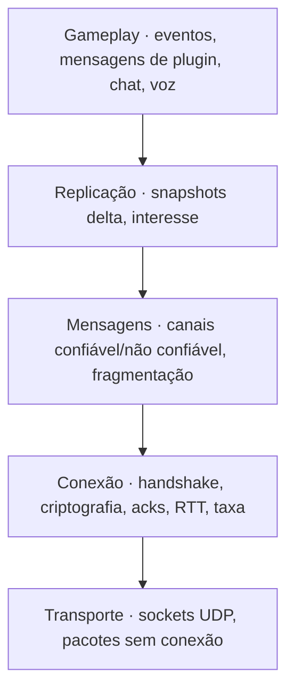
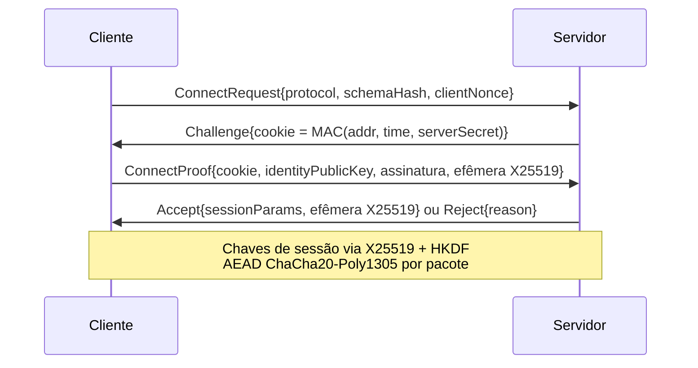

# 08 — Rede

> Decisão registrada em [ADR-0008](adr/0008-protocolo-de-rede-proprio.md).

## 1. Objetivos

- **Sensação idêntica ao original:** predição de movimento e armas, interpolação e
  compensação de lag com as mesmas cvars conhecidas (`rate`, `cl_updaterate`,
  `cl_cmdrate`, `ex_interp`, `sv_unlag`…).
- **Sem teto de entidades na rede:** gerenciamento de interesse e orçamento por cliente,
  com prioridades em vez de um limite fixo de entidades por pacote.
- **Escala de 1 a 1024 jogadores**, com montagem de snapshots em paralelo.
- **Seguro por padrão:** sessões criptografadas, proteção contra spoofing e amplificação,
  e todo dado de entrada validado.
- **Mensagens tipadas** de qualquer tamanho, inclusive as definidas por plugins.

## 2. Camadas



## 3. Transporte e pacotes sem conexão

- UDP sobre IPv4 e IPv6, porta padrão **27015** (configurável com `-port`).
- Pacotes iniciados por `0xFFFFFFFF` são **sem conexão**, como no original: consultas
  A2S ([09](09-servidor-dedicado.md#5-consultas-a2s-e-server-browser)), *ping* de LAN e
  início de handshake.
- Toda resposta a um pacote sem conexão é **menor ou igual** à requisição até que o
  endereço seja validado por cookie, o que impede amplificação.

## 4. Conexão

### 4.1 Handshake



- **Cookie sem estado:** o servidor não aloca nada antes de o cliente provar que recebe
  pacotes no endereço declarado.
- **Identidade:** chave Ed25519 do jogador ([09 §7](09-servidor-dedicado.md#7-identidade-de-jogadores)).
- **Rejeição tipada** (`RejectReason`): `ServerFull`, `Banned{until}`, `BadPassword`,
  `ProtocolMismatch{server, client}`, `SchemaMismatch`, `IdentityInvalid`, `RateLimited`.
- Criptografia via libsodium. Cada pacote tem nonce de contador, e pacotes repetidos ou
  fora da janela são descartados.

### 4.2 Confiabilidade e taxa

- Cabeçalho com `sequence`, `ack` e `ackBits` (32 bits de histórico). Cada pacote confirma
  vários anteriores sem pacotes extras.
- Estimativa de RTT e jitter (média móvel exponencial), perda por janela.
- **Taxa por cliente:** `rate` (bytes/s) do cliente, limitada por `sv_minrate` e
  `sv_maxrate`. O orçamento de snapshots e de download deriva dela.
- MTU segura padrão de 1200 bytes de payload, com descoberta opcional
  (`net_mtu_discovery 1`).
- Timeout: `sv_timeout` e `cl_timeout`, como no original.

## 5. Canais e mensagens

| Canal | Garantias | Uso |
|-------|-----------|-----|
| `Unreliable` | Nenhuma | Snapshots, voz |
| `ReliableOrdered` | Entrega e ordem | Comandos de console, chat, manifesto de recursos, eventos de jogo críticos, mensagens de plugin confiáveis |
| `ReliableUnordered` | Entrega | Download de recursos (fragmentos) |
| `UnreliableSequenced` | Descarta antigas | Atualizações de HUD de alta frequência de plugins |

### 5.1 Mensagens tipadas

```cpp
struct [[=nx::net::Message{.channel = nx::net::Channel::ReliableOrdered}]] RoundEnded {
    cs::RoundEndReason reason;
    cs::Team           winner;
    nx::Seconds        restartDelay;
};
```

- O serializador é **gerado por reflexão** a partir da struct, com quantização por
  anotações.
- A leitura é sempre verificada: `nx::net::BitReader` retorna
  `nx::Result<T, DecodeError>` e nunca lê além do buffer. Mensagem inválida gera
  desconexão com motivo e métrica, nunca *undefined behavior*.
- **Sem o teto histórico de mensagens de usuário:** mensagens confiáveis de qualquer
  tamanho são fragmentadas, até `net_max_message_size` (padrão 1 MiB). Mensagens não
  confiáveis precisam caber em um pacote. Excesso gera `MessageError::TooLargeForChannel`
  no remetente, em tempo de desenvolvimento.
- Plugins definem mensagens próprias em Rook ([15](15-api-de-mods.md#7-rede)) com as
  mesmas garantias.

## 6. Replicação

### 6.1 Snapshots

- O servidor envia snapshots a `cl_updaterate` Hz, limitado por `sv_minupdaterate` e
  `sv_maxupdaterate`, nunca acima de `sv_tickrate`.
- Cada snapshot é **delta** contra o último snapshot **confirmado** pelo cliente
  (*baseline*). Sem confirmação recente, o delta é contra as *baselines* do mapa.
- Codificação por campo, gerada dos componentes `[[=nx::net::Replicated{}]]`: cada campo
  tem bit de "mudou", quantização declarada e codificação apropriada (varint, delta de
  inteiro, float quantizado, ângulo comprimido).
- Entidades novas trazem o estado completo (ou delta contra a baseline do *prefab*).
  Entidades removidas são anunciadas até a confirmação.
- **Largura de campo segue o tipo de domínio, nunca o contrário.** Contadores de jogo
  (dinheiro, munição, frags) são inteiros de 32 bits codificados como varint ou delta.
  Vida e colete são `float` na simulação (paridade com o dano fracionário do original) e
  chegam ao HUD como o inteiro exibido, calculado pela regra do original, também em
  varint e sem teto. A quantização com bits fixos só é permitida em grandezas contínuas com faixa
  física conhecida (posição, ângulo, velocidade) e precisa declarar a faixa. Um valor fora
  da faixa declarada gera erro de codificação em desenvolvimento, nunca *wrap* silencioso
  (o problema da vida acima de 255 no HUD do original).

### 6.2 Gerenciamento de interesse

Uma entidade é **relevante** para um cliente quando:

1. está no **PVS** do ponto de vista do cliente (ou é sempre relevante, como regras do
   jogo e placares); **e**
2. passa nos filtros de visibilidade de jogo (time, espectador com `mp_forcecamera`,
   regras de plugins); **e**
3. está dentro de `sv_relevance_distance` (opcional, desligado por padrão).

Sons usam o **PAS** (*potentially audible set*). Dados de dono (munição, dinheiro,
inventário) vão só para o dono e para os espectadores dele (`Audience::Owner`).

### 6.3 Orçamento e prioridade

- Orçamento por snapshot = `rate / cl_updaterate` (com teto do canal).
- Cada entidade relevante acumula prioridade a cada snapshot sem envio
  (proximidade × importância × tempo sem atualização). As de maior prioridade entram
  primeiro.
- **Não há teto de entidades:** se o conjunto relevante não cabe, as menos prioritárias
  ficam para os próximos snapshots, e a interpolação do cliente cobre o intervalo. Isso
  gera a métrica `net_budget_overflow` por cliente, nunca a perda silenciosa de entidades.

### 6.4 Paralelismo e escala

- Visibilidade e montagem de snapshot rodam em `parallelFor` **por cliente**, lendo um
  snapshot imutável do mundo no fim do tick.
- O custo cresce com `clientes × entidades relevantes`. Para centenas de jogadores, a
  relevância por PVS e distância é obrigatória, e o servidor recomenda (e loga)
  `sv_maxupdaterate` adequado à quantidade de jogadores.
- Meta de estresse: 1024 clientes simulados em um mapa grande, com tick estável e
  degradação controlada só pelo orçamento ([18](18-testes-e-qualidade.md)).

### 6.5 Anti-wallhack por relevância

Assim como no original, entidades fora do PVS não são enviadas. Um modo opcional mais
estrito (`sv_occlusion 1`, futuro) usa oclusão no servidor para não enviar inimigos
garantidamente invisíveis.

## 7. Cliente: predição e interpolação

### 7.1 Predição

- O jogador local é **predito** com `cs.shared` (movimento e armas), equivalente ao
  `cl_lw 1` do original.
- Ao receber o estado autoritativo, o cliente **reconcilia**: aplica o estado do servidor
  e reexecuta os usercmds ainda não confirmados.
- Pequenos erros de predição são suavizados (`cl_smoothtime`). Grandes erros são
  aplicados imediatamente.
- Eventos de arma do próprio jogador (som, *muzzle flash*, cápsula) são preditos e **não**
  são reenviados pelo servidor para ele, como o original faz com eventos já executados
  localmente.

### 7.2 Interpolação

- Entidades remotas são interpoladas entre snapshots com atraso de `cl_interp`
  (`ex_interp` continua como alias). No modo automático, o atraso é `1 / cl_updaterate`.
- *Jitter buffer* adaptativo e extrapolação limitada (`cl_extrapolate_max`) quando
  faltam snapshots.

## 8. Compensação de lag

- O servidor guarda o histórico de poses de hitbox de cada jogador por até `sv_maxunlag`
  segundos (anel por jogador).
- Ao processar um tiro, os alvos são **rebobinados** para o instante que o atirador viu:
  `tempo do comando − latência − interpolação`. O tiro é testado contra essas poses, e os
  alvos são restaurados depois.
- Cvars preservadas: `sv_unlag`, `sv_maxunlag`, `sv_unlagpush`, e no cliente `cl_lc`.
- A pose de cada alvo é reconstruída em jobs paralelos quando há vários alvos potenciais.

## 9. Voz

- Codec **Opus**, enviado no canal não confiável.
- O servidor repassa segundo as regras: `sv_voiceenable`, `sv_alltalk`, mortos falam com
  mortos, *mute* por jogador e regras de plugins (ex.: voz por proximidade).
- No cliente: `voice_enable`, `voice_scale`, `+voicerecord`, ativação por voz opcional.

## 10. Versionamento

- `ProtocolVersion` com maior e menor. Mudança incompatível incrementa o maior.
- **Hash de esquema:** hash de todos os componentes replicados e mensagens registrados
  (engine, jogo e plugins). Como o servidor envia ao cliente o código de plugins
  `client`/`shared`, o esquema dos plugins sempre bate. Uma divergência é bug e gera
  `RejectReason::SchemaMismatch` com o diff.

## 11. Demos e espectadores

- `record <nome>` grava o fluxo de mensagens já decifradas recebido pelo cliente em
  `.nxdem`. `playdemo` o reproduz pelo mesmo caminho de código do cliente conectado.
- `timedemo` para benchmark de render.
- **Relay de espectadores** (equivalente moderno ao HLTV): processo que recebe um único
  fluxo do servidor e o redistribui com atraso configurável. Planejado para o M7.

## 12. Segurança

| Ameaça | Mitigação |
|--------|-----------|
| Spoofing de endereço | Cookie sem estado no handshake |
| Amplificação | Respostas sem conexão ≤ requisição antes da validação |
| Replay de pacotes | Nonce por contador e janela anti-replay |
| Pacotes malformados | Decodificação verificada e *fuzzing* contínuo do decodificador |
| *Speedhack* | Validação da soma de `msec` por janela |
| *Flood* de comandos e chat | Limites por cliente (`sv_max_commands_per_second`, antiflood de chat) |
| Ataques volumétricos | Fora do escopo da aplicação (infraestrutura do host) |

## 13. Erros tipados

| Enum | Exemplos |
|------|----------|
| `TransportError` | `BindFailed`, `AddressInUse`, `SendFailed` |
| `HandshakeError` | `CookieInvalid`, `CookieExpired`, `SignatureInvalid` |
| `DecodeError` | `Truncated`, `ValueOutOfRange`, `UnknownMessage`, `UnknownComponent` |
| `MessageError` | `TooLargeForChannel`, `ReliableBufferFull` |
| `DisconnectReason` | `Timeout`, `Kicked{reason}`, `Banned`, `InconsistentFile`, `ProtocolViolation`, `ServerShutdown` |

## 14. Diagnóstico

- `net_graph 1/2/3` (paridade visual com o original), mais um painel detalhado com perda,
  *choke*, RTT, jitter, bytes por categoria e entidades por snapshot.
- `net_stats` no servidor, por cliente.
- Simulação de rede em desenvolvimento: `net_fakelag`, `net_fakeloss`, `net_fakejitter`.
