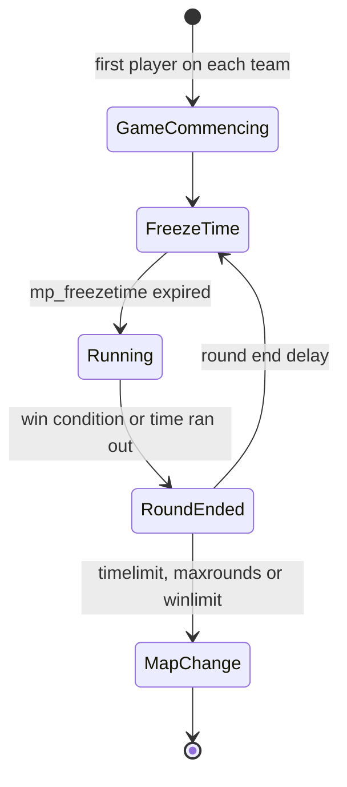

# 10 — Counter-Strike gameplay

## 1. Approach

- **Parity with Steam CS 1.6** (latest version) is the reference for everything in this
  document.
- Every tunable value (price, damage, time, speed) lives in **data** (`data/cstrike/`),
  with a validated schema and default values equal to the original's.
- Behaviors that are not simple numbers (spread formulas, recoil, the weapon state machine)
  are **code in `cs.shared`** parameterized by data.
- Each item has a **parity test** comparing against measurements of the original game
  ([18](18-testing-and-quality.md#parity-tests)). Values cited here as "reference" only
  become official after they are validated.
- Every relevant action is **hookable** by Rook plugins ([15](15-mod-api.md#5-hookable-actions)).

## 2. Teams and characters

| Team | Characters |
|------|------------|
| Terrorists | Phoenix Connexion, Elite Crew (L337 Krew), Arctic Avengers, Guerilla Warfare |
| Counter-Terrorists | Seal Team 6, GSG-9, SAS, GIGN |
| Spectator | — |
| VIP (`as_` maps) | VIP model |

- Team and character menus with the same options and keys as the original, including
  "auto-select".
- Rules: `mp_limitteams`, `mp_autoteambalance`, full team, team changes limited per round,
  `allow_spectators`.

## 3. Match and round flow



- **Freeze time** (`mp_freezetime`): players frozen, buying allowed.
- **Buy time** (`mp_buytime`), counted from the start of the round.
- **Round time** (`mp_roundtime`). The outcome when time runs out depends on the map type
  (e.g. CTs win on `de_` with no bomb planted).
- **Restart:** `sv_restart`/`sv_restartround <seconds>`.
- **End of match:** `mp_timelimit`, `mp_maxrounds`, `mp_winlimit`, with an intermission
  (`mp_chattime`) and the next map from `mapcycle.txt`.

### 3.1 Round end reasons

`enum class RoundEndReason` with parity with the original's reasons:

| Reason | Maps |
|--------|------|
| `TargetBombed` | `de_` |
| `BombDefused` | `de_` |
| `TargetSaved` (time ran out without a bomb) | `de_` |
| `AllHostagesRescued` | `cs_` |
| `HostagesNotRescued` (time ran out) | `cs_` |
| `VipEscaped` / `VipAssassinated` / `VipNotEscaped` | `as_` |
| `TerroristsEscaped` / `CTsPreventEscape` / `EscapingTerroristsNeutralized` / `TerroristsNotEscaped` | `es_` |
| `CTsWin` / `TerroristsWin` (elimination) | All |
| `RoundDraw` | All |
| `GameCommencing` | All |

## 4. Objectives by map type

| Prefix | Objective | Entities |
|--------|-----------|----------|
| `de_` | Plant and detonate the C4, or defuse it | `func_bomb_target`, `info_bomb_target`, `info_map_parameters` (bomb radius) |
| `cs_` | Rescue hostages | `hostage_entity`, `func_hostage_rescue`, `info_hostage_rescue` |
| `as_` | Escort the VIP | `info_vip_start`, `func_vip_safetyzone` |
| `es_` | Terrorists escape | `func_escapezone` |
| others (`fy_`, `aim_`, `awp_`…) | Elimination | — |

### 4.1 C4

- A random terrorist receives the C4 at the start of the round (the original's rules for
  when the carrier leaves or dies).
- Planting requires being in the zone, standing still on the ground and holding the button
  for the plant time.
- `mp_c4timer` timer, with accelerating beeps and a blinking light.
- Defuse takes less time with a kit, and is interrupted if the CT releases the button, moves
  or dies.
- Explosion with radius damage (`info_map_parameters`), screen shake and effects.

### 4.2 Hostages

- They follow the CT that "uses" them, with simple navigation and stopping rules.
- Penalties for damaging and killing hostages (`mp_hostagepenalty`, money).
- Rescue in a zone, with rewards for the team.

## 5. Map entities

Mandatory support so that **every official map** loads without warnings:

| Group | Entities |
|-------|----------|
| Spawn | `info_player_start` (CT), `info_player_deathmatch` (T), `info_vip_start` |
| Objectives | `func_bomb_target`, `info_bomb_target`, `func_hostage_rescue`, `info_hostage_rescue`, `hostage_entity`, `func_vip_safetyzone`, `func_escapezone`, `func_buyzone` |
| Configuration | `info_map_parameters`, `game_player_equip`, `player_weaponstrip`, `armoury_entity` |
| Brushes | `func_wall`, `func_wall_toggle`, `func_illusionary`, `func_breakable`, `func_pushable`, `func_ladder`, `func_water`, `func_conveyor`, `func_friction` |
| Movers | `func_door`, `func_door_rotating`, `func_button`, `func_rot_button`, `func_rotating`, `func_plat`, `func_train`, `func_tracktrain`, `func_vehicle`, `func_tank`, `path_corner`, `path_track` |
| Triggers | `trigger_multiple`, `trigger_once`, `trigger_hurt`, `trigger_push`, `trigger_teleport`, `trigger_gravity`, `trigger_camera`, `trigger_relay`, `multi_manager`, `multisource` |
| Environment | `ambient_generic`, `env_sound`, `env_sprite`, `env_glow`, `env_beam`, `env_laser`, `env_shake`, `env_fade`, `env_explosion`, `env_spark`, `env_render`, `env_bubbles`, `infodecal` |
| Game | `game_text`, `game_counter`, `game_end`, `game_score` |
| Light | `light`, `light_spot`, `light_environment` (animated styles at runtime) |

The complete list, with the *keyvalues* schema, will live in `data/cstrike/entities.toml`, and
the dedicated parity runner will load every official map and fail on an unknown `classname` or
key (planned, [18](18-testing-and-quality.md#parity-tests)). What the file holds today is in
[03 §11](03-ecs.md#11-prefabs-and-map-entities).

## 6. Economy

- Values in `data/cstrike/economy.toml`. References: starting money `mp_startmoney` (800),
  money cap (16000), default reward per kill (300). The others (win by reason, consecutive
  loss bonus, plant, defuse, hostages and *teamkill* penalties) are listed in the file and
  need to be surveyed and validated against the original.
- Money is `nx::Money` (`nx.core`) with saturating arithmetic up to the cap
  (`nx::addSaturated` plus `clamp`), with no overflow.
- Every transaction goes through a single auditable function
  (`Economy::apply(player, MoneyTransaction{reason, amount})`), which raises the
  `MoneyChanged` event for the HUD, the log and plugins.

## 7. Weapons and equipment

### 7.1 Catalog

| Category | Weapon | Team |
|----------|--------|------|
| Knife | Knife | Both |
| Pistols | Glock 18 | Both (T default) |
| | USP .45 | Both (CT default) |
| | P228 | Both |
| | Desert Eagle | Both |
| | Dual Elites | T |
| | Five-SeveN | CT |
| Shotguns | M3 | Both |
| | XM1014 | Both |
| SMGs | MAC-10 | T |
| | TMP | CT |
| | MP5 Navy | Both |
| | UMP45 | Both |
| | P90 | Both |
| Rifles | Galil | T |
| | FAMAS | CT |
| | AK-47 | T |
| | M4A1 | CT |
| | SG 552 | T |
| | AUG | CT |
| Snipers | Scout | Both |
| | AWP | Both |
| | G3SG1 | T |
| | SG 550 | CT |
| Machine gun | M249 | Both |
| Grenades | HE, Flashbang (up to 2), Smoke | Both |
| Equipment | Kevlar, Kevlar + Helmet, Night vision | Both |
| | Defuse kit, Tactical shield | CT |
| Objective | C4 | T (handed out, not buyable) |

### 7.2 Weapon data (`data/cstrike/weapons/<weapon>.toml`, `data/cstrike/ammo.toml`)

Each weapon is a file named after its `id`, read into `cs::Weapon` (`cs.shared:weapons`); the
kinds of ammo are `data/cstrike/ammo.toml`, read into `cs::AmmoTypes`. The values are ReGameDLL_CS's
([20 §3](20-legal-and-licensing.md#3-clean-room)), and `csSharedTests` pins them.

```toml
id        = "ak47"             # also the file's name, and the buy commands' name
classname = "weapon_ak47"
slot      = "primary"          # primary, secondary, knife, grenade, bomb: the HUD's 1 to 5
position  = 1                  # the order of the slot's weapons in the HUD's weapon menu
weight    = 25                 # the game picks the heaviest when it picks a weapon for a player
maxSpeed  = 221.0              # its holder's, in units per second

[purchase]                     # absent: not sold (the knife)
buyers = "terrorists"          # terrorists, counterTerrorists, everyone
price  = 2500

[magazine]                     # absent: no ammo (the knife)
ammo     = "762Nato"           # an id of ammo.toml
clipSize = 30

[models]
view            = "models/v_ak47.mdl"
player          = "models/p_ak47.mdl"
playerAnimation = "ak47"       # the end of the player model's sequences: "ref_aim_ak47"
viewHand        = "left"       # the view model's hand: drawn mirrored for a player of the other

[view]                         # the view model's sequences, by their number in it
drawSequences  = [2]           # one at random as it is drawn
idles          = [{ sequence = 0, wait = 20.0, share = 1.0 }] # by their shares, after each wait
idlesWhenEmpty = true          # the pistols do not idle with an empty clip

[firing]                       # absent: it fires nothing (the knife, until its attacks)
cycle          = 0.0955        # seconds from a shot to the next
isAutomatic    = true          # holding the button fires again; else once a press
idleAfterShot  = 1.9
shootSequences = [3, 4, 5]     # one at random; lastShotSequence: the clip's last round's

[firing.accuracy]              # initial, and burst (rifles) or paced (pistols)
initial = 0.2
burst   = { divisor = 200, offset = 0.35, maximum = 1.25 } # shots³ / 200 in whole numbers + 0.35

[firing.spread]                # base + scale × inaccuracy (the accuracy, or 1 less it when paced)
movingAbove = 140.0            # in the air, else moving faster, else ducked (when given), else standing
air         = { base = 0.04, scale = 0.4 }
moving      = { base = 0.04, scale = 0.07 }
standing    = { base = 0.0, scale = 0.0275 }

[firing.recoil.kicks]          # KickBack's seven numbers, by movement; or `punch`, up alone
standing = { upBase = 1.0, lateralBase = 0.375, upModifier = 0.175, lateralModifier = 0.0375, upMax = 5.75, lateralMax = 1.75, directionChange = 8 }
# moving, air and ducked likewise

[reload]
time      = 2.45
sequences = [1]
```

```toml
[[ammo]]
id         = "762Nato"         # the original's name
maxCarried = 90                # rounds a player carries besides the clips'
boxPrice   = 80
boxRounds  = 30
```

The catalog (`cs::WeaponCatalog`) refuses an id or a classname twice, two weapons at one position
of a slot, a weapon whose ammo `ammo.toml` lacks, a view without a draw sequence or an idle, an
idle that waits no time, or idles whose shares do not add up to 1, and firing or a reload without a
magazine, a shoot or reload sequence, a cycle, or one accuracy.

What a player of each team spawns with is `data/cstrike/loadouts.toml` (`cs::Loadouts`, the
original's `GiveDefaultItems`): the terrorists a knife, a Glock 18 and 40 rounds of 9mm, the
counter-terrorists a knife, a USP and 24 rounds of 45ACP, each weapon with a clip's worth.

**Today:** the knife, the Glock 18, the USP, the AK-47 and the M4A1, how the guns fire and are
reloaded, and the loadouts. Each next part of the weapons brings the data its code reads: damage,
range modifier and penetration, the special modes (silencer, burst: the USP and the M4A1 are without
their silencer today), the knife's attacks, and the armor ratio. Which shoot sequence a gun's client
plays is the project's choice until it is measured on the original.

### 7.3 Behaviors

- **Weapon state machine:** deploy, idle, primary/secondary attack, reload (including the
  shell-by-shell shotgun reload), holster, drop. The timings come from the model's sequences
  and from the data.
  **Today** (`cs.shared:inventory`, `cs::Inventory`, the same for the server and the client's
  prediction): a player is given weapons with a clip's worth of rounds (`AddPlayerItem`; a weapon
  it has gives its rounds alone) and carries rounds up to each kind's most (`GiveAmmo`); it draws
  the first weapon given, and one heavier than the one it holds while `_cl_autowepswitch` is on
  (`FShouldSwitchWeapon`). A command's selection draws the weapon (`SelectItem`), the one held
  becoming the one before, which `lastinv` selects (`SelectLastItem`: else the newest of the first
  of the primary, secondary and knife slots whose newest is not held). Drawing plays a draw
  sequence, and the weapon idles 1.5 seconds later (`DefaultDeploy`), then after each idle's wait
  (`WeaponIdle`), the pistols not with an empty clip. The player runs at the speed of the weapon it
  holds, 240 with none (`ResetMaxSpeed`). `next` gives the player its team's loadout, its team
  that of the spawn it starts at, and selects with `weapon_<name>` and `lastinv`; the slot keys
  and the weapon menu come with the HUD's.
  Once a command has moved the player, the weapon held runs its frame (`ItemPostFrame`): nothing
  while it is being drawn (0.75 seconds) or reloaded; a reload over fills the clip from what the
  player carries; `+attack` fires it when its cycle allows (once a press for a gun that is not
  automatic, a click and 0.2 seconds on an empty clip), `+reload` reloads it (its accuracy back to
  the initial, a rifle's burst forgotten); with no fire button down a rifle's burst wanes (kept
  0.4 seconds, then a shot every 0.0225) and a pistol's is forgotten, an empty clip is reloaded,
  else the weapon idles. The timers are the original's: seconds set as an event happens and counted
  down in float by each command's frame time once its frame is over, so a delay lasts as many
  commands as the original's (0.15 seconds, 16 commands at 100 a second; 0.75, 76). Drawing
  another weapon stops a reload.
- **Shots** (`cs::Shot`, today hitting nothing): from the eye, along the view turned by the punch,
  strayed by the spread at random, each way the sum of two even draws from the command number's
  `spread` stream (`FireBullets3`).
- **Spread:** a per-weapon function reproducing the original, depending on movement, being
  in the air, crouching, zoom and accumulated accuracy.
  **Today:** the data's terms (section 7.2), of the accuracy before the shot changes it: a burst's
  shots cubed over its divisor in whole numbers, as the original divides them (the AK-47's 0.35 up
  to the fifth shot, 1.25 from the sixth); a paced one losing (threshold less the time since the
  last shot) times its rate a shot.
- **Recoil:** *punch angle* and accumulation over consecutive shots, with recovery.
  **Today:** the rifles' `KickBack` (moving at all, else in the air, else ducked, else standing;
  its side turned over once in `directionChange` + 1 shots), the USP's 2 degrees up; the punch
  drops back in the movement (`PM_DropPunchAngle`) and turns the view `next` draws.
- **Special modes:** burst (Glock, FAMAS), silencer (USP, M4A1, with different damage and
  sound), one- or two-level zoom, shield with pistols.
- **Penetration:** depends on the weapon's power, the distance and the surface material
  (`materials.txt`).
- **Grenades:** bounce physics, detonation time, flashbang blindness by angle and distance,
  smoke with the original's duration and volume.
- **Knife:** quick slash and heavy stab, with a multiplier from behind.

### 7.4 Damage

- *Hitgroups* with multipliers (head, chest, stomach, arms, legs) in
  `data/cstrike/hitGroups.toml`.
- Vest and helmet absorb according to the weapon's `armorRatio`.
- Damage falloff by distance (`rangeModifier`).
- Friendly fire with `mp_friendlyfire` and the penalty rules (`mp_tkpunish`).
- All damage goes through the hookable `TakeDamage` action ([15](15-mod-api.md#5-hookable-actions)).

## 8. Buying

- Buy zones (`func_buyzone`, or automatic ones at the spawn when the map does not define
  any), buy time and `info_map_parameters` restrictions.
- **Classic menu** by keys (1 to 8, with submenus) and a **VGUI menu** with the same options.
- The original's **buy commands**: `ak47`, `m4a1`, `vesthelm`, `defuser`, `hegren`,
  `flash`, `sgren`, `buyammo1`, `buyammo2`, `primammo`, `secammo`, `nvgs`, `shield` etc.
- **`autobuy`/`rebuy`** with `cl_autobuy` and `cl_rebuy`.
- Every purchase goes through the hookable `BuyItem` action.

## 9. Communication

- **Radio:** `radio1`, `radio2`, `radio3` menus and direct commands (`coverme`,
  `takepoint`, `holdpos`, `regroup`, `followme`, `takingfire`, `go`, `fallback`,
  `sticktog`, `getinpos`, `stormfront`, `report`, `roger`, `enemyspot`, `needbackup`,
  `sectorclear`, `inposition`, `reportingin`, `getout`, `negative`, `enemydown`), with an
  icon over the player and a sound.
- **Chat:** `say`, `say_team`, the dead only talk to the dead, `*DEAD*` and `(Team)`
  prefixes.
- **Voice:** [08 §9](08-networking.md#9-voice).
- **Sprays:** the player's `tempdecal.wad`, sent to the server and distributed, limited by
  `decalfrequency`.

## 10. Spectator

- Modes: free camera, *chase*, first person, *overview* (2D map) and
  *picture-in-picture*.
- Restrictions: `mp_forcecamera`, `mp_forcechasecam`, `mp_fadetoblack`.

## 11. Bots (milestone M7)

- Bots with behavior equivalent to the official CS 1.6 bots, on a navigation mesh (with
  import of existing `.nav` files).
- Familiar commands and cvars: `bot_add`, `bot_add_t`, `bot_add_ct`, `bot_kick`,
  `bot_quota`, `bot_difficulty`, `bot_chatter`.
- Bots use the same intent API as players (usercmds), with no gameplay shortcuts.

## 12. Data organization

The planned layout; today `entities.toml`
([03 §11](03-ecs.md#11-prefabs-and-map-entities)), `ammo.toml` and `weapons/` (section 7.2) exist. The hull sizes are not data: `cs.shared` holds
them as constants ([07 §3.3](07-simulation-and-physics.md#33-hulls)).

```
data/cstrike/
├── cvars.toml          # all game cvars: name, type, default, range, flags
├── economy.toml
├── hitGroups.toml
├── movement.toml       # derived constants not exposed as cvars
├── entities.toml       # classname -> prefab + keyvalue schema
├── teams.toml          # teams, characters, models
├── ammo.toml           # kinds of ammo: carried, box price and rounds
├── weapons/
│   ├── ak47.toml
│   └── ...
├── equipment.toml
├── buyMenu.toml        # menu structure and key bindings
└── radio.toml          # radio commands, menus, sentences
```

Plugins can **override** this data through the API (e.g. change a weapon's price) and
**add** new data (weapons, teams, entities), always with schema validation.
