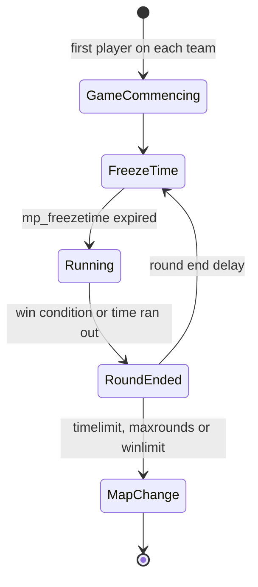

# 10 — Counter-Strike gameplay

## 1. Approach

- **Parity with Steam CS 1.6** (latest version) is the reference for everything in this
  document.
- Every tunable value (price, damage, time, speed) lives in **data** (`data/cstrike/`),
  with a validated schema and default values equal to the original's.
- Behaviors that are not simple numbers (spread formulas, recoil, the weapon state machine)
  are **code in `cs.shared`** parameterized by data.
- Each item has a **parity test** comparing against measurements of the original game
  ([18](18-testing-and-quality.md#parity-tests)). Values cited here as "reference" only
  become official after they are validated.
- Every relevant action is **hookable** by Rook plugins ([15](15-mod-api.md#5-hookable-actions)).

## 2. Teams and characters

| Team | Characters |
|------|------------|
| Terrorists | Phoenix Connexion, Elite Crew (L337 Krew), Arctic Avengers, Guerilla Warfare |
| Counter-Terrorists | Seal Team 6, GSG-9, SAS, GIGN |
| Spectator | — |
| VIP (`as_` maps) | VIP model |

- Team and character menus with the same options and keys as the original, including
  "auto-select".
- Rules: `mp_limitteams`, `mp_autoteambalance`, full team, team changes limited per round,
  `allow_spectators`.

## 3. Match and round flow



- **Freeze time** (`mp_freezetime`): players frozen, buying allowed.
- **Buy time** (`mp_buytime`), counted from the start of the round.
- **Round time** (`mp_roundtime`). The outcome when time runs out depends on the map type
  (e.g. CTs win on `de_` with no bomb planted).
- **Restart:** `sv_restart`/`sv_restartround <seconds>`.
- **End of match:** `mp_timelimit`, `mp_maxrounds`, `mp_winlimit`, with an intermission
  (`mp_chattime`) and the next map from `mapcycle.txt`.

**Today** (`cs.shared:rounds`, `cs::Rounds`, as ReGameDLL_CS's `CHalfLifeMultiplay` plays them,
GPL, consulted: [20 §3](20-legal-and-licensing.md#3-clean-room)): a map's rounds start as it starts, each
frozen for `mp_freezetime` (the first two seconds longer), its players at 1 unit a second at most
(`cs::kFreezeSpeed`) and their `+attack` held back (`+attack2` still switches and stabs), then
running for `mp_roundtime`, both read as the round starts and cut to whole seconds. A round whose
time runs out ends by what its map is played for (`cs::mapObjectivesOf`: the classes of its
entities), the first of a bomb target (`TargetSaved`), hostages (`HostagesNotRescued`), an escape
zone (`TerroristsNotEscaped`) and a VIP safety zone (`VipNotEscaped`); the rounds of a map played
for none run on. The next round starts five seconds after the end. `sv_restartround`, else
`sv_restart`, read once a second, restarts the game that many seconds later, the round playing on
until then (or until five seconds after it ends): the players spawn as they joined, with
`mp_startmoney`, no armor and their team's loadout alone (`cs::Inventory::removeAll`). As a round
starts, the local game's player spawns again at its team's next spawn point (`cs::spawnPointsOf`,
as `EntSelectSpawnPoint` takes them in turn), one unit above it, turned the way it faces, its
health whole, keeping its armor, weapons and money. The HUD counts down the whole seconds the game
told it as the player spawned and as the freeze ended ([12 §3.2](12-ui-hud-and-console.md#32-scale-and-resolution)).
Each end pays the teams as [§6](#6-economy) says. Game Commencing, the ends by elimination and by
the objectives, the teams' scores, buying and the end of the match come next.

### 3.1 Round end reasons

`enum class RoundEndReason` with parity with the original's reasons (today the four ends of a time
run out, with the team each is won by: `cs::winnerOf`):

| Reason | Maps |
|--------|------|
| `TargetBombed` | `de_` |
| `BombDefused` | `de_` |
| `TargetSaved` (time ran out without a bomb) | `de_` |
| `AllHostagesRescued` | `cs_` |
| `HostagesNotRescued` (time ran out) | `cs_` |
| `VipEscaped` / `VipAssassinated` / `VipNotEscaped` | `as_` |
| `TerroristsEscaped` / `CTsPreventEscape` / `EscapingTerroristsNeutralized` / `TerroristsNotEscaped` | `es_` |
| `CTsWin` / `TerroristsWin` (elimination) | All |
| `RoundDraw` | All |
| `GameCommencing` | All |

## 4. Objectives by map type

| Prefix | Objective | Entities |
|--------|-----------|----------|
| `de_` | Plant and detonate the C4, or defuse it | `func_bomb_target`, `info_bomb_target`, `info_map_parameters` (bomb radius) |
| `cs_` | Rescue hostages | `hostage_entity`, `func_hostage_rescue`, `info_hostage_rescue` |
| `as_` | Escort the VIP | `info_vip_start`, `func_vip_safetyzone` |
| `es_` | Terrorists escape | `func_escapezone` |
| others (`fy_`, `aim_`, `awp_`…) | Elimination | — |

### 4.1 C4

- A random terrorist receives the C4 at the start of the round (the original's rules for
  when the carrier leaves or dies).
- Planting requires being in the zone, standing still on the ground and holding the button
  for the plant time.
- `mp_c4timer` timer, with accelerating beeps and a blinking light.
- Defuse takes less time with a kit, and is interrupted if the CT releases the button, moves
  or dies.
- Explosion with radius damage (`info_map_parameters`), screen shake and effects.

### 4.2 Hostages

- They follow the CT that "uses" them, with simple navigation and stopping rules.
- Penalties for damaging and killing hostages (`mp_hostagepenalty`, money).
- Rescue in a zone, with rewards for the team.

## 5. Map entities

Mandatory support so that **every official map** loads without warnings:

| Group | Entities |
|-------|----------|
| Spawn | `info_player_start` (CT), `info_player_deathmatch` (T), `info_vip_start` |
| Objectives | `func_bomb_target`, `info_bomb_target`, `func_hostage_rescue`, `info_hostage_rescue`, `hostage_entity`, `func_vip_safetyzone`, `func_escapezone`, `func_buyzone` |
| Configuration | `info_map_parameters`, `game_player_equip`, `player_weaponstrip`, `armoury_entity` |
| Brushes | `func_wall`, `func_wall_toggle`, `func_illusionary`, `func_breakable`, `func_pushable`, `func_ladder`, `func_water`, `func_conveyor`, `func_friction` |
| Movers | `func_door`, `func_door_rotating`, `func_button`, `func_rot_button`, `func_rotating`, `func_plat`, `func_train`, `func_tracktrain`, `func_vehicle`, `func_tank`, `path_corner`, `path_track` |
| Triggers | `trigger_multiple`, `trigger_once`, `trigger_hurt`, `trigger_push`, `trigger_teleport`, `trigger_gravity`, `trigger_camera`, `trigger_relay`, `multi_manager`, `multisource` |
| Environment | `ambient_generic`, `env_sound`, `env_sprite`, `env_glow`, `env_beam`, `env_laser`, `env_shake`, `env_fade`, `env_explosion`, `env_spark`, `env_render`, `env_bubbles`, `infodecal` |
| Game | `game_text`, `game_counter`, `game_end`, `game_score` |
| Light | `light`, `light_spot`, `light_environment` (animated styles at runtime) |

The complete list, with the *keyvalues* schema, will live in `data/cstrike/entities.toml`, and
the dedicated parity runner will load every official map and fail on an unknown `classname` or
key (planned, [18](18-testing-and-quality.md#parity-tests)). What the file holds today is in
[03 §11](03-ecs.md#11-prefabs-and-map-entities).

## 6. Economy

- Values in `data/cstrike/economy.toml`. References: starting money `mp_startmoney` (800),
  money cap (16000), default reward per kill (300). The others (win by reason, consecutive
  loss bonus, plant, defuse, hostages and *teamkill* penalties) are listed in the file as their
  rules come, surveyed against the original.
- Money is `nx::Money` (`nx.core`) with saturating arithmetic up to the cap
  (`nx::addSaturated` plus `clamp`), with no overflow.
- Every transaction goes through a single auditable function
  (`Economy::apply(player, MoneyTransaction{reason, amount})`), which raises the
  `MoneyChanged` event for the HUD, the log and plugins.

**Today** (`cs.shared:economy`, `data/cstrike/economy.toml`, ReGameDLL_CS's values and rules):
the winners of a round get its end's money (`roundEnds`: 3250 for a target saved, hostages not
rescued or the VIP not escaped, nothing for terrorists not escaped) and, as the next round starts,
150 for each hostage still held while the sum is below 2000; the losers get the loser bonus, 1400
as a game starts, 500 more each round while a team has lost more than once in a row up to 3400,
1500 once a team wins after such a streak, never to the terrorists of a map with an escape zone
(`cs::TeamAccounts`). As a round starts each player gets its team's account but those alive on the
losing side of an end that does not pay them (a target saved, hostages not rescued); a player's
money is held from none to 16000 (`cs::addMoney`, `kMostMoney`); a restarted game starts the
accounts, the losses and the bonus over. The local game's player is paid so. The single auditable
function and its event come with their first consumers (the HUD's flash of a changed number,
plugins); the kills', the bomb's and the hostages' rescue money come with them.

## 7. Weapons and equipment

### 7.1 Catalog

| Category | Weapon | Team |
|----------|--------|------|
| Knife | Knife | Both |
| Pistols | Glock 18 | Both (T default) |
| | USP .45 | Both (CT default) |
| | P228 | Both |
| | Desert Eagle | Both |
| | Dual Elites | T |
| | Five-SeveN | CT |
| Shotguns | M3 | Both |
| | XM1014 | Both |
| SMGs | MAC-10 | T |
| | TMP | CT |
| | MP5 Navy | Both |
| | UMP45 | Both |
| | P90 | Both |
| Rifles | Galil | T |
| | FAMAS | CT |
| | AK-47 | T |
| | M4A1 | CT |
| | SG 552 | T |
| | AUG | CT |
| Snipers | Scout | Both |
| | AWP | Both |
| | G3SG1 | T |
| | SG 550 | CT |
| Machine gun | M249 | Both |
| Grenades | HE, Flashbang (up to 2), Smoke | Both |
| Equipment | Kevlar, Kevlar + Helmet, Night vision | Both |
| | Defuse kit, Tactical shield | CT |
| Objective | C4 | T (handed out, not buyable) |

### 7.2 Weapon data (`data/cstrike/weapons/<weapon>.toml`, `data/cstrike/ammo.toml`)

Each weapon is a file named after its `id`, read into `cs::Weapon` (`cs.shared:weapons`); the
kinds of ammo are `data/cstrike/ammo.toml`, read into `cs::AmmoTypes`. The values are ReGameDLL_CS's
([20 §3](20-legal-and-licensing.md#3-clean-room)), and `csSharedTests` pins them.

```toml
id        = "ak47"             # also the file's name, and the buy commands' name
classname = "weapon_ak47"
name      = "CV-47"            # what the game shows it as: the original's buy menu's
slot      = "primary"          # primary, secondary, knife, grenade, bomb: the HUD's 1 to 5
position  = 1                  # the order of the slot's weapons in the HUD's weapon menu
weight    = 25                 # the game picks the heaviest when it picks a weapon for a player
maxSpeed  = 221.0              # its holder's, in units per second

[purchase]                     # absent: not sold (the knife)
buyers = "terrorists"          # terrorists, counterTerrorists, everyone
price  = 2500

[magazine]                     # absent: no ammo (the knife)
ammo     = "762Nato"           # an id of ammo.toml
clipSize = 30

[models]
view            = "models/v_ak47.mdl"
player          = "models/p_ak47.mdl"
playerAnimation = "ak47"       # the end of the player model's sequences: "ref_aim_ak47"
viewHand        = "left"       # the view model's hand: drawn mirrored for a player of the other

[view]                         # the view model's sequences and static appearance
drawSequences  = [2]           # one at random as it is drawn
idles          = [{ sequence = 0, wait = 20.0, share = 1.0 }] # by their shares, after each wait
idlesWhenEmpty = true          # the pistols do not idle with an empty clip
skin           = 0             # optional, zero-based skin family; omitted: the first
bodyChoices    = []            # optional, zero-based choice by body-part index; omitted parts: the first

[firing]                       # absent: it fires nothing (the knife, until its attacks)
cycle          = 0.0955        # seconds from a shot to the next
isAutomatic    = true          # holding the button fires again; else once a press
reach          = 8192.0        # how far its rounds go (FireBullets3's distance)
idleAfterShot  = 1.9
shootSequences = [3, 4, 5]     # one at random; lastShotSequence: the clip's last round's

[firing.accuracy]              # initial, and burst (rifles) or paced (pistols)
initial = 0.2
burst   = { divisor = 200, offset = 0.35, maximum = 1.25 } # shots³ / 200 in whole numbers + 0.35

[firing.spread]                # base + scale × inaccuracy (the accuracy, or 1 less it when paced)
movingAbove = 140.0            # in the air, else moving faster, else ducked (when given), else standing
air         = { base = 0.04, scale = 0.4 }
moving      = { base = 0.04, scale = 0.07 }
standing    = { base = 0.0, scale = 0.0275 }

[firing.recoil.kicks]          # KickBack's seven numbers, by movement; or `punch`, up alone
standing = { upBase = 1.0, lateralBase = 0.375, upModifier = 0.175, lateralModifier = 0.0375, upMax = 5.75, lateralMax = 1.75, directionChange = 8 }
# moving, air and ducked likewise

[reload]
time      = 2.45
sequences = [1]
```

A weapon `+attack2` switches has an `[alternate]` (the USP's and the M4A1's silencers, the
Glock's burst): its `switchTime`, the view model's `onSequence` and `offSequence` (a switch that
plays them also holds the weapon's fire and idle that long), and the `view`, `firing` and `reload`
it has while on, the weapon's own where it gives none. A firing's `followUps` are the rounds a shot
fires after it on its own, one a weapon frame, each strayed by their `spread` (the Glock's burst:
`{ rounds = 2, spread = 0.05 }`).

The main `[view]` may declare a fixed appearance with `skin` and `bodyChoices`. They bind to the
loaded MDL's skin families (from its `*T.mdl` when separate) and body parts; unavailable indexes,
choices or extra body-part entries fail with `ViewModelError::NoAppearance`, rather than falling
back to a different appearance. These values stay fixed during the weapon's alternate mode.
`[alternate.view]` may change its sequences but cannot declare either appearance field, including
an explicit `skin = 0` or `bodyChoices = []`. This is static presentation data, for offline and
live rendering alike; it does not implement charge, transformation or other weapon state.

The main `[view]` may also style the weapon's muzzle flashes (`cs::MuzzleFlashLook`). Its view
model's flash events say where and when a flash shows, and what it looks like, the original's or
Counter-Strike Online's way ([05 §9](05-rendering.md#9-studio-models-and-gpu-skinning)); each value
given here replaces the events' one, the others stay theirs, so that one value alone is enough:

```toml
[view.muzzleFlash]             # optional; the Drakar III's, over its events' #I341 S0.16 F0 P30 T999
sprite     = "sprites/muzzleflash341.spr" # any sprite: SPR v2, or Counter-Strike Online's v3
scale      = 0.16              # times the sprite's size
firstFrame = 0                 # the original's events show one at random
frameRate  = 30.0              # played once at this rate; 0 holds its first frame
time       = 0.4               # it shows this long at most: less when its last frame is played
roll       = 0.0               # rolled at random by a whole number of degrees up to this
rollRate   = 60.0              # degrees a second it turns, counter-clockwise; the events' R times their P
brightness = 1.5               # its colors times this, as the original adds them: beyond 1, on to white
light      = { color = [3000.0, 1800.0, 600.0], reach = 96.0, time = 0.06 } # enhanced look: on the weapon in hand
```

A flash's `light` is its light at a unit's distance in linear light, as the enhanced look's lights
of models have it (the key light of the weapon in hand is 4200, 3900 and 3500, reaching 256),
dimming to nothing over its `time`. `[alternate.view]` cannot declare `muzzleFlash` either: the
flashes of both modes are those of the view model's own events, styled alike. As any value, it is
set as the game runs: `set_weapon_var DrakarIII view.muzzleFlash.brightness 6`; the client reads
the sprite a style names with the view model, before a frame shows it. Fired in the running game, a
weapon's flash is tuned by eye: `view.muzzleFlash.rollRate`, `scale` and `brightness` set from the
console show on the next shot.

A melee weapon has `[melee.slash]` (`+attack`) and `[melee.stab]` (`+attack2`): each its `reach`,
its `missSequences` and `hitSequences`, played in turn an attack after another, how long a miss
and a hit hold `+attack` and `+attack2` (`miss = { primary = 0.35, secondary = 0.5 }`), and
`idleAfter` (absent: the idle stays as it was, as the original's stab leaves it).

A weapon's sounds are `cs::GameSound` tables (`files`, one at random; `channel`; `volume`; and an
optional `pitch = { least, most }` in hundredths): a view's `drawSound` (the knife's Deploy), a
firing's `sound`, as each round fires, and `emptySound`, as it clicks empty, and a melee attack's
`missSound` and `hitSound` (on the world; flesh comes with the players to meet). The view model's
own sounds (reloads, draws, silencers) are its sequences' events and need no data
([11 §2](11-audio.md#2-architecture)).

```toml
[[ammo]]
id         = "762Nato"         # the original's name
maxCarried = 90                # rounds a player carries besides the clips'
boxPrice   = 80
boxRounds  = 30
picture    = { sprite = "sprites/640hud7.spr", x = 72, y = 72, width = 24, height = 24 } # the HUD's
```

A kind of ammo's `picture` is the one the HUD shows beside its rounds: the `ammo` entry the
original's weapon lists (`sprites/weapon_<name>.txt`) give each weapon that fires it, the same for
every weapon of a kind, read once into the data, so that the HUD reads no weapon's list and a weapon
made as the game runs shows its ammo as the game's own do.

The catalog (`cs::WeaponCatalog`) refuses an id (in any case) or a classname twice, two weapons at
one position of a slot, a weapon without a name or whose ammo `ammo.toml` lacks, a view without a
draw sequence or an idle, an idle that waits no time, or idles whose shares do not add up to 1, and
firing or a reload without a magazine, a shoot or reload sequence, a cycle, or one accuracy. It has
no limit of weapons nor of kinds of ammo, where the original has 32 of each (its `m_rgAmmo` and
the bits of `pev->weapons`), nor messages that number them in a byte.

What a player of each team spawns with is `data/cstrike/loadouts.toml` (`cs::Loadouts`, the
original's `GiveDefaultItems`): the terrorists a knife, a Glock 18 and 40 rounds of 9mm, the
counter-terrorists a knife, a USP and 24 rounds of 45ACP, each weapon with a clip's worth.

**Today:** the knife, the Glock 18, the USP, the AK-47 and the M4A1, how the guns fire and are
reloaded, their silencers and burst, the knife's attacks, and the loadouts. Each next part of the
weapons brings the data its code reads: damage, range modifier and penetration, the knife's damage
and back stab, and the armor ratio.
Which shoot sequence a gun's client plays is the project's choice until it is measured on the
original, guided by the models' own events: the Glock's `shoot3` flashes once, a single shot, and
its `shoot` and `shoot2` three times, a burst, which its follow-up rounds leave playing.

### 7.3 Behaviors

- **Weapon state machine:** deploy, idle, primary/secondary attack, reload (including the
  shell-by-shell shotgun reload), holster, drop. The timings come from the model's sequences
  and from the data.
  **Today** (`cs.shared:inventory`, `cs::Inventory`, the same for the server and the client's
  prediction): a player is given weapons with a clip's worth of rounds (`AddPlayerItem`; a weapon
  it has gives its rounds alone) and carries rounds up to each kind's most (`GiveAmmo`); it draws
  the first weapon given, and one heavier than the one it holds while `_cl_autowepswitch` is on
  (`FShouldSwitchWeapon`). A command's selection draws the weapon (`SelectItem`), the one held
  becoming the one before, which `lastinv` selects (`SelectLastItem`: else the newest of the first
  of the primary, secondary and knife slots whose newest is not held). Drawing plays a draw
  sequence, and the weapon idles 1.5 seconds later (`DefaultDeploy`), then after each idle's wait
  (`WeaponIdle`), the pistols not with an empty clip. The player runs at the speed of the weapon it
  holds, 240 with none (`ResetMaxSpeed`). `next` gives the player its team's loadout, its team
  that of the spawn it starts at, and selects with `weapon_<id>` and `lastinv`; the slot keys
  and the weapon menu come with the HUD's.
  Once a command has moved the player, the weapon held runs its frame (`ItemPostFrame`): nothing
  while it is being drawn (0.75 seconds) or reloaded; a reload over fills the clip from what the
  player carries; `+attack` fires it when its cycle allows (once a press for a gun that is not
  automatic, a click and 0.2 seconds on an empty clip), `+reload` reloads it (its accuracy back to
  the initial, a rifle's burst forgotten); with no fire button down a rifle's burst wanes (kept
  0.4 seconds, then a shot every 0.0225) and a pistol's is forgotten, an empty clip is reloaded,
  else the weapon idles. The timers are the original's: seconds set as an event happens and counted
  down in float by each command's frame time once its frame is over, so a delay lasts as many
  commands as the original's (0.15 seconds, 16 commands at 100 a second; 0.75, 76). Drawing
  another weapon stops a reload.
- **Shots** (`cs::Shot`): from the eye, along the view turned by the punch, strayed by the spread
  at random, each way the sum of two even draws from the command number's `spread` stream
  (`FireBullets3`). Each goes as far as its weapon's `reach` (`cs::Shot::reach`: 8192 units for the
  Glock, the AK-47 and the M4A1, 4096 for the USP, as the original's fire them), its direction as it
  strayed (not of length 1), through
  the world and the solid brush entities (`nx::game::traceSolidsHit`, which tells what stopped it)
  and the hostages, by their hitboxes (`cs::MapModels::traceHostages`, [07 §4.2](07-simulation-and-physics.md#42-entities)):
  a hostage it meets first stops it. Where it meets the world or a brush entity it leaves the mark the game names for it
  (`cs::bulletMarkOf`, `DamageDecal`): on the world and on an entity drawn normally a bullet hole,
  one of `{shot1` to `{shot5` of decals.wad at random; none on a solid one (`kRenderTransAlpha`);
  `{bproof1` on one drawn otherwise; on a `func_breakable`, by its `material` first, one of
  `{break1` to `{break3` on glass (its default) and `{bproof1` on unbreakable glass. The client
  stamps them on what was hit, where the game had it (docs/05 §8), `DecalGunshot` being empty on the
  server. Their damage and how far they go through come with damage.
- **Spread:** a per-weapon function reproducing the original, depending on movement, being
  in the air, crouching, zoom and accumulated accuracy.
  **Today:** the data's terms (section 7.2), of the accuracy before the shot changes it: a burst's
  shots cubed over its divisor in whole numbers, as the original divides them (the AK-47's 0.35 up
  to the fifth shot, 1.25 from the sixth); a paced one losing (threshold less the time since the
  last shot) times its rate a shot.
- **Recoil:** *punch angle* and accumulation over consecutive shots, with recovery.
  **Today:** the rifles' `KickBack` (moving at all, else in the air, else ducked, else standing;
  its side turned over once in `directionChange` + 1 shots), the USP's 2 degrees up; the punch
  drops back in the movement (`PM_DropPunchAngle`) and turns the view `next` draws.
- **Special modes:** burst (Glock, FAMAS), silencer (USP, M4A1, with different damage and
  sound), one- or two-level zoom, shield with pistols.
  **Today:** `+attack2` switches a weapon with an alternate before it fires, once its last switch's
  time is over, again while held (`SecondaryAttack`): the USP's silencer (3 seconds, its sequences
  and spread), the M4A1's (2 seconds), each drawn and reloaded as they are; the Glock's burst (0.3
  seconds, no sequence), which fires two more rounds on the next two weapon frames, as the
  original's does with no time between them (`FireRemaining`), and fires again while held, every
  0.5 seconds. A weapon without an alternate ignores `+attack2`. The message the Glock's switch
  prints comes with the HUD's center text.
- **Penetration:** depends on the weapon's power, the distance and the surface material
  (`materials.txt`).
- **Grenades:** bounce physics, detonation time, flashbang blindness by angle and distance,
  smoke with the original's duration and volume.
- **Knife:** quick slash and heavy stab, with a multiplier from behind.
  **Today:** `+attack` slashes and `+attack2` stabs (Swing, Stab): a line 48 units ahead of the eye
  (32 for the stab), along the view without its kick, then a ducked player's hull, through the world
  and its solid brush entities (`nx::game::traceSolids`, the original's `SV_Move`) and the hostages,
  the line by their hitboxes and the hull by their boxes (`cs::MapModels::traceHostages`, as
  `SV_HullForStudioModel` chooses); where the hull meets the world or a brush entity, it looks for
  where it meets it as `FindHullIntersection` does: a line to twice as far as the hull stopped, else
  of the lines to the corners of a ducked player's box about that end the nearest that meets
  something, which may be a hostage; a miss and a hit play their sequences and hold the attacks as
  the data says (a slash 0.35 or 0.4 seconds, the next stab 0.5; a stab 1.0 or 1.1), the slashes
  from their first sequence again each time the knife is drawn. A hit on a body
  (`cs::WeaponHit::isBody`: a hostage, or an entity of a class the original's `Classify` makes other
  than none, a `func_vehicle`) sounds as flesh, `knife_hit1` to `knife_hit4` for the slash and
  `knife_stab` for the stab; one on the world or a brush entity `knife_hitwall1` alone, with no
  sound of what its texture is made of, as the original's multiplayer rules play none
  (`CHalfLifeMultiplay::PlayTextureSounds`). Its damage and the back stab come with the damage.

### 7.4 Damage

- *Hitgroups* with multipliers (head, chest, stomach, arms, legs) in
  `data/cstrike/hitGroups.toml`.
- Vest and helmet absorb according to the weapon's `armorRatio`.
- Damage falloff by distance (`rangeModifier`).
- Friendly fire with `mp_friendlyfire` and the penalty rules (`mp_tkpunish`).
- All damage goes through the hookable `TakeDamage` action ([15](15-mod-api.md#5-hookable-actions)).

### 7.5 Weapons made as the game runs

A weapon is a type, standalone: the game's are read from its data (§7.2), and others are made as
the game runs, by the same catalog and with the same rules, so that a mod's weapon is one weapon
among the game's (its plugin API: [15](15-mod-api.md)).

- **Made** (`WeaponCatalog::create`, a `WeaponDraft`): an id of letters and digits that no weapon
  has in any case, its classname `weapon_<id>`, a slot, at the next position of its slot, its name
  its id; with the values of the weapon it starts from (`from`), copied once and linked to it no
  more: a change to the AK-47 later changes no weapon made from it. Without one it starts from no
  values, **incomplete**, until its values make a weapon: what readWeapon would read from a file.
  The game gives only complete weapons (`checkComplete` says what one lacks).
- **Its values** are set and read by the key paths of its data (`setVar`, `var`, `vars`, through
  `nx::data::assignField`, [01 §8](01-architecture.md#8-configuration-and-data)):
  `magazine.clipSize`, `firing.cycle`, `models.view`, a table whole (`magazine`,
  `{ ammo = "9mm", clipSize = 30 }`), one schema for the files, the console and plugins. Its id,
  classname, slot and position are what the catalog knows it by, and no var sets them. A value its
  type or Range refuses, or one that would leave a complete weapon incomplete (a kind of ammo the
  catalog lacks, no draw sequence), is refused, and the weapon stays as it was. Each value set
  counts a revision: the client reads a weapon's view model again when it changes.
- **Replaced** (`replace`, `madeFor`): the game makes the replacement wherever it would make the
  original (a loadout, `give`, and buying and the map's entities when they come), and `weapon_<id>`
  of the original selects it, while a copy of the original given before is still selected by its
  name. A replacement is complete, not the original, and not replaced in its turn: one step,
  never a chain. Changing the AK-47 itself changes every AK-47; replacing it puts another weapon in
  its place.
- **Seen as soon as made:** the client reads the view model and the sounds of a weapon made or
  changed while a map is played before the game plays the next frame, and puts the view model on
  the GPU before that frame is drawn (`Level::updateViewModels`, `cs::soundFilesOf`,
  `Scene::loadWeapons`), with no precache to make before the map, as the original requires; a view
  model that cannot be read leaves the weapon unseen in hand, logged, and a sound that cannot be
  read is logged and not heard.

The console's weapon commands (`cs.client:weaponCommands`) are named as a plugin's functions
([15](15-mod-api.md)):

| Command | What it does |
|---------|--------------|
| `create_weapon <id> <slot> [from weapon]` | Makes a weapon (`create_weapon DrakarIII primary ak47`), and its `weapon_<id>` |
| `set_weapon_var <weapon> <key path> <value>` | Sets a value as its data writes it (`set_weapon_var DrakarIII name Drakar III`, `set_weapon_var DrakarIII firing.cycle 0.05`, `set_weapon_var DrakarIII view.muzzleFlash.brightness 6`) |
| `get_weapon_var <weapon> [key path]` | Prints a value, or all of them and what the weapon lacks |
| `list_weapons` | Prints the weapons: id, classname, name, slot, position, and whether incomplete or replaced |
| `replace_weapon <weapon> [replacement]` | The game makes the replacement for the weapon, or the weapon again |
| `give <weapon>` | Gives the player a weapon, by its id or classname: its replacement, when it is replaced |

**Today:** weapons made, set, replaced and given through the catalog and the console; their
behavior is the weapons' own, driven by their values. A weapon's own behavior (overriding its
attack, its reload) and hooks come with Rook ([14](14-rook-language.md), [15](15-mod-api.md));
kinds of ammo made as the game runs, with the HUD's picture of each, come with them.

## 8. Buying

- Buy zones (`func_buyzone`, or automatic ones at the spawn when the map does not define
  any), buy time and `info_map_parameters` restrictions.
- **Classic menu** by keys (1 to 8, with submenus) and a **VGUI menu** with the same options.
- The original's **buy commands**: `ak47`, `m4a1`, `vesthelm`, `defuser`, `hegren`,
  `flash`, `sgren`, `buyammo1`, `buyammo2`, `primammo`, `secammo`, `nvgs`, `shield` etc.
- **`autobuy`/`rebuy`** with `cl_autobuy` and `cl_rebuy`.
- Every purchase goes through the hookable `BuyItem` action.

## 9. Communication

- **Radio:** `radio1`, `radio2`, `radio3` menus and direct commands (`coverme`,
  `takepoint`, `holdpos`, `regroup`, `followme`, `takingfire`, `go`, `fallback`,
  `sticktog`, `getinpos`, `stormfront`, `report`, `roger`, `enemyspot`, `needbackup`,
  `sectorclear`, `inposition`, `reportingin`, `getout`, `negative`, `enemydown`), with an
  icon over the player and a sound.
- **Chat:** `say`, `say_team`, the dead only talk to the dead, `*DEAD*` and `(Team)`
  prefixes.
- **Voice:** [08 §9](08-networking.md#9-voice).
- **Sprays:** the player's `tempdecal.wad`, sent to the server and distributed, limited by
  `decalfrequency`.

## 10. Spectator

- Modes: free camera, *chase*, first person, *overview* (2D map) and
  *picture-in-picture*.
- Restrictions: `mp_forcecamera`, `mp_forcechasecam`, `mp_fadetoblack`.

## 11. Bots (milestone M7)

- Bots with behavior equivalent to the official CS 1.6 bots, on a navigation mesh (with
  import of existing `.nav` files).
- Familiar commands and cvars: `bot_add`, `bot_add_t`, `bot_add_ct`, `bot_kick`,
  `bot_quota`, `bot_difficulty`, `bot_chatter`.
- Bots use the same intent API as players (usercmds), with no gameplay shortcuts.

## 12. Data organization

The planned layout; today `entities.toml`
([03 §11](03-ecs.md#11-prefabs-and-map-entities)), `ammo.toml`, `weapons/` (section 7.2), `loadouts.toml`,
`lightStyles.toml` ([05 §8](05-rendering.md#8-bsp-world)), `economy.toml` (section 6), and `footsteps.toml` and
`breath.toml` ([11 §3](11-audio.md#3-original-semantics-to-preserve)) exist. The hull sizes are not data:
`cs.shared` holds them as constants ([07 §3.3](07-simulation-and-physics.md#33-hulls)).

```
data/cstrike/
├── cvars.toml          # all game cvars: name, type, default, range, flags
├── economy.toml
├── hitGroups.toml
├── movement.toml       # derived constants not exposed as cvars
├── entities.toml       # classname -> prefab + keyvalue schema
├── teams.toml          # teams, characters, models
├── ammo.toml           # kinds of ammo: carried, box price and rounds
├── loadouts.toml       # what each team spawns with
├── lightStyles.toml    # the light styles the game sets as a map starts
├── footsteps.toml      # the sounds of a player's feet
├── breath.toml         # the sounds of a player's breath in water
├── weapons/
│   ├── ak47.toml
│   └── ...
├── equipment.toml
├── buyMenu.toml        # menu structure and key bindings
└── radio.toml          # radio commands, menus, sentences
```

Plugins can **override** this data through the API (e.g. change a weapon's price) and
**add** new data (weapons, teams, entities), always with schema validation.
