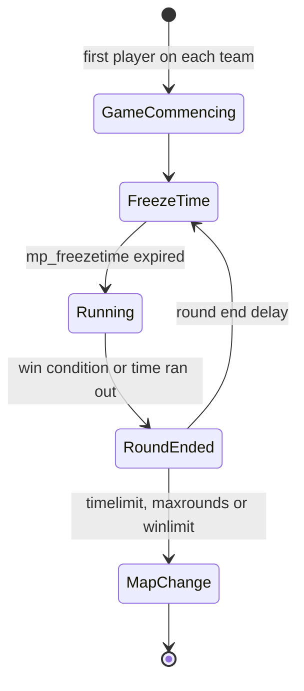

# 10 — Counter-Strike gameplay

## 1. Approach

- **Parity with Steam CS 1.6** (latest version) is the reference for everything in this
  document.
- Every tunable value (price, damage, time, speed) lives in **data** (`data/cstrike/`),
  with a validated schema and default values equal to the original's.
- Behaviors that are not simple numbers (spread formulas, recoil, the weapon state machine)
  are **code in `cs.shared`** parameterized by data.
- Each item has a **parity test** comparing against measurements of the original game
  ([18](18-testing-and-quality.md#parity-tests)). Values cited here as "reference" only
  become official after they are validated.
- Every relevant action is **hookable** by Rook plugins ([15](15-mod-api.md#5-hookable-actions)).

## 2. Teams and characters

| Team | Characters |
|------|------------|
| Terrorists | Phoenix Connexion, Elite Crew (L337 Krew), Arctic Avengers, Guerilla Warfare |
| Counter-Terrorists | Seal Team 6, GSG-9, SAS, GIGN |
| Spectator | — |
| VIP (`as_` maps) | VIP model |

- Team and character menus with the same options and keys as the original, including
  "auto-select".
- Rules: `mp_limitteams`, `mp_autoteambalance`, full team, team changes limited per round,
  `allow_spectators`.

## 3. Match and round flow



- **Freeze time** (`mp_freezetime`): players frozen, buying allowed.
- **Buy time** (`mp_buytime`), counted from the start of the round.
- **Round time** (`mp_roundtime`). The outcome when time runs out depends on the map type
  (e.g. CTs win on `de_` with no bomb planted).
- **Restart:** `sv_restart`/`sv_restartround <seconds>`.
- **End of match:** `mp_timelimit`, `mp_maxrounds`, `mp_winlimit`, with an intermission
  (`mp_chattime`) and the next map from `mapcycle.txt`.

### 3.1 Round end reasons

`enum class RoundEndReason` with parity with the original's reasons:

| Reason | Maps |
|--------|------|
| `TargetBombed` | `de_` |
| `BombDefused` | `de_` |
| `TargetSaved` (time ran out without a bomb) | `de_` |
| `AllHostagesRescued` | `cs_` |
| `HostagesNotRescued` (time ran out) | `cs_` |
| `VipEscaped` / `VipAssassinated` / `VipNotEscaped` | `as_` |
| `TerroristsEscaped` / `CTsPreventEscape` / `EscapingTerroristsNeutralized` / `TerroristsNotEscaped` | `es_` |
| `CTsWin` / `TerroristsWin` (elimination) | All |
| `RoundDraw` | All |
| `GameCommencing` | All |

## 4. Objectives by map type

| Prefix | Objective | Entities |
|--------|-----------|----------|
| `de_` | Plant and detonate the C4, or defuse it | `func_bomb_target`, `info_bomb_target`, `info_map_parameters` (bomb radius) |
| `cs_` | Rescue hostages | `hostage_entity`, `func_hostage_rescue`, `info_hostage_rescue` |
| `as_` | Escort the VIP | `info_vip_start`, `func_vip_safetyzone` |
| `es_` | Terrorists escape | `func_escapezone` |
| others (`fy_`, `aim_`, `awp_`…) | Elimination | — |

### 4.1 C4

- A random terrorist receives the C4 at the start of the round (the original's rules for
  when the carrier leaves or dies).
- Planting requires being in the zone, standing still on the ground and holding the button
  for the plant time.
- `mp_c4timer` timer, with accelerating beeps and a blinking light.
- Defuse takes less time with a kit, and is interrupted if the CT releases the button, moves
  or dies.
- Explosion with radius damage (`info_map_parameters`), screen shake and effects.

### 4.2 Hostages

- They follow the CT that "uses" them, with simple navigation and stopping rules.
- Penalties for damaging and killing hostages (`mp_hostagepenalty`, money).
- Rescue in a zone, with rewards for the team.

## 5. Map entities

Mandatory support so that **every official map** loads without warnings:

| Group | Entities |
|-------|----------|
| Spawn | `info_player_start` (CT), `info_player_deathmatch` (T), `info_vip_start` |
| Objectives | `func_bomb_target`, `info_bomb_target`, `func_hostage_rescue`, `info_hostage_rescue`, `hostage_entity`, `func_vip_safetyzone`, `func_escapezone`, `func_buyzone` |
| Configuration | `info_map_parameters`, `game_player_equip`, `player_weaponstrip`, `armoury_entity` |
| Brushes | `func_wall`, `func_wall_toggle`, `func_illusionary`, `func_breakable`, `func_pushable`, `func_ladder`, `func_water`, `func_conveyor`, `func_friction` |
| Movers | `func_door`, `func_door_rotating`, `func_button`, `func_rot_button`, `func_rotating`, `func_plat`, `func_train`, `func_tracktrain`, `func_vehicle`, `func_tank`, `path_corner`, `path_track` |
| Triggers | `trigger_multiple`, `trigger_once`, `trigger_hurt`, `trigger_push`, `trigger_teleport`, `trigger_gravity`, `trigger_camera`, `trigger_relay`, `multi_manager`, `multisource` |
| Environment | `ambient_generic`, `env_sound`, `env_sprite`, `env_glow`, `env_beam`, `env_laser`, `env_shake`, `env_fade`, `env_explosion`, `env_spark`, `env_render`, `env_bubbles`, `infodecal` |
| Game | `game_text`, `game_counter`, `game_end`, `game_score` |
| Light | `light`, `light_spot`, `light_environment` (animated styles at runtime) |

The complete list, with the *keyvalues* schema, lives in `data/cstrike/entities.toml`. CI
loads every official map and fails if there is an unknown `classname` or key.

## 6. Economy

- Values in `data/cstrike/economy.toml`. References: starting money `mp_startmoney` (800),
  money cap (16000), default reward per kill (300). The others (win by reason, consecutive
  loss bonus, plant, defuse, hostages and *teamkill* penalties) are listed in the file and
  need to be surveyed and validated against the original.
- Money is `cs::Money` with saturating arithmetic up to the cap (`std::add_sat` plus
  `clamp`), with no overflow.
- Every transaction goes through a single auditable function
  (`Economy::apply(player, MoneyTransaction{reason, amount})`), which raises the
  `MoneyChanged` event for the HUD, the log and plugins.

## 7. Weapons and equipment

### 7.1 Catalog

| Category | Weapon | Team |
|----------|--------|------|
| Knife | Knife | Both |
| Pistols | Glock 18 | Both (T default) |
| | USP .45 | Both (CT default) |
| | P228 | Both |
| | Desert Eagle | Both |
| | Dual Elites | T |
| | Five-SeveN | CT |
| Shotguns | M3 | Both |
| | XM1014 | Both |
| SMGs | MAC-10 | T |
| | TMP | CT |
| | MP5 Navy | Both |
| | UMP45 | Both |
| | P90 | Both |
| Rifles | Galil | T |
| | FAMAS | CT |
| | AK-47 | T |
| | M4A1 | CT |
| | SG 552 | T |
| | AUG | CT |
| Snipers | Scout | Both |
| | AWP | Both |
| | G3SG1 | T |
| | SG 550 | CT |
| Machine gun | M249 | Both |
| Grenades | HE, Flashbang (up to 2), Smoke | Both |
| Equipment | Kevlar, Kevlar + Helmet, Night vision | Both |
| | Defuse kit, Tactical shield | CT |
| Objective | C4 | T (handed out, not buyable) |

### 7.2 Per-weapon data (`data/cstrike/weapons/<weapon>.toml`)

```toml
[weapon]
id            = "ak47"
team          = "Terrorist"
slot          = "Primary"
price         = 2500           # reference value, validated by parity test
clipSize      = 30
ammoType      = "762nato"
maxSpeed      = 221.0          # units per second
fireInterval  = 0.0955         # seconds between shots
damage        = 36
rangeModifier = 0.98
penetration   = { power = 2, distance = 8192.0 }
armorRatio    = 1.55

[weapon.spread]
model = "RifleAk47"            # selects the parity-accurate spread function in cs.shared
[weapon.recoil]
model = "KickBack"
```

> The numbers above illustrate the format. The official values come from the parity
> survey.

### 7.3 Behaviors

- **Weapon state machine:** deploy, idle, primary/secondary attack, reload (including the
  shell-by-shell shotgun reload), holster, drop. The timings come from the model's sequences
  and from the data.
- **Spread:** a per-weapon function reproducing the original, depending on movement, being
  in the air, crouching, zoom and accumulated accuracy.
- **Recoil:** *punch angle* and accumulation over consecutive shots, with recovery.
- **Special modes:** burst (Glock, FAMAS), silencer (USP, M4A1, with different damage and
  sound), one- or two-level zoom, shield with pistols.
- **Penetration:** depends on the weapon's power, the distance and the surface material
  (`materials.txt`).
- **Grenades:** bounce physics, detonation time, flashbang blindness by angle and distance,
  smoke with the original's duration and volume.
- **Knife:** quick slash and heavy stab, with a multiplier from behind.

### 7.4 Damage

- *Hitgroups* with multipliers (head, chest, stomach, arms, legs) in
  `data/cstrike/hitGroups.toml`.
- Vest and helmet absorb according to the weapon's `armorRatio`.
- Damage falloff by distance (`rangeModifier`).
- Friendly fire with `mp_friendlyfire` and the penalty rules (`mp_tkpunish`).
- All damage goes through the hookable `TakeDamage` action ([15](15-mod-api.md#5-hookable-actions)).

## 8. Buying

- Buy zones (`func_buyzone`, or automatic ones at the spawn when the map does not define
  any), buy time and `info_map_parameters` restrictions.
- **Classic menu** by keys (1 to 8, with submenus) and a **VGUI menu** with the same options.
- The original's **buy commands**: `ak47`, `m4a1`, `vesthelm`, `defuser`, `hegren`,
  `flash`, `sgren`, `buyammo1`, `buyammo2`, `primammo`, `secammo`, `nvgs`, `shield` etc.
- **`autobuy`/`rebuy`** with `cl_autobuy` and `cl_rebuy`.
- Every purchase goes through the hookable `BuyItem` action.

## 9. Communication

- **Radio:** `radio1`, `radio2`, `radio3` menus and direct commands (`coverme`,
  `takepoint`, `holdpos`, `regroup`, `followme`, `takingfire`, `go`, `fallback`,
  `sticktog`, `getinpos`, `stormfront`, `report`, `roger`, `enemyspot`, `needbackup`,
  `sectorclear`, `inposition`, `reportingin`, `getout`, `negative`, `enemydown`), with an
  icon over the player and a sound.
- **Chat:** `say`, `say_team`, the dead only talk to the dead, `*DEAD*` and `(Team)`
  prefixes.
- **Voice:** [08 §9](08-networking.md#9-voice).
- **Sprays:** the player's `tempdecal.wad`, sent to the server and distributed, limited by
  `decalfrequency`.

## 10. Spectator

- Modes: free camera, *chase*, first person, *overview* (2D map) and
  *picture-in-picture*.
- Restrictions: `mp_forcecamera`, `mp_forcechasecam`, `mp_fadetoblack`.

## 11. Bots (milestone M7)

- Bots with behavior equivalent to the official CS 1.6 bots, on a navigation mesh (with
  import of existing `.nav` files).
- Familiar commands and cvars: `bot_add`, `bot_add_t`, `bot_add_ct`, `bot_kick`,
  `bot_quota`, `bot_difficulty`, `bot_chatter`.
- Bots use the same intent API as players (usercmds), with no gameplay shortcuts.

## 12. Data organization

```
data/cstrike/
├── cvars.toml          # all game cvars: name, type, default, range, flags
├── economy.toml
├── hitGroups.toml
├── hulls.toml
├── movement.toml       # derived constants not exposed as cvars
├── entities.toml       # classname -> prefab + keyvalue schema
├── teams.toml          # teams, characters, models
├── weapons/
│   ├── ak47.toml
│   └── ...
├── equipment.toml
├── buyMenu.toml        # menu structure and key bindings
└── radio.toml          # radio commands, menus, sentences
```

Plugins can **override** this data through the API (e.g. change a weapon's price) and
**add** new data (weapons, teams, entities), always with schema validation.
