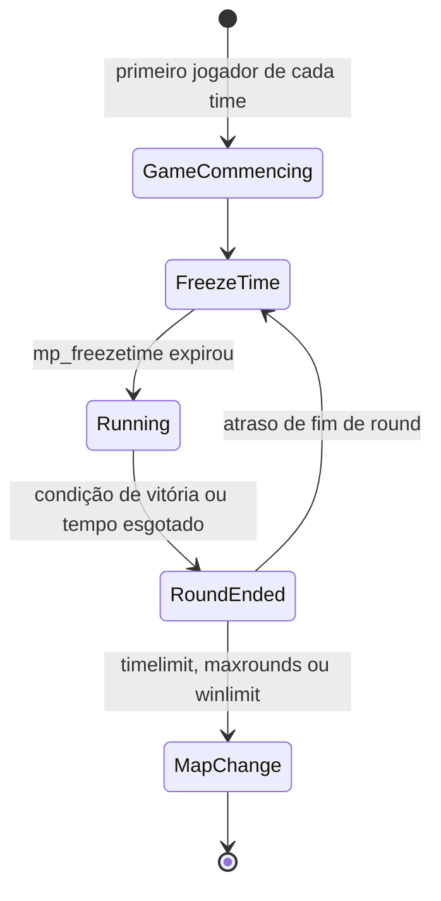

# 10 — Gameplay Counter-Strike

## 1. Abordagem

- **Paridade com o CS 1.6 Steam** (última versão) é a referência para tudo deste documento.
- Todo valor ajustável (preço, dano, tempo, velocidade) mora em **dados** (`data/cstrike/`),
  com esquema validado e valores padrão iguais aos do original.
- Comportamentos que não são simples números (fórmulas de spread, recoil, máquina de
  estados de arma) são **código em `cs.shared`** parametrizado por dados.
- Cada item tem um **teste de paridade** comparando com medições do jogo original
  ([18](18-testes-e-qualidade.md#testes-de-paridade)). Valores citados aqui como
  "referência" só viram oficiais depois de validados.
- Toda ação relevante é **hookável** por plugins Rook ([15](15-api-de-mods.md#5-ações-hookáveis)).

## 2. Times e personagens

| Time | Personagens |
|------|-------------|
| Terroristas | Phoenix Connexion, Elite Crew (L337 Krew), Arctic Avengers, Guerilla Warfare |
| Contra-Terroristas | Seal Team 6, GSG-9, SAS, GIGN |
| Espectador | — |
| VIP (mapas `as_`) | Modelo VIP |

- Menus de time e de personagem com as mesmas opções e teclas do original, incluindo
  "auto-select".
- Regras: `mp_limitteams`, `mp_autoteambalance`, time cheio, troca de time limitada por
  round, `allow_spectators`.

## 3. Fluxo de partida e round



- **Freeze time** (`mp_freezetime`): jogadores parados, compra permitida.
- **Buy time** (`mp_buytime`), contado a partir do início do round.
- **Tempo de round** (`mp_roundtime`). O resultado de tempo esgotado depende do tipo de
  mapa (ex.: CTs vencem em `de_` sem bomba plantada).
- **Restart:** `sv_restart`/`sv_restartround <segundos>`.
- **Fim de partida:** `mp_timelimit`, `mp_maxrounds`, `mp_winlimit`, com intermissão
  (`mp_chattime`) e próximo mapa do `mapcycle.txt`.

### 3.1 Motivos de fim de round

`enum class RoundEndReason` com paridade dos motivos do original:

| Motivo | Mapas |
|--------|-------|
| `TargetBombed` | `de_` |
| `BombDefused` | `de_` |
| `TargetSaved` (tempo esgotado sem bomba) | `de_` |
| `AllHostagesRescued` | `cs_` |
| `HostagesNotRescued` (tempo esgotado) | `cs_` |
| `VipEscaped` / `VipAssassinated` / `VipNotEscaped` | `as_` |
| `TerroristsEscaped` / `CTsPreventEscape` / `EscapingTerroristsNeutralized` / `TerroristsNotEscaped` | `es_` |
| `CTsWin` / `TerroristsWin` (eliminação) | Todos |
| `RoundDraw` | Todos |
| `GameCommencing` | Todos |

## 4. Objetivos por tipo de mapa

| Prefixo | Objetivo | Entidades |
|---------|----------|-----------|
| `de_` | Plantar e explodir ou defusar a C4 | `func_bomb_target`, `info_bomb_target`, `info_map_parameters` (raio da bomba) |
| `cs_` | Resgatar reféns | `hostage_entity`, `func_hostage_rescue`, `info_hostage_rescue` |
| `as_` | Escoltar o VIP | `info_vip_start`, `func_vip_safetyzone` |
| `es_` | Terroristas escapam | `func_escapezone` |
| outros (`fy_`, `aim_`, `awp_`…) | Eliminação | — |

### 4.1 C4

- Um terrorista aleatório recebe a C4 no início do round (regras do original para
  quando o portador sai ou morre).
- Plantar exige estar na zona, parado no chão e segurando o botão pelo tempo de plantio.
- Timer `mp_c4timer`, com bipes acelerando e luz piscando.
- Defuse com tempo menor com kit, interrompido se o CT soltar o botão, se mover ou
  morrer.
- Explosão com dano por raio (`info_map_parameters`), sacudida de tela e efeitos.

### 4.2 Reféns

- Seguem o CT que os "usa", com navegação simples e regras de parada.
- Penalidades por dano e morte de reféns (`mp_hostagepenalty`, dinheiro).
- Resgate em zona, com recompensas para o time.

## 5. Entidades de mapa

Suporte obrigatório para que **todos os mapas oficiais** carreguem sem avisos:

| Grupo | Entidades |
|-------|-----------|
| Spawn | `info_player_start` (CT), `info_player_deathmatch` (T), `info_vip_start` |
| Objetivos | `func_bomb_target`, `info_bomb_target`, `func_hostage_rescue`, `info_hostage_rescue`, `hostage_entity`, `func_vip_safetyzone`, `func_escapezone`, `func_buyzone` |
| Configuração | `info_map_parameters`, `game_player_equip`, `player_weaponstrip`, `armoury_entity` |
| Brushes | `func_wall`, `func_wall_toggle`, `func_illusionary`, `func_breakable`, `func_pushable`, `func_ladder`, `func_water`, `func_conveyor`, `func_friction` |
| Movers | `func_door`, `func_door_rotating`, `func_button`, `func_rot_button`, `func_rotating`, `func_plat`, `func_train`, `func_tracktrain`, `func_vehicle`, `func_tank`, `path_corner`, `path_track` |
| Triggers | `trigger_multiple`, `trigger_once`, `trigger_hurt`, `trigger_push`, `trigger_teleport`, `trigger_gravity`, `trigger_camera`, `trigger_relay`, `multi_manager`, `multisource` |
| Ambiente | `ambient_generic`, `env_sound`, `env_sprite`, `env_glow`, `env_beam`, `env_laser`, `env_shake`, `env_fade`, `env_explosion`, `env_spark`, `env_render`, `env_bubbles`, `infodecal` |
| Jogo | `game_text`, `game_counter`, `game_end`, `game_score` |
| Luz | `light`, `light_spot`, `light_environment` (estilos animados em runtime) |

A lista completa, com esquema de *keyvalues*, vive em `data/cstrike/entities.toml`. O CI
carrega todos os mapas oficiais e falha se houver `classname` ou chave desconhecida.

## 6. Economia

- Valores em `data/cstrike/economy.toml`. Referências: dinheiro inicial
  `mp_startmoney` (800), teto de dinheiro (16000), recompensa padrão por kill (300). Os
  demais (vitória por motivo, bônus de derrota consecutiva, plantio, defuse, reféns e
  penalidades por *teamkill*) estão listados no arquivo e precisam de levantamento e
  validação contra o original.
- Dinheiro é `cs::Money` com aritmética saturada até o teto (`std::add_sat` mais
  `clamp`), sem estouro.
- Toda transação passa por uma única função auditável
  (`Economy::apply(player, MoneyTransaction{reason, amount})`), que gera o evento
  `MoneyChanged` para HUD, log e plugins.

## 7. Armas e equipamentos

### 7.1 Catálogo

| Categoria | Arma | Time |
|-----------|------|------|
| Faca | Knife | Ambos |
| Pistolas | Glock 18 | Ambos (padrão T) |
| | USP .45 | Ambos (padrão CT) |
| | P228 | Ambos |
| | Desert Eagle | Ambos |
| | Dual Elites | T |
| | Five-SeveN | CT |
| Escopetas | M3 | Ambos |
| | XM1014 | Ambos |
| SMGs | MAC-10 | T |
| | TMP | CT |
| | MP5 Navy | Ambos |
| | UMP45 | Ambos |
| | P90 | Ambos |
| Rifles | Galil | T |
| | FAMAS | CT |
| | AK-47 | T |
| | M4A1 | CT |
| | SG 552 | T |
| | AUG | CT |
| Snipers | Scout | Ambos |
| | AWP | Ambos |
| | G3SG1 | T |
| | SG 550 | CT |
| Metralhadora | M249 | Ambos |
| Granadas | HE, Flashbang (até 2), Smoke | Ambos |
| Equipamento | Kevlar, Kevlar + Capacete, Visão noturna | Ambos |
| | Kit de defuse, Escudo tático | CT |
| Objetivo | C4 | T (entregue, não comprável) |

### 7.2 Dados por arma (`data/cstrike/weapons/<arma>.toml`)

```toml
[weapon]
id            = "ak47"
team          = "Terrorist"
slot          = "Primary"
price         = 2500           # reference value, validated by parity test
clipSize      = 30
ammoType      = "762nato"
maxSpeed      = 221.0          # units per second
fireInterval  = 0.0955         # seconds between shots
damage        = 36
rangeModifier = 0.98
penetration   = { power = 2, distance = 8192.0 }
armorRatio    = 1.55

[weapon.spread]
model = "RifleAk47"            # selects the parity-accurate spread function in cs.shared
[weapon.recoil]
model = "KickBack"
```

> Os números acima ilustram o formato. Os valores oficiais saem do levantamento de
> paridade.

### 7.3 Comportamentos

- **Máquina de estados de arma:** deploy, idle, ataque primário/secundário, reload
  (inclusive reload de escopeta cartucho a cartucho), holster, drop. Os tempos vêm das
  sequências do modelo e dos dados.
- **Spread:** função por arma reproduzindo o original, dependente de movimento, estar no
  ar, agachado, zoom e precisão acumulada.
- **Recoil:** *punch angle* e acúmulo por disparos consecutivos, com recuperação.
- **Modos especiais:** rajada (Glock, FAMAS), silenciador (USP, M4A1, com dano e som
  diferentes), zoom de um ou dois níveis, escudo com pistolas.
- **Penetração:** depende de potência da arma, distância e material da superfície
  (`materials.txt`).
- **Granadas:** física de quique, tempo de detonação, cegueira da flashbang por ângulo e
  distância, fumaça com duração e volume do original.
- **Faca:** golpe rápido e golpe forte, com multiplicador por costas.

### 7.4 Dano

- *Hitgroups* com multiplicadores (cabeça, peito, estômago, braços, pernas) em
  `data/cstrike/hitGroups.toml`.
- Colete e capacete absorvem conforme `armorRatio` da arma.
- Queda de dano por distância (`rangeModifier`).
- Fogo amigo com `mp_friendlyfire` e as regras de penalidade (`mp_tkpunish`).
- Todo dano passa pela ação hookável `TakeDamage` ([15](15-api-de-mods.md#5-ações-hookáveis)).

## 8. Compra

- Zonas de compra (`func_buyzone`, ou automáticas no spawn quando o mapa não define),
  tempo de compra e restrições de `info_map_parameters`.
- **Menu clássico** por teclas (1 a 8, com submenus) e **menu VGUI** com as mesmas opções.
- **Comandos de compra** do original: `ak47`, `m4a1`, `vesthelm`, `defuser`, `hegren`,
  `flash`, `sgren`, `buyammo1`, `buyammo2`, `primammo`, `secammo`, `nvgs`, `shield` etc.
- **`autobuy`/`rebuy`** com `cl_autobuy` e `cl_rebuy`.
- Toda compra passa pela ação hookável `BuyItem`.

## 9. Comunicação

- **Rádio:** menus `radio1`, `radio2`, `radio3` e comandos diretos (`coverme`,
  `takepoint`, `holdpos`, `regroup`, `followme`, `takingfire`, `go`, `fallback`,
  `sticktog`, `getinpos`, `stormfront`, `report`, `roger`, `enemyspot`, `needbackup`,
  `sectorclear`, `inposition`, `reportingin`, `getout`, `negative`, `enemydown`), com
  ícone sobre o jogador e som.
- **Chat:** `say`, `say_team`, mortos só falam com mortos, prefixos `*DEAD*` e `(Team)`.
- **Voz:** [08 §9](08-rede.md#9-voz).
- **Sprays:** `tempdecal.wad` do jogador, enviado ao servidor e distribuído, limitado por
  `decalfrequency`.

## 10. Espectador

- Modos: câmera livre, perseguição (*chase*), primeira pessoa, *overview* (mapa 2D) e
  *picture-in-picture*.
- Restrições: `mp_forcecamera`, `mp_forcechasecam`, `mp_fadetoblack`.

## 11. Bots (marco M7)

- Bots com comportamento equivalente aos bots oficiais do CS 1.6, sobre malha de
  navegação (com importação de arquivos `.nav` existentes).
- Comandos e cvars familiares: `bot_add`, `bot_add_t`, `bot_add_ct`, `bot_kick`,
  `bot_quota`, `bot_difficulty`, `bot_chatter`.
- Bots usam a mesma API de intenções que jogadores (usercmds), sem atalhos de gameplay.

## 12. Organização dos dados

```
data/cstrike/
├── cvars.toml          # all game cvars: name, type, default, range, flags
├── economy.toml
├── hitGroups.toml
├── hulls.toml
├── movement.toml       # derived constants not exposed as cvars
├── entities.toml       # classname -> prefab + keyvalue schema
├── teams.toml          # teams, characters, models
├── weapons/
│   ├── ak47.toml
│   └── ...
├── equipment.toml
├── buyMenu.toml        # menu structure and key bindings
└── radio.toml          # radio commands, menus, sentences
```

Plugins podem **sobrepor** esses dados pela API (ex.: mudar o preço de uma arma) e
**adicionar** novos (armas, times, entidades), sempre com validação de esquema.
