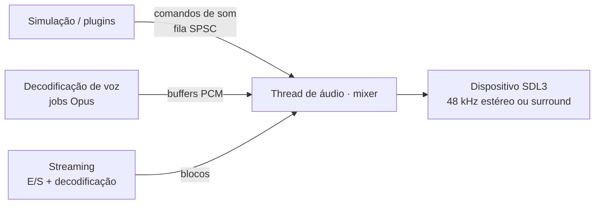

# 11 — Áudio

## 1. Objetivos

- **Paridade auditiva:** canais por entidade, atenuação, pitch, volume, DSP de salas
  (`env_sound`/`room_type`), frases (`sentences.txt`) e passos por material iguais aos do
  original. Som é informação competitiva no CS.
- **Tempo real robusto:** mixagem em thread dedicada, sem alocações nem locks no callback.
- **Sem teto fixo de vozes:** pool configurável com prioridade e roubo de voz documentado.
- **Extensível:** formatos modernos, streaming e efeitos novos para plugins, todos
  opcionais.

## 2. Arquitetura

- O jogo nunca chama o mixer direto: ele envia **comandos** (`PlaySound`, `StopSound`,
  `UpdateListener`, `SetRoom`) por uma fila sem lock.
- A thread de áudio mixa em blocos pequenos (tamanho configurável, padrão de baixa
  latência), reamostrando de 11/22/44 kHz para a taxa do dispositivo.

## 3. Semântica do original a preservar

| Conceito | Comportamento |
|----------|---------------|
| Canais por entidade | `Auto`, `Weapon`, `Voice`, `Item`, `Body`, `Stream`, `Static`. Um som novo no mesmo canal e entidade **substitui** o anterior (exceto `Auto`) |
| Atenuação | `None`, `Normal`, `Idle`, `Static`, com as curvas do original |
| Pitch e volume | Por evento, com os mesmos intervalos |
| Sons posicionais | Seguem a entidade emissora enquanto ela existe |
| PAS | Só toca o que o servidor enviou (relevância por PAS, [08](08-rede.md#62-gerenciamento-de-interesse)) |
| DSP de sala | Presets de `room_type` (reverb e eco) ativados por `env_sound` ou pela água |
| Frases | Composição de palavras de `sentences.txt` com parâmetros de pitch, volume e corte |
| Passos | Som por material (`materials.txt`) e por superfície (escada, água, grade) com `mp_footsteps` |
| Música | Comando `mp3`/`cd` para `media/*.mp3` (menu e mapas) |

## 4. Vozes e prioridades

- Pool de vozes com tamanho configurável (`s_max_voices`), sem teto de formato.
- Ao esgotar, uma voz nova rouba a voz de **menor prioridade efetiva** (prioridade do
  canal × volume percebido). O roubo gera métrica, nunca falha silenciosa.
- Sons de jogabilidade crítica (passos, tiros, bomba, rádio) têm prioridade alta por
  dados.

## 5. Espacialização

| Modo | Descrição |
|------|-----------|
| `s_spatial legacy` (padrão) | Pan estéreo e atenuação como no original |
| `s_spatial hrtf` | HRTF binaural opcional para fones |
| `s_spatial surround` | Saída 5.1/7.1 quando o dispositivo suporta |

Oclusão por geometria (`s_occlusion 1`) é **opcional e desligada por padrão**, porque altera
a informação competitiva em relação ao original.

## 6. Formatos

| Formato | Uso | Decodificador |
|---------|-----|---------------|
| WAV PCM 8/16 bits | Conteúdo original | Próprio |
| MP3 | Música original (`media/`) | `minimp3` |
| OGG Vorbis | Mods | `stb_vorbis` |
| Opus | Voz e mods | `libopus` |
| FLAC | Mods | `dr_flac` |

Sons curtos ficam decodificados em memória. Música e sons longos (acima de
`s_stream_threshold`) usam streaming.

## 7. Voz

- Captura via SDL3, codificação Opus em job e envio no canal não confiável.
- Decodificação por remetente em jobs e mixagem como voz posicional ou não posicional,
  conforme as regras do servidor e dos plugins.
- `voice_enable`, `voice_scale`, `voice_loopback`, *mute* por jogador no scoreboard.

## 8. Cvars

| Cvar | Original | Função |
|------|----------|--------|
| `volume` | ✅ | Volume geral |
| `bgmvolume` | ✅ | Música |
| `suitvolume` | ✅ | Falas de HUD |
| `voice_scale` | ✅ | Volume da voz recebida |
| `room_type`, `room_off` | ✅ | Depuração e desligamento do DSP |
| `s_max_voices` | novo | Tamanho do pool de vozes |
| `s_spatial`, `s_occlusion` | novo | Espacialização e oclusão |
| `s_device` | novo | Dispositivo de saída |

## 9. Erros tipados

| Enum | Exemplos |
|------|----------|
| `AudioDeviceError` | `NoDevice`, `FormatUnsupported`, `DeviceLost` |
| `SoundError` | `DecodeFailed`, `UnsupportedEncoding`, `CuePointInvalid` |
| `SentenceError` | `UnknownSentence`, `MissingWord` |

Perder o dispositivo (ex.: fone desconectado) faz o mixer tentar reabrir o padrão do
sistema e emite um evento de diagnóstico. O jogo continua rodando sem áudio enquanto isso.
