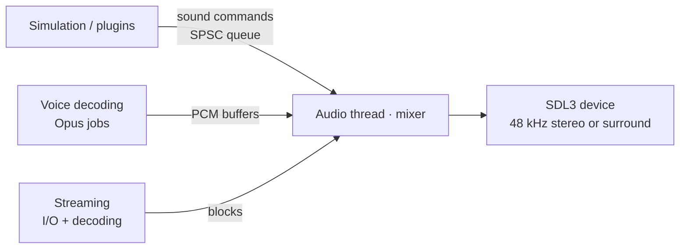

# 11 — Audio

## 1. Goals

- **Auditory parity:** per-entity channels, attenuation, pitch, volume, room DSP
  (`env_sound`/`room_type`), sentences (`sentences.txt`) and per-material footsteps identical
  to the original. Sound is competitive information in CS.
- **Robust real time:** mixing on a dedicated thread, with no allocations or locks in the
  callback.
- **No fixed voice ceiling:** a configurable pool with priority and documented voice
  stealing.
- **Extensible:** modern formats, streaming and new effects for plugins, all optional.
- **Quality and reliability fixed at the cause:** none of the original's audio limits and
  failures ([§2.1](#21-the-originals-audio-problems-and-their-causes)).

## 2. Architecture

- The game never calls the mixer directly: it sends **commands** (`PlaySound`, `StopSound`,
  `UpdateListener`, `SetRoom`) through a lock-free queue.
- The audio thread mixes in small blocks (configurable size, low-latency default),
  resampling every source, whatever its rate, to the device rate.

Today: the mixer, on the system's default output. A `Sound` is a WAV file of any layout made
32-bit floats, its first two channels, at its own rate, looping from its first cue point; the
game owns it, so the audio thread never frees memory. The game sends the mixer `PlayVoice`,
`StopVoice`, `SetVoiceGains` and `SetMasterGain`, each of a voice by its `VoiceId`, through an SPSC queue (`nx.jobs:spscQueue`; a
full queue is a typed `QueueFull`, never a wait), each done at once or a delay after the start of
the block that takes it, to the frame: the block is mixed in parts, cut where a command is due, and
commands due at the same frame are done in the order sent. `QueueFull` counts the commands waiting
for their time too, so the audio thread never makes room for them. Each voice reads its sound at
`rate / deviceRate × pitch` frames a frame through a windowed sinc (Kaiser window, β 8, 8 zero
crossings each way), narrowed when the sound is sped up so that nothing folds back: a sine at
another rate comes out over 90 dB clean, and one sped up past the mix's band over 80 dB down.
Voices sum in float; a master gain and a stereo-linked limiter (instant attack, 100 ms release)
keep every sample under 0.98 of full scale. A voice pool with priorities and stealing,
spatialization, the room's DSP and streaming come with what plays sounds.

`nx.platform:audio` opens the system's default output with SDL3 at its own rate, in two channels
of 32-bit floats, and pulls an `AudioSource` (the mixer is one) on SDL's real-time thread in
blocks of whole frames; when the default output changes, SDL moves the stream to the new one.
`nx.audio:library` reads the game's sounds by the original's names, under `sound/` (`\` a
separator too, any case), once each, and keeps them while it lives: a missing or broken file is a
typed `SoundError` and is tried again the next time. In `next`, `cs::ClientAudio` plays the mixer
on the output and the console's `play <sound>` and `playvol <sound> <volume>` as the original's:
heard everywhere, `.wav` added to a name without an extension, the volume bounded to [0, 1]. They
take 8 voices in turn, a ninth sound the voice of the one that started first, until the voice pool
of §4. `volume` (0.7, from 0) is the mixer's master gain, sent before each sound and each frame.
Without an output the game plays on, silent, and says so once. The tests run on SDL's dummy output,
which pulls at a real device's pace; the client was checked end to end on SDL's disk output: `play
weapons/ak47-1` is the WAV resampled from 22 050 to 44 100 Hz at 0.7 of its level, to float
precision at the WAV's own instants.

The player's own sounds come from the game as data, `cs::GameSound` (`cs.shared:sounds`): its
files, one at random, its channel of the player (`auto`, `weapon`, `voice`, `item`, `body`), its
volume and its pitch range, in hundredths of the recorded speed (the original's 100 normal, 255 at
most). The game says which sound it makes; `cs::ClientAudio` chooses the file and the pitch with its
own random numbers, as the original's client and engine choose them, so that hearing never changes
what the game draws. A sound on a channel other than `auto` replaces the one the player's channel
plays (§3): an AK-47's shot cuts the last one's tail, as on `CHAN_WEAPON`. The weapons make theirs
(`Inventory::takeSounds`, docs/10 §7.2): their draw (the knife's `knife_deploy1` at 0.3), each
round fired (a burst's follow-ups too), the empty click (`dryfire_pistol` or `dryfire_rifle` at
0.8, PlayEmptySound), and the knife's miss (`knife_slash1`/`2` at pitch 94) or its hit on the world
(`knife_hitwall1` at 98 to 101), with ReGameDLL_CS's values. The guns' shots come from the
original's client events, whose code is not free: their files are the ones it has, the choice among
them to be measured on it. The view model's sound events (5004: the reloads', the draws' and the
silencers' sounds of the original's models) play their sound at full volume as a frame passes them
(`cs::ViewModelEvents`, docs/05 §9). Checked end to end on SDL's disk output: on de_dust2 the knife's
draw, the USP's `usp_slideback` from its draw's event, and a shot's `usp_unsil-1` are heard in
their order, each matching its file.

No frame waits on the file of a sound it plays. The client reads the sounds the player hears of a
weapon in hand (`cs::soundFilesOf`: the files of each sound its data gives, `cs::soundsOf`, and its
view model's sound events) with `ClientAudio::preload`: those of every weapon as a map starts, and
those of a weapon as it is made or changed, before the game plays the next frame. Read as they were
first played, they held up the frame of the first shot, draw or reload: a file the system has not
cached took 8 to 11 ms to open and read (the disk, and the scan of the file as it opens), more than
a frame at 100 a second, and a frame of the first shot took 11.6 ms where the others took 0.4. Read
ahead, the first shot's frame takes what the others do; the map's start takes the time instead, 16
ms for the 45 sounds of the five weapons and the Drakar III with the files cached, about 0.3 s
without.
`play` and `playvol` read theirs as they play, as the original's do.

A frame runs as many ticks of the game as its time takes (docs/07 §2.2), so a slow one makes many
sounds at once. Each sound comes with the moment of its tick (`cs::SoundMade`), each view model event
with the moment of its play it comes at (`cs::PassedEvent`), and the client hears it as long after
the frame as it came after the moment the last frame showed (`cs::Hearing`): the sounds of a frame
are heard spread as they were made, a frame later at most, and a shot cuts the last one's tail as it
starts, not before. Measured with the Drakar III (10 ticks between shots) on the mixer's own clock:
its shots are heard 95 to 105 ms apart at 100, 20 and 8 frames a second and with no limit, where
before two came together at 8 (0 ms) and a fast pair at 20 (49 ms), heard as a weapon firing faster.
The ±5 ms left, at any frame rate, is the output's block, at whose start the mixer takes commands.

### 2.1 The original's audio problems and their causes

| Problem in the original | Cause | Here |
|-------------------------|-------|------|
| Sounds limited to 8/16-bit PCM, mostly mono, at 11/22/44 kHz; other files rejected or played at the wrong speed | Fixed formats in the loader and the mixer | WAV of any common PCM layout (8, 16, 24 and 32-bit integer, 32-bit float, extensible) at any rate, plus FLAC, Vorbis and Opus ([§6](#6-formats)); every source resampled with a high-quality resampler; mixing in 32-bit float with headroom and a limiter, never clipping |
| MP3 music that stops by itself, after a map change, an alt-tab or a device change, with its own volume | Music played by a second player (Miles), outside the mixer, with its own device and state | **One mixer for everything:** effects, sentences, voice and music (`media/*.mp3` included) are voices of the same mixer on the same device; music is a streamed voice and `bgmvolume` a gain of the mixer |
| A stream that stalls or ends early | Decoding on demand, with no margin, and failures without a report | Streams decode ahead in `Low` jobs into a ring of blocks with a prefetch margin. An underrun plays silence for the missing block, is counted (`snd_stats`) and reported once, and the stream goes on; only its end or a command stops it. A decoding failure is a typed `SoundError` in the log, never a silent stop |
| Sound that depends on the frame, the loading screen or the window focus | Mixing driven by the game loop | The audio thread runs on its own clock: frame rate, map loads and losing the focus do not touch it (`s_play_unfocused` decides whether an unfocused window is heard); and each sound is heard at its tick's moment, not at the frame that took it, so a weapon's cadence is the same at any frame rate |
| Audio gone after unplugging headphones | The device opened once | Losing or changing the device reopens the system default and resumes every voice and stream where it was |

Every decoder refuses malformed input with a typed error and is fuzzed
([18](18-testing-and-quality.md#sanitizers-and-analysis)). Streaming is tested with slow,
simulated I/O (underruns are survived and counted), and the device with a fake one that
disappears and returns.

## 3. Original semantics to preserve

| Concept | Behavior |
|---------|----------|
| Per-entity channels | `Auto`, `Weapon`, `Voice`, `Item`, `Body`, `Stream`, `Static`. A new sound on the same channel and entity **replaces** the previous one (except `Auto`) |
| Attenuation | `None`, `Normal`, `Idle`, `Static`, with the original curves |
| Pitch and volume | Per event, with the same ranges |
| Positional sounds | Follow the emitting entity while it exists |
| PAS | Only plays what the server sent (PAS relevance, [08](08-networking.md#62-interest-management)) |
| Room DSP | `room_type` presets (reverb and echo) triggered by `env_sound` or by water |
| Sentences | Word composition from `sentences.txt` with pitch, volume and cut parameters |
| Footsteps | Sound per material (`materials.txt`) and per surface (ladder, water, grate) with `mp_footsteps` |
| Music | The `mp3`/`cd` command for `media/*.mp3` (menu and maps) |

**Today**, the footsteps: the movement says each step of the player's feet, where it is and where
it stood ([07 §3.1](07-simulation-and-physics.md#31-purity-requirements)); the local game looks up
the texture 64 units under it, on the world or turned into the entity it stands on
(`Level::materialAlong`, `nx::assets::surfaceAt`, the original's `SurfaceAtPoint`), what that texture
is made of by the installation's `sound/materials.txt` (`cs::TextureMaterials`, read as the
original reads it: lines of 510 bytes at most, each ending at a NUL, 1024 textures, 16 characters,
its own sort and search), and plays the step of that kind (`cs::StepVoice`,
`data/cstrike/footsteps.toml`: each foot's sounds and volume, the rare `pl_tile5`, the silent first
of each four wading steps; the splash), on the player's `Body` channel,
while `mp_footsteps` is not 0. The weapons' and the bullets' sounds of the materials come with what they
hit.

**Today**, the breath in water, as the original's `CBasePlayer::WaterMove` has it before each
command moves the player (`cs::Breath`, `data/cstrike/breath.toml`): with its head out of water its
12 seconds of air are whole again, and coming up with less than 9 of them left it gasps, `pl_wade2`
on its `Voice` channel, `pl_wade1` once they ran out; with its head under, it bubbles one breath in
32, then as likely as a whole second from 0 to 11 drawn at random is the whole seconds of its air
left or more (`pl_swim1` to `pl_swim4`, at 0.8, on its `Body` channel). A noclipping player holds
its breath as it was, and a dead one breathes no more. Its drowning once its air ran out, and the harm
of slime and lava, are a player's harm, whose pain, splat and death the player is heard by
([10 §7.4](10-counter-strike-gameplay.md#74-damage)). The
original's float time sometimes makes the air a little less than whole, so that one wading within 12
seconds before a power of two of seconds bubbles now and then; the game's time does not
([07 §1](07-simulation-and-physics.md#1-time-and-tick)).

## 4. Voices and priorities

- A voice pool with a configurable size (`s_max_voices`), with no format ceiling.
- When it runs out, a new voice steals the voice with the **lowest effective priority**
  (channel priority × perceived volume). Stealing produces a metric, never a silent failure.
- Gameplay-critical sounds (footsteps, gunshots, bomb, radio) have high priority through
  data.

## 5. Spatialization

| Mode | Description |
|------|-------------|
| `s_spatial legacy` (default) | Stereo panning and attenuation as in the original |
| `s_spatial hrtf` | Optional binaural HRTF for headphones |
| `s_spatial surround` | 5.1/7.1 output when the device supports it |

Geometry occlusion (`s_occlusion 1`) is **optional and off by default**, because it changes
the competitive information relative to the original.

## 6. Formats

| Format | Use | Decoder |
|--------|-----|---------|
| PCM WAV: 8, 16, 24 and 32-bit integer, 32-bit float, extensible | Original content and mods | In-house (`nx.assets:wav`) |
| MP3 | Original music (`media/`), streamed through the mixer like any other source | `minimp3` |
| OGG Vorbis | Mods | `stb_vorbis` |
| Opus | Voice and mods | `libopus` |
| FLAC | Mods | `dr_flac` |

Short sounds stay decoded in memory. Music and long sounds (above `s_stream_threshold`) are
streamed.

## 7. Voice

- Capture via SDL3, Opus encoding in a job and sending on the unreliable channel.
- Per-sender decoding in jobs and mixing as positional or non-positional voice, according
  to the server and plugin rules.
- `voice_enable`, `voice_scale`, `voice_loopback`, per-player *mute* in the scoreboard.

## 8. Cvars

| Cvar | Original | Role |
|------|----------|------|
| `volume` | ✅ | Master volume |
| `bgmvolume` | ✅ | Music |
| `suitvolume` | ✅ | HUD speech |
| `voice_scale` | ✅ | Volume of received voice |
| `room_type`, `room_off` | ✅ | DSP debugging and disabling |
| `s_max_voices` | new | Voice pool size |
| `s_spatial`, `s_occlusion` | new | Spatialization and occlusion |
| `s_device` | new | The output played on, by its name (`s_devices` lists them); empty, the default: the system's default output, followed as it changes. Read once the startup files and the command line ran: until then, and when no output has that name (logged), the default plays |
| `s_play_unfocused` | new | Whether the game is heard while its window is not focused: 0 by default, silent then, as the original is (today: `next` sets the mixer's gain to none, the sounds playing on in silence) |

## 9. Typed errors

| Enum | Examples |
|------|----------|
| `AudioDeviceError` (`nx.platform:audio`) | `Unavailable` (no audio driver), `NoDevice` (the default output could not be opened), `StartFailed` |
| `SoundError` (`nx.audio:library`) | `NotFound`, `ReadFailed`, `DecodeFailed` (cause: the `WavError`) |
| `MixerError` (`nx.audio:mixer`) | `QueueFull` |
| `SentenceError` (planned, with sentences) | `UnknownSentence`, `MissingWord` |

Today the output is the system's default, and SDL moves the stream to the new default when it
changes. Planned ([TODO](TODO.md)): losing the device (headphones unplugged) reopens the
system's default and resumes every voice and stream where it was, with a diagnostic event; the
game keeps running without audio meanwhile.
