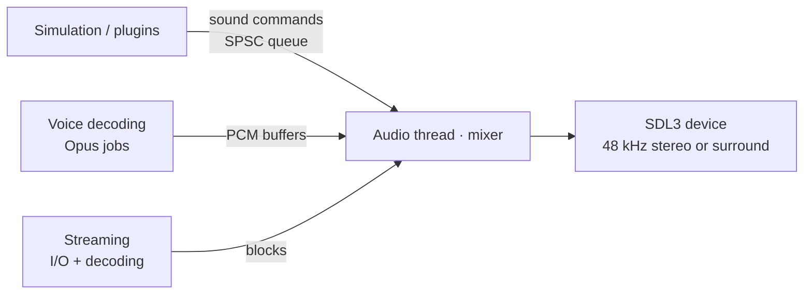

# 11 — Audio

## 1. Goals

- **Auditory parity:** per-entity channels, attenuation, pitch, volume, room DSP
  (`env_sound`/`room_type`), sentences (`sentences.txt`) and per-material footsteps identical
  to the original. Sound is competitive information in CS.
- **Robust real time:** mixing on a dedicated thread, with no allocations or locks in the
  callback.
- **No fixed voice ceiling:** a configurable pool with priority and documented voice
  stealing.
- **Extensible:** modern formats, streaming and new effects for plugins, all optional.

## 2. Architecture

- The game never calls the mixer directly: it sends **commands** (`PlaySound`, `StopSound`,
  `UpdateListener`, `SetRoom`) through a lock-free queue.
- The audio thread mixes in small blocks (configurable size, low-latency default),
  resampling from 11/22/44 kHz to the device rate.

## 3. Original semantics to preserve

| Concept | Behavior |
|---------|----------|
| Per-entity channels | `Auto`, `Weapon`, `Voice`, `Item`, `Body`, `Stream`, `Static`. A new sound on the same channel and entity **replaces** the previous one (except `Auto`) |
| Attenuation | `None`, `Normal`, `Idle`, `Static`, with the original curves |
| Pitch and volume | Per event, with the same ranges |
| Positional sounds | Follow the emitting entity while it exists |
| PAS | Only plays what the server sent (PAS relevance, [08](08-networking.md#62-interest-management)) |
| Room DSP | `room_type` presets (reverb and echo) triggered by `env_sound` or by water |
| Sentences | Word composition from `sentences.txt` with pitch, volume and cut parameters |
| Footsteps | Sound per material (`materials.txt`) and per surface (ladder, water, grate) with `mp_footsteps` |
| Music | The `mp3`/`cd` command for `media/*.mp3` (menu and maps) |

## 4. Voices and priorities

- A voice pool with a configurable size (`s_max_voices`), with no format ceiling.
- When it runs out, a new voice steals the voice with the **lowest effective priority**
  (channel priority × perceived volume). Stealing produces a metric, never a silent failure.
- Gameplay-critical sounds (footsteps, gunshots, bomb, radio) have high priority through
  data.

## 5. Spatialization

| Mode | Description |
|------|-------------|
| `s_spatial legacy` (default) | Stereo panning and attenuation as in the original |
| `s_spatial hrtf` | Optional binaural HRTF for headphones |
| `s_spatial surround` | 5.1/7.1 output when the device supports it |

Geometry occlusion (`s_occlusion 1`) is **optional and off by default**, because it changes
the competitive information relative to the original.

## 6. Formats

| Format | Use | Decoder |
|--------|-----|---------|
| 8/16-bit PCM WAV | Original content | In-house |
| MP3 | Original music (`media/`) | `minimp3` |
| OGG Vorbis | Mods | `stb_vorbis` |
| Opus | Voice and mods | `libopus` |
| FLAC | Mods | `dr_flac` |

Short sounds stay decoded in memory. Music and long sounds (above `s_stream_threshold`) are
streamed.

## 7. Voice

- Capture via SDL3, Opus encoding in a job and sending on the unreliable channel.
- Per-sender decoding in jobs and mixing as positional or non-positional voice, according
  to the server and plugin rules.
- `voice_enable`, `voice_scale`, `voice_loopback`, per-player *mute* in the scoreboard.

## 8. Cvars

| Cvar | Original | Role |
|------|----------|------|
| `volume` | ✅ | Master volume |
| `bgmvolume` | ✅ | Music |
| `suitvolume` | ✅ | HUD speech |
| `voice_scale` | ✅ | Volume of received voice |
| `room_type`, `room_off` | ✅ | DSP debugging and disabling |
| `s_max_voices` | new | Voice pool size |
| `s_spatial`, `s_occlusion` | new | Spatialization and occlusion |
| `s_device` | new | Output device |

## 9. Typed errors

| Enum | Examples |
|------|----------|
| `AudioDeviceError` | `NoDevice`, `FormatUnsupported`, `DeviceLost` |
| `SoundError` | `DecodeFailed`, `UnsupportedEncoding`, `CuePointInvalid` |
| `SentenceError` | `UnknownSentence`, `MissingWord` |

Losing the device (e.g. headphones unplugged) makes the mixer try to reopen the system
default and emits a diagnostic event. The game keeps running without audio meanwhile.
