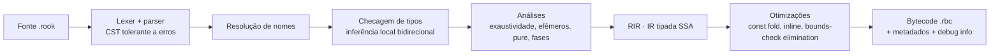

# 14 — Linguagem Rook

> **Rook**: a peça do xadrez que vem depois do *Pawn*. Nome provisório
> ([ADR-0006](adr/0006-linguagem-de-plugins-propria-rook.md)).
> Extensão `.rook` · compilador `rookc` · bytecode `.rbc`.

## 1. Objetivos de design

1. **Migração fácil a partir do Pawn/AMXX:** sintaxe C-like, ponto e vírgula, `forward`,
   o padrão `get*Var`/`set*Var` e os nomes de lifecycle do AMXX, escritos em camelCase
   como todo o projeto (`getWeaponVar`, `pluginPrecache`, `pluginInit`).
2. **Tipagem mais forte que TypeScript:** tipos nominais, sem `any`, sem `null`, sem
   coerção implícita, erros no tipo de retorno, `match` exaustivo e unidades de medida.
3. **Seguro por construção:** handles que não ficam pendurados, sem acesso a memória crua,
   sandbox e orçamentos na VM.
4. **Determinístico:** mesmo estado e mesmas entradas geram o mesmo resultado.
5. **Rápido o bastante para gameplay:** tipos estáticos, bytecode de registradores,
   sem verificações dinâmicas de tipo.
6. **Ferramentas de primeira classe:** compilador incremental, LSP, formatador, linter,
   depurador e testes.

## 2. Comparação: Pawn × TypeScript × Rook

| Aspecto | Pawn (AMXX) | TypeScript | Rook |
|---------|-------------|------------|------|
| Tipo base | Célula de 32 bits sem tipo, *tags* fracas | Estrutural, com `any` | **Nominal**, sem `any`/`unknown` |
| Nulo | `0` como handle inválido | `null`/`undefined`, `!` para forçar | **Sem nulo**: `T?` com tratamento obrigatório e sem `!` |
| Erros | Código de retorno ou `log_error` | Exceções não tipadas | `Result<T, E>` com `error enum` e `?`. Ignorar um `Result` é erro |
| Conversões | Implícitas entre tags com aviso | Coerção (`"1" + 1`) | **Nenhuma** implícita (exceto `T → T?`) |
| Inteiros | Célula de 32 bits, *wrap* silencioso | `number` (double) | Larguras fixas e **overflow detectado** |
| Unidades | Nenhuma (`Float:` para tudo) | Nenhuma | `320ups`, `5000hp`, `3s`, `64hu` como tipos distintos |
| Structs | Não existem (arrays e enums) | Objetos estruturais | `struct` por valor, `class` por referência |
| Enums | Constantes inteiras | Inteiros ou strings | Tipos soma com dados, sem conversão para inteiro |
| `switch` | Sem exaustividade | Sem exaustividade obrigatória | `match` **exaustivo** obrigatório |
| Condições | Qualquer célula | *Truthiness* | Só `bool` |
| Propriedades por string | Sem verificação | `keyof` (estrutural) | Chave literal verificada em compilação, com tipo e unidade |
| Handles de entidade | Índice reutilizável | — | Handle geracional que **não pode** ser guardado sem `Ref` |
| Mutabilidade | Tudo mutável | `const` só para o binding | `let` imutável por padrão |
| Concorrência | Thread única | Event loop | Isolates por plugin e `pure fn` em jobs |

## 3. Primeiro plugin

```rook
import cs.prelude.*;

plugin {
    name:    "Hello",
    version: "1.0.0",
    author:  "Modern-Client.v2",
}

forward pluginInit() -> Result<void, PluginError> {
    registerClcmd("say /hello", cmdHello)?;
    return ok();
}

fn cmdHello(player: Player) -> PluginResult {
    let name = getPlayerVar(player, "name");
    clientPrint(player, PrintTarget.Chat, "Olá, {name}!");
    return PluginResult.Handled;
}
```

## 4. Léxico

- Fonte em **UTF-8**. Ponto e vírgula **obrigatório** (como `#pragma semicolon 1`).
- Comentários: `//`, `/* ... */` e documentação `///` (gera `rook doc` e aparece no LSP).
- Nomenclatura (verificada pelo linter), seguindo a regra camelCase do projeto
  ([02 §3.1](02-padroes-de-codigo.md#31-regra-do-projeto-camelcase)):

| Elemento | Estilo | Exemplo |
|----------|--------|---------|
| Funções, variáveis, parâmetros, módulos, chaves de `vars`, campos | `camelCase` | `setWeaponVar`, `maxClip`, `pluginPrecache` |
| Tipos, enums, variantes, interfaces | `PascalCase` | `WeaponClass`, `Team.Zombie` |
| Constantes | `SCREAMING_SNAKE_CASE` | `MAX_INFECTION_DELAY` |
| Nomes de cvars e comandos de console (strings) | nome clássico do console | `"rz_infection_delay"`, `"say /menu"` |

- Literais:

| Literal | Exemplos |
|---------|----------|
| Inteiro | `42`, `1_000_000`, `0xFF`, `0b1010` (tipo padrão `i32`) |
| Ponto flutuante | `0.75`, `1.5e3` (tipo padrão `f32`) |
| Com unidade | `5000hp`, `100ap`, `320ups`, `64hu`, `1.5s`, `250ms`, `90deg`, `0.75x` |
| Booleano | `true`, `false` |
| Caractere | `'a'`, `'\n'` |
| String | `"texto {interpolação}"`, `r"sem escapes"` |

- Palavras reservadas: `plugin`, `import`, `pub`, `fn`, `pure`, `async`, `await`, `let`,
  `var`, `const`, `persist`, `if`, `else`, `match`, `while`, `for`, `in`, `loop`, `break`,
  `continue`, `return`, `struct`, `enum`, `error`, `class`, `open`, `abstract`, `override`,
  `super`, `self`, `interface`, `impl`, `newtype`, `suffix`, `handle`, `vars`, `readonly`,
  `component`, `forward`, `type`, `inout`, `is`, `true`, `false`, `none`, `some`, `ok`,
  `err`, `void`.

## 5. Tipos primitivos e conversões

| Tipo | Descrição |
|------|-----------|
| `bool` | `true`/`false` |
| `i8`, `i16`, `i32`, `i64` | Inteiros com sinal |
| `u8`, `u16`, `u32`, `u64` | Inteiros sem sinal |
| `f32`, `f64` | IEEE 754 |
| `char` | Ponto de código Unicode |
| `string` | UTF-8 imutável |
| `void` | Ausência de valor (`Result<void, E>`) |

**Aritmética:** overflow e divisão por zero geram `panic` (o callback é abortado com
falha tipada). Para outros comportamentos, a escolha é explícita:

```rook
let a = x.wrappingAdd(y);     // wraps around
let b = x.saturatingAdd(y);   // clamps at the type bounds
let c = x.checkedAdd(y);      // i32? (none on overflow)
```

**Conversões** nunca são implícitas:

| De → para | Como |
|-----------|------|
| Sem perda (`i32 → i64`, `i32 → f64`) | `i64(x)`, `f64(x)` |
| Com possível perda (`i64 → i32`) | `i32.tryFrom(x)` → `Result<i32, ConversionError>` |
| Float → inteiro | `x.roundToI32()`, `x.floorToI32()`, `x.truncToI32()` → `Result<i32, ConversionError>` |
| Qualquer → string | Interpolação `"{x}"` ou `x.toString()` |
| String → número | `i32.parse(s)` → `Result<i32, ParseError>` |

## 6. Unidades e newtypes

Um **newtype** cria um tipo novo e incompatível com a base, que pode ter sufixo literal e
operações permitidas:

```rook
newtype Health(f32) suffix hp derive(Ord, Add, Sub, Scale);
newtype Speed(f32) suffix ups derive(Ord, Add, Sub, Scale);
```

```rook
let a: Health = 100hp;
let b: Armor  = 100ap;
let c = a + b;          // error R0201: cannot add `Health` and `Armor`
let d = a + 50;         // error R0204: expected `Health`, found integer literal; did you mean `50hp`?
let e = a.value();      // f32, explicit escape when really needed
```

Unidades da biblioteca padrão:

| Tipo | Sufixos | Base | Significado |
|------|---------|------|-------------|
| `Health` | `hp` | `f32` | Pontos de vida (fracionários como no original. O HUD exibe o inteiro pela regra original, sem teto) |
| `Armor` | `ap` | `f32` | Pontos de colete |
| `Damage` | `dmg` | `f32` | Dano bruto, antes de colete e multiplicadores |
| `Money` | — (use `Money(800)`) | `i32` | Dinheiro |
| `AmmoCount` | — (use `AmmoCount(30)`) | `i32` | Munição |
| `Distance` | `hu` | `f32` | Unidades de mapa (*hammer units*) |
| `Speed` | `ups` | `f32` | Unidades por segundo |
| `Duration` | `ms`, `s`, `min` | `i64` (µs) | Tempo de jogo |
| `Angle` | `deg`, `rad` | `f32` | Ângulos |
| `Scale` | `x` | `f32` | Multiplicadores (gravidade, dano) |

Operações dimensionais da biblioteca padrão: `Distance / Duration → Speed`,
`Speed * Duration → Distance`, `Health − Damage → Health`, `Damage * Scale → Damage`,
`Health * Scale → Health`, `Duration * f32 → Duration`.

## 7. Tipos compostos

### 7.1 Structs (valor)

```rook
pub struct HudText {
    message:  string,
    position: HudPosition = HudPosition.CENTER,
    color:    Color = Color.WHITE,
    hold:     Duration = 3s,
}

let text = HudText { message: "Infection!", hold: 5s };   // omitted fields use defaults
let bad  = HudText { mesage: "x" };                        // error R0310: unknown field `mesage`
```

Campos sem valor padrão são obrigatórios no literal. Structs são copiadas ao atribuir ou
passar como argumento.

### 7.2 Enums (tipos soma)

```rook
pub enum Team { Terrorist, CounterTerrorist, Spectator }

pub enum DamageSource {
    Weapon(weapon: Weapon),
    Fall(speed: Speed),
    Explosion(radius: Distance),
    World,
}
```

Enums **não** convertem para inteiro. `team.ordinal()` existe para serialização explícita.
Quando o tipo esperado é conhecido, a variante pode ser abreviada: `.Terrorist`.

### 7.3 Tuplas, arrays e coleções

| Tipo | Semântica |
|------|-----------|
| `(A, B)` | Tupla por valor |
| `[T; N]` | Array de tamanho fixo por valor, com índice verificado |
| `List<T>` | Lista dinâmica (referência) |
| `Map<K, V>` | Mapa com **ordem de inserção** (iteração determinística) |
| `Set<T>` | Conjunto com ordem de inserção |
| `PlayerMap<T>` | Dados por jogador, **limpos automaticamente** quando ele desconecta |
| `EntityMap<T>` | Dados por entidade, limpos automaticamente quando ela é destruída |

`PlayerMap` substitui o padrão `new g_data[MAX_PLAYERS + 1]` do AMXX e elimina o bug clássico
de esquecer de zerar dados em `clientDisconnected`.

## 8. Option e Result

### 8.1 Sem nulo

```rook
let target: Player? = findPlayerByName("Arctic");

if let player = target {
    giveItem(player, ItemId.Ak47);
}

let name: string = match target {
    some(player) => getPlayerVar(player, "name"),
    none         => "ninguém",
};

let respawnDelay = customDelay ?? DEFAULT_RESPAWN_DELAY;   // `??` supplies a default
```

- `T` → `T?` é a **única** conversão implícita da linguagem.
- Não existe operador para "forçar" um opcional. Para afirmar que algo existe, use
  `match`, `if let` ou `.expect("motivo")`, que gera `panic` com a mensagem e é marcado
  pelo linter em caminhos de gameplay.

### 8.2 Erros tipados

```rook
pub error enum ClassError {
    @message("class \"{id}\" is already registered")
    AlreadyRegistered(id: ClassId),

    @message("classes can only be registered during pluginPrecache")
    RegistrationClosed,
}

pub error enum PrecacheError {
    from Class(ClassError),          // `?` converts ClassError automatically
    from Resource(ResourceError),
}

pub fn createClass(id: ClassId, team: Team) -> Result<Class, ClassError> {
    if !isPrecachePhase() {
        return err(ClassError.RegistrationClosed);
    }
    if classes.containsKey(id) {
        return err(ClassError.AlreadyRegistered(id: id));
    }
    ...
}
```

`ClassId` é um newtype de string criado por `classId("assassin")`, uma `const fn` que
valida o formato do ID **em compilação**. O plugin dono exporta o ID como constante
(`pub const ASSASSIN: ClassId = classId("assassin");`), e quem o importa ganha
verificação de nome e dependência de carga ([§19](#19-módulos-imports-e-visibilidade)).

- Ignorar um `Result` é **erro de compilação** (`R0410`). Para descartar de propósito:
  `let _ = ...;` com comentário.
- `?` só funciona quando o erro de origem tem uma variante `from` no erro de destino.
  Não existe conversão "genérica".

## 9. Variáveis, constantes e escopo

```rook
const MAX_ZOMBIE_SPEED: Speed = 320ups;    // compile-time constant
let delay = 10s;                            // immutable local
var infectedCount = 0;                     // mutable local

var roundCounter: i32 = 0;                 // plugin global (lives in the isolate)
persist var totalInfections: i64 = 0;      // survives hot reload (matched by name and type)
```

- Toda variável é inicializada na declaração (sem "lixo" nem zero implícito).
- *Shadowing* em escopo aninhado é proibido (`R0120`).
- Globais existem (como no Pawn), mas pertencem ao isolate do plugin e não são visíveis
  para outros plugins, exceto via funções `pub`.

## 10. Funções, closures e genéricos

```rook
pub fn giveHealth(player: Player, amount: Health, limit: Health = 100hp) -> Health {
    let current = getPlayerVar(player, "health");
    let updated = min(current + amount, limit);
    setPlayerVar(player, "health", updated);
    return updated;
}

giveHealth(player, 25hp);
giveHealth(player, amount: 50hp, limit: 200hp);   // named arguments (like Pawn's .name = value)
```

- Sem sobrecarga de funções: nomes distintos ou genéricos.
- Parâmetros `inout` permitem alterar o argumento, com `&` explícito na chamada:

```rook
fn clampSpeed(inout velocity: Vector3, limit: Speed) { ... }
clampSpeed(&velocity, MAX_ZOMBIE_SPEED);
```

- Closures: `(player) => isAlive(player)` ou `(player) => { ...; return x; }`.
- Genéricos com restrições por interface:

```rook
pub fn strongest<T: HasHealth>(items: List<T>) -> T? { ... }
```

- `const fn`: avaliada em compilação. Usada em IDs (`classId("human")`) e constantes
  derivadas, com validação do argumento no build.
- `pure fn`: proibida de acessar o mundo, globais mutáveis e funções não-`pure`. Pode
  rodar em jobs ([§17](#17-concorrência-e-determinismo)).

## 11. Controle de fluxo e match

```rook
let reward = match reason {
    RoundEndReason.TargetBombed        => economy.bombWin,
    RoundEndReason.BombDefused         => economy.defuseWin,
    RoundEndReason.CTsWin
    | RoundEndReason.TerroristsWin     => economy.eliminationWin,
    _                                  => economy.defaultWin,
};

match source {
    .Weapon(weapon) if isKnife(weapon) => applyKnifeBonus(weapon),
    .Weapon(weapon)                     => applyWeaponDamage(weapon),
    .Fall(speed)                        => applyFall(speed),
    .Explosion(radius)                  => applyExplosion(radius),
    .World                              => {},
}
```

- `if`, `while`, `for x in coleção`, `for i in 0..count`, `loop`, `break`, `continue`
  e rótulos (`'outer: for ...`).
- `match` é **exaustivo**. `_` só é permitido quando há variantes restantes (lint avisa
  quando `_` esconde variantes novas de um enum do próprio plugin).
- `if` e `match` são expressões.
- Condições só aceitam `bool`: `if (count)` é erro e deve ser `if count > 0`.

## 12. Strings, formatação e tradução

```rook
let money = getPlayerVar(player, "money");
clientPrint(player, .Chat, "Você tem {money}.");
let line = "{name:<16} {frags:>4} {deaths:>4}";      // alignment and width
```

- Interpolação verificada em compilação. Especificadores de formato são validados contra
  o tipo.
- **Tradução** com chaves tipadas:

```rook
clientPrint(player, .Center, tr("RZ_INFECTED_BY", infected: victimName, by: attackerName));
```

```toml
# locale/pt-BR.toml
RZ_INFECTED_BY = "{infected} foi infectado por {by}!"
```

O `rookc` lê os arquivos de locale do mod. Chave inexistente, parâmetro faltando ou sobrando
é erro de compilação. O idioma é escolhido por jogador (`cl_language`).

## 13. Handles, vars e o padrão get/set

### 13.1 Handles

Um `handle` é um identificador opaco e tipado para um objeto que vive na engine ou em
outro plugin (entidade, jogador, arma, classe do ReZombie…):

```rook
pub handle Class;
pub handle Props;
```

- Handles são **geracionais**: um handle de algo destruído nunca passa a apontar para outra
  coisa.
- Handles de objetos com vida curta (`Player`, `Entity`, `Weapon`) são **efêmeros**:
  válidos até o fim do callback atual. O compilador **proíbe** guardá-los em globais,
  campos, componentes ou closures agendadas, e mantê-los através de `await`. Para guardar,
  use o par `Ref`:

```rook
var lastAttacker: PlayerRef? = none;

fn onDamage(victim: Player, attacker: Player) {
    lastAttacker = refOf(attacker);          // ok: Ref can be stored
}

fn later() {
    if let attacker = resolve(lastAttacker) { // Player? (none if disconnected)
        ...
    }
}
```

Isso elimina, em compilação, a classe de bugs do AMXX em que um `id` guardado passa a
apontar para outro jogador.

### 13.2 Catálogos de variáveis (`vars`)

O padrão que a comunidade conhece (`getEntityVar`, `setWeaponVar`,
`setClassVar`…) é a forma principal de ler e escrever propriedades. Cada handle tem um
**catálogo `vars`** declarado:

```rook
/// Gameplay properties shared by classes and subclasses.
pub handle Props;

pub vars Props {
    health:              Health = 100hp,
    armor:               Armor = 0ap,
    speed:               Speed = 250ups,
    gravity:             Scale = 1.0x,
    weaponsInteraction: bool = true,
    readonly id:         string,
}
```

O compilador gera `getPropsVar` e `setPropsVar`, em que **a chave literal define o
tipo**:

```rook
setPropsVar(props, "health", 5000hp);       // ok
setPropsVar(props, "health", 5000);         // error R0204: expected `Health`; did you mean `5000hp`?
setPropsVar(props, "helth", 5000hp);        // error R0312: unknown var "helth"; did you mean "health"?
setPropsVar(props, "id", "x");              // error R0313: var "id" is readonly
let speed = getPropsVar(props, "speed");    // speed: Speed
```

- A chave precisa ser **literal**. Acesso dinâmico por string existe só em
  `getVarDynamic`/`setVarDynamic`, que retornam `Result<VarValue, VarError>` e são
  destinados a ferramentas de admin e depuração.
- O LSP autocompleta as chaves e mostra tipo, padrão e documentação de cada uma.
- A engine fornece catálogos para `Entity`, `Player`, `Weapon`, `WeaponClass`,
  `WeaponDef` e outros ([15 §4](15-api-de-mods.md#4-handles-e-catálogos-de-vars)).

## 14. Classes e interfaces

```rook
pub interface Damageable {
    fn takeDamage(self, amount: Health, source: DamageSource) -> Health;
}

pub abstract class Ability {
    var cooldown: Duration;

    pub fn new(cooldown: Duration) -> Self { return Self { cooldown: cooldown }; }
    pub abstract fn activate(self, player: Player) -> Result<void, AbilityError>;
}

pub class Leap extends Ability {
    override fn activate(self, player: Player) -> Result<void, AbilityError> {
        let velocity = forwardVector(player) * LEAP_FORCE;
        setEntityVar(player, "velocity", velocity);
        return ok();
    }
}
```

- Classes são `final` por padrão. `open`/`abstract` liberam herança e `override` é
  obrigatório.
- Herança simples, interfaces múltiplas (`impl Damageable for Leap`).
- Classes são tipos por referência, gerenciados pelo GC do isolate.

## 15. Forwards, hooks, comandos e cvars

### 15.1 Forwards

```rook
forward pluginPrecache() -> Result<void, PrecacheError> { ... }
forward clientPutinserver(player: Player) { ... }
forward clientDisconnected(player: Player, reason: DisconnectReason) { ... }
```

- `forward` implementa um forward **conhecido**: da engine, do jogo ou exportado por outro
  plugin. Nome inexistente ou assinatura diferente é erro (`R0501: unknown forward
  "pluginInti"; did you mean "pluginInit"?`). No Pawn, esse erro era silencioso.
- Plugins de API declaram e disparam os próprios forwards:

```rook
pub forward roundStart(mode: Mode, duration: Duration);

executeForward(roundStart, mode, duration);
```

### 15.2 Hooks (estilo ReAPI)

```rook
@hook(Hook.PlayerTakeDamage, HookPhase.Pre)
fn onTakeDamage(inout args: PlayerTakeDamageArgs) -> HookResult {
    if getPlayerVar(args.victim, "team") == Team.Zombie && args.source is .Fall {
        return HookResult.Supercede;            // block the original action
    }
    args.damage = args.damage * ZOMBIE_DAMAGE_SCALE;
    return HookResult.Continue;
}
```

- Cada hook tem uma struct de argumentos tipada. Campos `readonly` não podem ser
  alterados nem no pré.
- Retornos: `Continue`, `Supercede` (bloqueia a ação original) e `Break` (bloqueia e
  interrompe os hooks seguintes). Os nomes são os mesmos do ReAPI.
- Hooks pós recebem `args` e o resultado da ação (`postResult`).
- Registro dinâmico: `let hook = registerHook(Hook.PlayerSpawn, HookPhase.Post, onSpawn);`
  com `disableHook(hook)` e `enableHook(hook)`.

### 15.3 Comandos com argumentos tipados

```rook
forward pluginInit() -> Result<void, PluginError> {
    registerConcmd("rz_give_health", cmdGiveHealth, access: Permission.Cheats,
                    usage: "<player> <amount>")?;
    return ok();
}

fn cmdGiveHealth(caller: Caller, target: Player, amount: Health) -> PluginResult {
    giveHealth(target, amount);
    return PluginResult.Handled;
}
```

O runtime analisa os argumentos de acordo com a assinatura (`Player` aceita `#userid`,
nome parcial ou `PlayerId`, e `Health` aceita `50` ou `50hp`). Argumento inválido responde
o uso correto automaticamente.

### 15.4 Cvars tipadas

```rook
let infectionDelay = createCvar("rz_infection_delay", 10s,
                                  description: "Delay before the first infection",
                                  min: 1s, max: 60s)?;

let delay = getCvar(infectionDelay);          // Duration
hookCvarChange(infectionDelay, onDelayChanged);
```

## 16. Tarefas e coroutines

```rook
let task = setTask(2s, onTimer);              // TaskHandle
removeTask(task);

async fn infectionCountdown() {
    for remaining in (1..=COUNTDOWN_STEPS).rev() {
        showHudText(allPlayers(), HudText { message: tr("RZ_INFECTION_IN", seconds: remaining) });
        await wait(1s);
    }
}
```

- O tempo é **tempo de jogo**. Tarefas e coroutines são retomadas no início da fase
  `Script` do tick em que o prazo venceu, ordenadas por (prazo, ordem de criação). Isso
  é determinístico e independente de FPS.
- `await wait(duração)`, `await nextTick()` e `await until(condição)`.
- Tarefas podem ter **dono** (`setTask(2s, cb, owner: refOf(player))`) e são canceladas
  automaticamente quando o dono deixa de existir.

## 17. Concorrência e determinismo

- Cada plugin é um isolate de **thread única**: o código Rook nunca tem data race.
- Paralelismo vem de dois lugares:
  1. **Sistemas ECS** ([§18](#18-ecs-componentes-e-sistemas)) de plugins diferentes sem
     conflito rodam em paralelo.
  2. **`pure fn` em jobs:** `let path = await runJob(findPath, start, goal);`. A função
     recebe dados por cópia e não toca o mundo.
- Determinismo: sem relógio de parede (exceto com capability), `random_*` vem de um
  fluxo por plugin semeado pelo servidor, e `Map`/`Set` iteram em ordem de inserção.

## 18. ECS: componentes e sistemas

```rook
@replicated
pub component Frozen {
    until: GameTime,
}

@system(phase: Phase.Simulation)
fn thawFrozen(query: Query<(Entity, Frozen)>, time: Time, commands: Commands) {
    for (entity, frozen) in query {
        if time.now >= frozen.until {
            commands.removeComponent<Frozen>(entity);
        }
    }
}

addComponent(player, Frozen { until: gameTime() + FREEZE_DURATION });
```

- Componentes de plugin entram nas queries e na replicação como os da engine
  ([03 §13](03-ecs.md#13-integração-com-plugins-rook)).
- `@replicated` envia o componente aos clientes, permitindo efeitos e predição em
  plugins `client`/`shared`.

## 19. Módulos, imports e visibilidade

```rook
import cs.weapons.{createWeaponClass, setWeaponClassVar, WeaponType};
import rezombie.api.classes.{createClass, Class};    // another plugin: creates a dependency
import rezombie.prelude.*;                           // glob only for modules marked `prelude`
```

- Cada arquivo é um módulo, e o caminho do módulo vem do caminho do arquivo.
- `pub` exporta. Sem `pub`, o item é privado do módulo.
- Importar de outro plugin cria a dependência de carga ([13 §3.2](13-sistema-de-mods.md#32-ordem-de-carregamento-automática)).
- Imports glob (`*`) só valem para módulos `prelude`, que reúnem o uso mais comum (o
  equivalente moderno a `#include <rezombie_main>`).

## 20. Erros, panics e falhas

| Situação | Mecanismo |
|----------|-----------|
| Falha esperada (recurso inexistente, nome duplicado) | `Result<T, E>` |
| Invariante violada (bug) | `panic("motivo")`, `assert(cond, "motivo")`, `unreachable()` |
| Limite excedido (CPU, heap, pilha) | Falha da VM (`PluginFault`) |

Panics e falhas abortam **apenas o callback atual**, com *stack trace* Rook e a política
de falha do servidor ([13 §6.4](13-sistema-de-mods.md#64-orçamentos-e-falhas)). `todo()` é
proibido em builds de release.

## 21. Testes

```rook
@test
fn assassinHasHighHealth() -> Result<void, TestError> {
    let server = TestServer.start(map: "de_dust2")?;
    let player = server.addBot(team: Team.Terrorist)?;
    changePlayerClass(player, requireClass(ASSASSIN)?)?;
    expectEq(getPlayerVar(player, "health"), 5000hp)?;
    return ok();
}
```

`rook test` sobe um servidor *headless* simulado, com tempo controlado
(`server.advance(3s)`), bots de teste e asserções tipadas.

## 22. Lints e números mágicos

| Lint | Padrão | Regra |
|------|--------|-------|
| `magicNumber` | erro | Literal numérico sem unidade e sem nome (fora de `const`, `vars`, argumento nomeado ou chave de var) |
| `stringLookupInPrecache` | aviso | `require*("nome")` em `pluginPrecache`. Importe o ID exportado |
| `expectInGameplay` | aviso | `.expect()` fora de precache, init e testes |
| `wildcardHidesVariants` | aviso | `_` em `match` esconde variantes do próprio plugin |
| `unused` | aviso | Variável, import, função ou resultado sem uso |
| `naming` | erro | Nomenclatura fora do padrão da [§4](#4-léxico) |

## 23. Compilador `rookc`



- Escrito em **C++26**, compartilhando com a VM as definições do formato de bytecode.
- **Incremental e orientado a consultas:** a mesma base atende `rook build`, `rook check`
  e o `rookLsp`. Editar uma função recompila só o que depende dela.
- O CST sem perdas alimenta o formatador e o *refactoring*.
- Diagnósticos com código, trecho, explicação e sugestão de correção, em inglês e
  português (`--lang pt-BR`), com `rookc --explain R0204`:

```text
error[R0204]: expected `Speed`, found integer literal
  --> plugins/class/assassin.rook:19:35
   |
19 |     setPropsVar(props, "speed", 320);
   |                                   ^^^ var "speed" has type `Speed`
   |
   = help: add the unit suffix: `320ups`
```

## 24. VM e bytecode

- **Bytecode de registradores tipado.** Instruções já sabem os tipos dos operandos, sem
  verificação dinâmica de tipo.
- **Verificador na carga** (como JVM/Wasm): o `.rbc` é checado quanto a tipos,
  limites de registradores e destinos de salto antes de executar. Por isso bytecode vindo
  da rede é seguro no cliente.
- Interpretador com *dispatch* por *computed goto*. Um JIT opcional fica como trabalho
  futuro, sem mudar o formato.
- **GC por isolate**, preciso e incremental, executado no orçamento ocioso do tick. Não
  existe pausa global entre plugins.
- **Combustível de instruções** para orçamento de CPU e *stack trace* com mapa de fontes.
- Detalhes em [ADR-0007](adr/0007-vm-propria-bytecode-tipado.md).

## 25. Gramática (resumo)

```ebnf
file          = { import } [ plugin_decl ] { item } ;
import        = "import" path [ "." ( "{" ident { "," ident } "}" | "*" ) ] ";" ;
plugin_decl   = "plugin" struct_body ;
item          = [ attributes ] [ "pub" ] ( fn_decl | forward_decl | struct_decl | enum_decl
              | class_decl | interface_decl | newtype_decl | handle_decl | vars_decl
              | component_decl | const_decl | var_decl | type_alias ) ;
fn_decl       = [ "pure" ] [ "async" ] "fn" ident [ generics ] "(" [ params ] ")" [ "->" type ] block ;
forward_decl  = "forward" ident "(" [ params ] ")" [ "->" type ] ( block | ";" ) ;
params        = param { "," param } ;
param         = [ "inout" ] ident ":" type [ "=" expr ] ;
newtype_decl  = "newtype" ident "(" type ")" [ "suffix" ident ] [ "derive" "(" ident { "," ident } ")" ] ";" ;
handle_decl   = "handle" ident ";" ;
vars_decl     = "vars" ident "{" var_entry { "," var_entry } [ "," ] "}" ;
var_entry     = [ "readonly" ] ident ":" type [ "=" expr ] ;
type          = path [ "<" type { "," type } ">" ] [ "?" ] | "(" type { "," type } ")" | "[" type ";" expr "]" ;
statement     = let_stmt | var_stmt | expr ";" | if_stmt | match_expr | while_stmt
              | for_stmt | loop_stmt | "return" [ expr ] ";" | "break" ";" | "continue" ";" ;
attributes    = { "@" ident [ "(" args ")" ] } ;
```

A gramática completa, com precedência de operadores, vive em `rook/spec/grammar.ebnf`, e o
conjunto de testes de conformidade do compilador é a referência executável.
