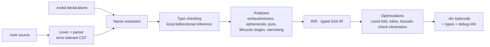

# 14 — Rook language

> **Rook**: the chess piece that comes after the *Pawn*. Working name
> ([ADR-0006](adr/0006-own-plugin-language-rook.md)).
> `.rook` extension · `rookc` compiler · `.rbc` bytecode.

## 1. Design goals

1. **Looks like AMX Pawn, new inside:** a C-like syntax, semicolons, parentheses around conditions,
   `forward` and the lifecycle names, written in camelCase like the whole project (`pluginPrecache`,
   `pluginInit`). Nothing of AMX Mod X is ported ([ADR-0034](adr/0034-rook-modern-only.md)).
2. **Typed to the maximum:** nominal types, no `any`, no `null`, no implicit coercion, errors in the
   return type, exhaustive `match`, units of measure, lifecycle stages in signatures, states proved
   by a check and text from outside as its own type
   ([ADR-0033](adr/0033-rook-compiler-and-types.md)).
3. **Safe by construction:** handles that never dangle, no raw memory access, a sandbox and budgets
   in the VM, and a verifier that enforces the types again at load.
4. **Deterministic:** the same state and the same inputs produce the same result.
5. **Fast enough for gameplay:** static types, register bytecode, no dynamic type checks.
6. **First-class tooling:** a compiler that stands apart from the engine, incremental builds, LSP,
   formatter, linter, debugger and tests.

## 2. Comparison: Pawn × TypeScript × Rook

| Aspect | Pawn (AMXX) | TypeScript | Rook |
|--------|-------------|------------|------|
| Base type | Untyped 32-bit cell, weak *tags* | Structural, with `any` | **Nominal**, no `any`/`unknown` |
| Null | `0` as an invalid handle | `null`/`undefined`, `!` to force | **No null**: `T?` with mandatory handling and no `!` |
| Errors | Return code or `log_error` | Untyped exceptions | `Result<T, E>` with `error enum` and `?`. Ignoring a `Result` is an error |
| Conversions | Implicit between tags, with a warning | Coercion (`"1" + 1`) | **No** implicit ones (except `T → T?`). Only a literal takes the type of its place |
| Integers | 32-bit cell, silent *wrap* | `number` (double) | Fixed widths and **detected overflow** |
| Units | None (`Float:` for everything) | None | `Health`, `Speed`, `Duration` as distinct types, with optional ranges |
| Structs | Do not exist (arrays and enums) | Structural objects | `struct` by value, `class` by reference |
| Enums | Integer constants | Integers or strings | Sum types with data, no conversion to integer |
| `switch` | No exhaustiveness | No mandatory exhaustiveness | Mandatory **exhaustive** `match` |
| Conditions | Any cell | *Truthiness* | Only `bool` |
| Properties | Enum names and offsets, no checking | Structural fields | Typed fields of a handle, with no string |
| Entity handles | Reusable index | — | Generational handle that **cannot** be stored without `Ref` |
| Lifecycle stages | An error when it runs | — | In the signature: calling from another stage does not compile |
| A player being alive | Up to the author | Narrowing, on no game type | A check gives an `AlivePlayer`, which the API asks for |
| Text from players | A plain string | A plain string | `UntrustedText`, which cannot reach a command |
| Timers | `set_task` by name, no owner | `setTimeout`, cancelled by hand | Tasks that cannot outlive their owner |
| Mutability | Everything mutable | `const` only for the binding | `let` immutable by default |
| Concurrency | Single thread | Event loop | Per-plugin isolates and `pure fn` in jobs |

## 3. First plugin

```rook
import cs.prelude.*;

plugin {
    name:    "Hello",
    version: "1.0.0",
    author:  "Modern-Client.v2",
}

forward pluginInit() -> Result<void, PluginError> {
    registerClientCommand("say /hello", cmdHello)?;
    return ok();
}

fn cmdHello(player: Player) -> PluginResult {
    clientPrint(player, PrintTarget.Chat, "Hello, {player.name}!");
    return PluginResult.Handled;
}
```

## 4. Lexical structure

- Source in **UTF-8**. Semicolons are **mandatory**.
- Comments: `//`, `/* ... */` and `///` documentation (feeds `rook document` and shows up in the LSP).
- Naming (checked by the linter, always as an error), following the project's camelCase rule
  ([02 §3.1](02-coding-standards.md#31-project-rule-camelcase)):

| Element | Style | Example |
|---------|-------|---------|
| Functions, variables, parameters, modules, fields | `camelCase` | `precacheModel`, `maxClip`, `pluginPrecache` |
| Types, enums, variants, interfaces | `PascalCase` | `WeaponClass`, `Team.Zombie` |
| Constants | `SCREAMING_SNAKE_CASE` | `MAX_INFECTION_DELAY` |
| Cvar and console command names (strings) | Classic console name | `"rz_infection_delay"`, `"say /menu"` |

- Literals:

| Literal | Examples |
|---------|----------|
| Integer | `42`, `1_000_000`, `0xFF`, `0b1010` (`i32` where nothing asks for another type) |
| Floating point | `0.75`, `1.5e3` (`f32` where nothing asks for another type) |
| With a unit | `1.5s`, `250ms`, `90deg`: only for types with several units ([§6](#6-units-and-newtypes)) |
| Boolean | `true`, `false` |
| Character | `'a'`, `'\n'` |
| String | `"text {interpolation}"`, `r"no escapes"` |

- Reserved words: `plugin`, `import`, `pub`, `fn`, `pure`, `async`, `await`, `defer`, `let`,
  `var`, `const`, `persist`, `if`, `else`, `match`, `while`, `for`, `in`, `loop`, `break`,
  `continue`, `return`, `struct`, `enum`, `error`, `class`, `open`, `abstract`, `override`,
  `super`, `self`, `interface`, `impl`, `newtype`, `suffix`, `dimension`, `range`, `handle`, `vars`,
  `readonly`, `narrows`, `component`, `forward`, `type`, `inout`, `is`, `true`, `false`, `none`,
  `some`, `ok`, `err`, `void`.

## 5. Primitive types and conversions

| Type | Description |
|------|-------------|
| `bool` | `true`/`false` |
| `i8`, `i16`, `i32`, `i64` | Signed integers |
| `u8`, `u16`, `u32`, `u64` | Unsigned integers |
| `f32`, `f64` | IEEE 754 |
| `char` | Unicode code point |
| `string` | Immutable UTF-8 |
| `void` | Absence of a value (`Result<void, E>`) |

**Arithmetic:** overflow and division by zero raise a `panic` (the callback is aborted with a
typed failure). For other behaviors, the choice is explicit:

```rook
let a = x.wrappingAdd(y);     // wraps around
let b = x.saturatingAdd(y);   // clamps at the type bounds
let c = x.checkedAdd(y);      // i32? (none on overflow)
```

**A literal takes the type its place asks for**, while compiling, and only a literal does. A value
that already has a type keeps it:

```rook
player.health = 100;          // ok: `Health`
player.health = 99.5;         // ok
weapon.accuracy = 1;          // ok: `f32`
player.frags = 1.5;           // error R0204: expected `i32`, found a fraction

let amount = 100;             // i32
player.health = amount;       // error R0201: expected `Health`, found `i32`
let bonus = Health(25);       // nothing asks for a type here, so it is named
let limit: Health = 5000;     // ok
player.health + 50;           // ok: the literal takes the type the operation asks of it
```

**Conversions** are never implicit:

| From → to | How |
|-----------|-----|
| Lossless (`i32 → i64`, `i32 → f64`) | `i64(x)`, `f64(x)` |
| Possibly lossy (`i64 → i32`) | `i32.tryFrom(x)` → `Result<i32, ConversionError>` |
| Float → integer | `x.roundToI32()`, `x.floorToI32()`, `x.truncToI32()` → `Result<i32, ConversionError>` |
| Any → string | Interpolation `"{x}"` or `x.toString()` |
| String → number | `i32.parse(s)` → `Result<i32, ParseError>` |

## 6. Units and newtypes

A **newtype** creates a new type, incompatible with its base, with the operations it permits:

```rook
newtype Health(f32) derive(Ord, Add, Sub, Scale);
newtype Armor(f32) derive(Ord, Add, Sub, Scale);
```

```rook
player.health = 100;                // ok
player.health = player.armor;       // error R0201: expected `Health`, found `Armor`
let c = player.health + player.armor; // error R0201: cannot add `Health` and `Armor`
let e = player.health.value();      // f32, explicit escape when really needed
```

A **suffix** exists only where a number alone cannot say which unit it means:

```rook
await wait(3);                      // error R0205: `Duration` has several units; write `3s` or `3ms`
await wait(3s);                     // ok
player.fieldOfView = 90deg;         // ok
```

Standard library units:

| Type | Suffixes | Base | Meaning |
|------|----------|------|---------|
| `Health` | — | `f32` | Health points (fractional as in the original. The HUD shows the integer by the original rule, with no cap) |
| `Armor` | — | `f32` | Armor points |
| `Damage` | — | `f32` | Raw damage, before armor and multipliers |
| `Money` | — | `i32` | Money |
| `AmmoCount` | — | `i32` | Ammunition |
| `Distance` | — | `f32` | Map units (*hammer units*) |
| `Speed` | — | `f32` | Units per second |
| `Duration` | `ms`, `s`, `min` | `i64` (µs) | Game time |
| `Angle` | `deg`, `rad` | `f32` | Angles |
| `Scale` | — | `f32` | Multipliers (gravity, damage) |

**A unit derives its operations** from one declaration, and a mod's own units get them too:

```rook
newtype Speed(f32) dimension(Distance / Duration);
```

This gives `Distance / Duration → Speed`, `Speed * Duration → Distance` and
`Distance / Speed → Duration`, the conversion from `Duration`'s microseconds included. Relations that
are not dimensions stay declared one by one: `Health − Damage → Health`, `Damage * Scale → Damage`,
`Health * Scale → Health`, `Duration * f32 → Duration`.

**A newtype may declare a range.** A literal is checked while compiling, and a value known only at
run time goes through `tryFrom`:

```rook
newtype Volume(f32) range(0..=1);

sound.volume = 1.5;                    // error R0206: `Volume` goes from 0 to 1
let volume = Volume.tryFrom(value)?;   // Result<Volume, ConversionError>
```

## 7. Compound types

### 7.1 Structs (value)

```rook
pub struct HudText {
    message:  string,
    position: HudPosition = HudPosition.CENTER,
    color:    Color = Color.WHITE,
    hold:     Duration = 3s,
}

let text = HudText { message: "Infection!", hold: 5s };   // omitted fields use defaults
let bad  = HudText { mesage: "x" };                        // error R0310: unknown field `mesage`
```

Fields without a default value are mandatory in the literal. Structs are copied on
assignment or when passed as an argument.

### 7.2 Enums (sum types)

```rook
pub enum Team { Terrorist, CounterTerrorist, Spectator }

pub enum DamageSource {
    Weapon(weapon: Weapon),
    Fall(speed: Speed),
    Explosion(radius: Distance),
    World,
}
```

Enums do **not** convert to integers. `team.ordinal()` exists for explicit serialization.
When the expected type is known, the variant can be abbreviated: `.Terrorist`.

### 7.3 Tuples, arrays and collections

| Type | Semantics |
|------|-----------|
| `(A, B)` | Tuple by value |
| `[T; N]` | Fixed-size array by value, with checked indexing |
| `List<T>` | Dynamic list (reference) |
| `Map<K, V>` | Map with **insertion order** (deterministic iteration) |
| `Set<T>` | Set with insertion order |
| `PlayerMap<T>` | Per-player data, **cleared automatically** when the player disconnects |
| `EntityMap<T>` | Per-entity data, cleared automatically when the entity is destroyed |

`PlayerMap` eliminates the classic bug of forgetting to reset per-player data when a player
disconnects.

## 8. Option and Result

### 8.1 No null

```rook
let target: Player? = findPlayerByName("Arctic");

if (let player = target) {
    clientPrint(player, .Chat, "Found you.");
}

let name: UntrustedText = match (target) {
    some(player) => player.name,
    none         => "nobody",
};

let respawnDelay = customDelay ?? DEFAULT_RESPAWN_DELAY;   // `??` supplies a default
```

- `T` → `T?` is the **only** implicit conversion in the language.
- There is no operator to "force" an optional. To assert that something exists, use
  `match`, `if let` or `.expect("reason")`, which raises a `panic` with the message and is
  an error on gameplay paths ([§22](#22-lints-and-magic-numbers)).

### 8.2 Typed errors

```rook
pub error enum ClassError {
    @message("class \"{id}\" is already registered")
    AlreadyRegistered(id: ClassId),
}

pub error enum PrecacheError {
    from Class(ClassError),          // `?` converts ClassError automatically
    from Resource(ResourceError),
}

@onlyIn(Lifecycle.Precache)
pub fn createClass(id: ClassId, team: Team) -> Result<Class, ClassError> {
    if (classes.containsKey(id)) {
        return err(ClassError.AlreadyRegistered(id: id));
    }
    ...
}
```

`ClassId` is a string newtype created by `classId("assassin")`, a `const fn` that
validates the ID format **at compile time**. The owning plugin exports the ID as a constant
(`pub const ASSASSIN: ClassId = classId("assassin");`), and whoever imports it gets
name checking and a load dependency ([§19](#19-modules-imports-and-visibility)).

- Ignoring a `Result` is a **compile error** (`R0410`). To discard one on purpose:
  `let _ = ...;` with a comment.
- `?` only works when the source error has a `from` variant in the target error.
  There is no "generic" conversion.

### 8.3 Lifecycle stages

A function that only makes sense in one stage of the lifecycle says so, and calling it from anywhere
else does not compile:

```rook
forward pluginInit() -> Result<void, PluginError> {
    createClass(ASSASSIN, Team.Zombie)?;   // error R0701: `createClass` runs only in `pluginPrecache`
    return ok();
}
```

The mark is inferred inside a plugin and declared on a `pub` function. A function reference carries
it, so `startTask(player, createLater)` does not compile either.

## 9. Variables, constants and scope

```rook
const MAX_ZOMBIE_SPEED: Speed = 320;       // compile-time constant
let delay = 10s;                            // immutable local
var infectedCount = 0;                     // mutable local

var roundCounter: i32 = 0;                 // plugin global (lives in the isolate)
persist var totalInfections: i64 = 0;      // survives hot reload (matched by name and type)
```

- Every variable is initialized at its declaration (no "garbage" and no implicit zero).
- *Shadowing* in a nested scope is forbidden (`R0120`).
- Globals belong to the plugin's isolate and are not visible to other plugins, except through `pub`
  functions.

## 10. Functions, closures and generics

```rook
pub fn giveHealth(player: Player, amount: Health, limit: Health = 100) -> Health {
    let updated = min(player.health + amount, limit);
    player.health = updated;
    return updated;
}

giveHealth(player, 25);
giveHealth(player, amount: 50, limit: 200);   // named arguments
```

- No function overloading: distinct names or generics.
- `inout` parameters allow modifying the argument, with an explicit `&` at the call site:

```rook
fn clampSpeed(inout velocity: Vector3, limit: Speed) { ... }
clampSpeed(&velocity, MAX_ZOMBIE_SPEED);
```

- Closures: `(player) => isAlive(player)` or `(player) => { ...; return x; }`.
- Generics with interface constraints:

```rook
pub fn strongest<T: HasHealth>(items: List<T>) -> T? { ... }
```

- `const fn`: evaluated at compile time, under a budget. Used in IDs (`classId("human")`) and derived
  constants, with the argument validated at build time.
- `pure fn`: forbidden from accessing the world, mutable globals and non-`pure` functions. It
  can run in jobs ([§17](#17-concurrency-and-determinism)).

## 11. Control flow and match

Parentheses and braces are mandatory in control flow, in one form only:

```rook
if (!player.isAlive) { ... }
if (let target = findTarget(player)) { ... }
while (count > 0) { ... }
for (player in players) { ... }
for (index in 0..count) { ... }
loop { ... }

let reward = match (reason) {
    RoundEndReason.TargetBombed        => economy.bombWin,
    RoundEndReason.BombDefused         => economy.defuseWin,
    RoundEndReason.CTsWin
    | RoundEndReason.TerroristsWin     => economy.eliminationWin,
    _                                  => economy.defaultWin,
};

match (source) {
    .Weapon(weapon) if isKnife(weapon) => applyKnifeBonus(weapon),
    .Weapon(weapon)                     => applyWeaponDamage(weapon),
    .Fall(speed)                        => applyFall(speed),
    .Explosion(radius)                  => applyExplosion(radius),
    .World                              => {},
}
```

- `break`, `continue` and labels (`'outer: for (...)`).
- `match` is **exhaustive**. `_` is only allowed when there are remaining variants, and it is an
  error when it hides new variants of an enum from the plugin itself.
- `if` and `match` are expressions.
- Conditions only accept `bool`: `if (count)` is an error and must be `if (count > 0)`.

## 12. Strings, formatting and translation

```rook
let money = player.money;
clientPrint(player, .Chat, "You have {money}.");
let line = "{name:<16} {frags:>4} {deaths:>4}";      // alignment and width
```

- Interpolation checked at compile time. Format specifiers are validated against
  the type.
- **Translation** with typed keys:

```rook
clientPrint(player, .Center, translate("RZ_INFECTED_BY", infected: victimName, by: attackerName));
```

```toml
# locale/pt-BR.toml
RZ_INFECTED_BY = "{infected} foi infectado por {by}!"
```

`rookc` reads the mod's locale files. A missing key, or a missing or extra parameter, is
a compile error. The language is chosen per player (`cl_language`).

### 12.1 Text from outside

A player's name pasted into a server command can carry a second command. A player's `name`, the text
of `say`, a command's `string` argument, a client's message and an HTTP response are `UntrustedText`,
and an interpolation with an untrusted piece is untrusted.

```rook
let name = player.name;                             // UntrustedText
clientPrint(player, .Chat, "Hello, {name}!");       // ok: the engine draws it as text
serverCommand("kick {name}");                       // error R0703: text from a player cannot reach a command
serverCommand(consoleCommand("kick", name)?);       // ok: quoted as one argument, or an error
```

Printing, comparing and parsing accept it. `serverCommand` takes a `ConsoleCommand`, and a SQLite
statement is a literal with parameters. It becomes a `string` only through a check that returns a
`Result` (`validateText(name, PATTERN)?`). Command arguments typed as `Player` or `Health` are parsed
values, not untrusted text.

## 13. Handles, fields and checked states

### 13.1 Handles

A `handle` is an opaque, typed identifier for an object that lives in the engine or in
another plugin (entity, player, weapon, ReZombie class…):

```rook
pub handle Class;
pub handle Props;
```

- Handles are **generational**: a handle to something destroyed never comes to point to
  something else. The engine validates a handle on every call, whatever the bytecode proved.
- Handles to short-lived objects (`Player`, `Entity`, `Weapon`) are **ephemeral**:
  valid until the end of the current callback. The compiler **forbids** storing them in globals,
  fields, components or scheduled closures, and keeping them across an `await`, except a task's owner
  ([§16](#16-tasks-and-coroutines)). To store one, use its `Ref` counterpart:

```rook
var lastAttacker: PlayerRef? = none;

fn onDamage(victim: Player, attacker: Player) {
    lastAttacker = refOf(attacker);          // ok: Ref can be stored
}

fn later() {
    if (let attacker = resolve(lastAttacker)) { // Player? (none if disconnected)
        ...
    }
}
```

This eliminates, at compile time, the AMXX class of bugs in which a stored `id` comes to
point to another player.

### 13.2 Variable catalogs (`vars`)

Properties are typed **fields** of a handle, with no string and no accessor
([ADR-0034](adr/0034-rook-modern-only.md)). Each handle has a declared **`vars` catalog**:

```rook
/// Gameplay properties shared by classes and subclasses.
pub handle Props;

pub vars Props {
    health:              Health = 100,
    armor:               Armor = 0,
    speed:               Speed = 250,
    gravity:             Scale = 1.0,
    weaponsInteraction: bool = true,
    readonly id:         string,
}
```

```rook
props.health = 5000;                 // ok
props.health = props.armor;          // error R0201: expected `Health`, found `Armor`
props.helth = 5000;                  // error R0312: no field `helth` on `Props`; did you mean `health`?
props.id = "x";                      // error R0313: `id` is readonly
let speed = props.speed;             // speed: Speed
```

- A field compiles to an index, with no lookup by name at run time.
- **A field write only stores.** Whatever applies rules or raises an event is a named action and the
  field is `readonly`: `player.money` is changed by `setMoney(player, 800, reason)?`, and `player.team`
  by `changeTeam`. No write hides a flow.
- A handle has the fields of those above it, and its own field hides one of the same name
  ([15 §4](15-mod-api.md#4-handles-and-var-catalogs)).
- By-name access exists only in `getVarDynamic`/`setVarDynamic`, which return
  `Result<VarValue, VarError>` and are meant for admin and debugging tools.
- The LSP autocompletes the fields and shows the type, default and documentation of each one.
- The engine provides catalogs for `Entity`, `Player`, `Weapon`, `WeaponClass`, the game rules and
  others ([15 §4](15-mod-api.md#4-handles-and-var-catalogs)).

### 13.3 States proved by a check

`AlivePlayer` is a handle under `Player`, accepted wherever a `Player` is. The catalog declares what
narrows to it (`readonly isAlive: bool narrows AlivePlayer`), so no new spelling is needed:

```rook
fn onMenuChoice(player: Player) {
    giveItem(player, ItemId.Ak47);     // error R0702: `giveItem` needs a living player; check `isAlive` first
}

fn onBuy(player: Player) -> PluginResult {
    if (!player.isAlive) {
        return PluginResult.Handled;
    }
    giveItem(player, ItemId.Ak47);     // ok: from here on `player` is an `AlivePlayer`
    return PluginResult.Handled;
}
```

- A parameter or a `let` narrows; a `var` does not. Like any ephemeral handle it ends with the
  callback and at an `await`, unless it owns the task, and it is never stored: `refOf` gives a
  `PlayerRef`. Only the instruction that asks the engine makes one, which the verifier checks.
- It proves that the check was made and that nothing the plugin did since could undo it. A call that
  can end the state says so, `@ends(AlivePlayer)`, inferred inside a plugin and declared on a `pub`
  function; after it the variable is a `Player` again.
- The engine checks again on every call, because another plugin's hook can end the state during an
  action. The callback is then aborted with `PluginFault.StateEnded` and logged; being an order of
  events and not a bug, it does not count toward `rook_fault_policy`
  ([13 §6.4](13-mod-system.md#64-budgets-and-failures)).

### 13.4 Resource paths

A literal path takes the type the parameter asks for, and `rookc` looks for it in the mod's `assets/`
and those of its dependencies, with the kind its extension says:

```rook
let model = precacheModel("models/rezombie/zombie.mdl")?;   // ok
let other = precacheModel("models/rezombie/zombi.mdl")?;    // error R0704: no such file; did you mean "zombie.mdl"?
```

The compiler never reads the game's content
([ADR-0015](adr/0015-free-content-and-optional-original-assets.md)), so a mod names what it expects
of it in `mod.toml` ([13 §3.1](13-mod-system.md#31-modtoml)). The call still returns a `Result`,
because files can change after a build. A path built at run time is checked only then.

## 14. Classes and interfaces

```rook
pub interface Damageable {
    fn takeDamage(self, amount: Health, source: DamageSource) -> Health;
}

pub abstract class Ability {
    var cooldown: Duration;

    pub fn new(cooldown: Duration) -> Self { return Self { cooldown: cooldown }; }
    pub abstract fn activate(self, player: Player) -> Result<void, AbilityError>;
}

pub class Leap extends Ability {
    override fn activate(self, player: Player) -> Result<void, AbilityError> {
        player.velocity = forwardVector(player) * LEAP_FORCE;
        return ok();
    }
}
```

- Classes are `final` by default. `open`/`abstract` allow inheritance, and `override` is
  mandatory.
- Single inheritance, multiple interfaces (`impl Damageable for Leap`).
- Classes are reference types, managed by the isolate's GC.

## 15. Forwards, hooks, commands and cvars

### 15.1 Forwards

```rook
forward pluginPrecache() -> Result<void, PrecacheError> { ... }
forward clientPutInServer(player: Player) { ... }
forward clientDisconnected(player: Player, reason: DisconnectReason) { ... }
```

- `forward` implements a **known** forward: from the engine, from the game or exported by another
  plugin. An unknown name or a different signature is an error (`R0501: unknown forward
  "pluginInti"; did you mean "pluginInit"?`).
- API plugins declare and fire their own forwards:

```rook
pub forward roundStart(mode: Mode, duration: Duration);

executeForward(roundStart, mode, duration);
```

### 15.2 Hooks

```rook
@hook(Hook.PlayerTakeDamage, HookPhase.Pre)
fn onTakeDamage(inout args: PlayerTakeDamageArgs) -> HookResult {
    if (args.victim.team == Team.Zombie && args.source is .Fall) {
        return HookResult.Supersede;            // block the original action
    }
    args.damage = args.damage * ZOMBIE_DAMAGE_SCALE;
    return HookResult.Continue;
}
```

- Each hook has a typed argument struct. `readonly` fields cannot be changed, not even in
  the pre hook.
- Returns: `Continue`, `Supersede` (blocks the original action) and `Break` (blocks it and
  stops the following hooks).
- Post hooks receive `args` and the result of the action (`postResult`).
- Dynamic registration: `let hook = registerHook(Hook.PlayerSpawn, HookPhase.Post, onSpawn);`
  with `disableHook(hook)` and `enableHook(hook)`.

### 15.3 Commands with typed arguments

```rook
forward pluginInit() -> Result<void, PluginError> {
    registerConsoleCommand("rz_give_health", cmdGiveHealth, access: Permission.Cheats,
                           usage: "<player> <amount>")?;
    return ok();
}

fn cmdGiveHealth(caller: Caller, target: Player, amount: Health) -> PluginResult {
    giveHealth(target, amount);
    return PluginResult.Handled;
}
```

The runtime parses the arguments according to the signature (`Player` accepts `#userid`,
a partial name or a `PlayerId`, and `Health` accepts `50`). A `string` argument arrives as
`UntrustedText` ([§12.1](#121-text-from-outside)). An invalid argument automatically gets the correct
usage as the reply.

### 15.4 Typed cvars

```rook
let infectionDelay = createCvar("rz_infection_delay", 10s,
                                  description: "Delay before the first infection",
                                  min: 1s, max: 60s)?;

let delay = getCvar(infectionDelay);          // Duration
hookCvarChange(infectionDelay, onDelayChanged);
```

A cvar of a type with a range ([§6](#6-units-and-newtypes)) takes its limits from the type.

## 16. Tasks and coroutines

A task is an `async fn` that belongs to something and cannot outlive it: structured concurrency
([ADR-0034](adr/0034-rook-modern-only.md)). AMX Mod X's `set_task` has no equivalent here.

```rook
fn burn(player: AlivePlayer) -> Result<void, TaskError> {
    startTask(player, burnDamage)?;   // ends by itself if the player dies or leaves
    return ok();
}

async fn burnDamage(player: AlivePlayer) -> Result<void, PluginError> {
    for (_ in 0..BURN_TICKS) {
        await wait(1s);
        takeDamage(player, BURN_DAMAGE);   // `player` is still valid after the `await`
    }
    return ok();
}
```

| Rule | What it closes |
|------|----------------|
| The owner is mandatory, and the function's first parameter has its type: an `AlivePlayer` (dies or leaves), a `Player` (leaves), an `Entity` (removed), a `Round` (ends) or the plugin | A task that outlives what it acts on |
| The VM checks the owner before resuming; if it is gone, the task is cancelled and never resumes | A stale handle after a wait, with no check to write |
| `startTask` returns a `Result`, `TaskError.AlreadyRunning` for the same function and owner; `restartTask` replaces the running one, and `cancelTask` ends it | A timer armed twice by accident |
| Cancellation happens only at an `await`, and `defer` runs when a task ends for any reason | State left half done |
| A task returns a `Result`, and an `err` goes to the log and to `rook_fault_policy` | An error with nowhere to go |
| A quota of tasks per plugin, and the fuel of each step | Endless tasks, and a loop that never waits |
| A plugin's tasks are cancelled on reload and unload, and a `Task` cannot be `persist` | A task running old code |
| No flags: repeating is a `for` or a `loop` with `await wait(1s)`, and a delay is a `wait` on the first line | A second mechanism for each case |

- `await wait(duration)`, `await nextTick()` and `await until(condition)`.
- Time is **game time**. Tasks resume at the start of the `Script` phase of the tick in which their
  deadline expired, ordered by (deadline, creation order). This is deterministic and independent of
  the FPS.
- The owner is the one ephemeral handle that crosses an `await`, sound because of the check before
  resuming. Any other handle crosses as a `Ref`, and `resolve` gives it back as optional.
- Inside `defer` the owner may be gone, so there it is optional (`Player?`), and `defer` cannot
  `await`.

## 17. Concurrency and determinism

- Each plugin is a **single-threaded** isolate: Rook code never has a data race, and the code between
  two `await`s runs whole.
- Parallelism comes from two places:
  1. **ECS systems** ([§18](#18-ecs-components-and-systems)) from different plugins without
     conflicts run in parallel.
  2. **`pure fn` in jobs:** `let path = await runJob(findPath, start, goal);`. The function
     receives data by copy and does not touch the world.
- Determinism: no wall clock (except with a capability), `random_*` comes from a
  per-plugin stream seeded by the server, and `Map`/`Set` iterate in insertion order.

## 18. ECS: components and systems

```rook
@replicated
pub component Frozen {
    until: GameTime,
}

@system(phase: Phase.Simulation)
fn thawFrozen(query: Query<(Entity, Frozen)>, time: Time, commands: Commands) {
    for ((entity, frozen) in query) {
        if (time.now >= frozen.until) {
            commands.removeComponent<Frozen>(entity);
        }
    }
}

addComponent(player, Frozen { until: gameTime() + FREEZE_DURATION });
```

- Plugin components take part in queries and replication like the engine's
  ([03 §13](03-ecs.md#13-rook-plugin-integration)).
- `@replicated` sends the component to the clients, enabling effects and prediction in
  `client`/`shared` plugins.

## 19. Modules, imports and visibility

```rook
import cs.weapons.{createWeaponClass, WeaponType};
import rezombie.api.classes.{createClass, Class};    // another plugin: creates a dependency
import rezombie.prelude.*;                           // glob only for modules marked `prelude`
```

- Each file is a module, and the module path comes from the file path.
- `pub` exports. Without `pub`, the item is private to the module.
- Importing from another plugin creates the load dependency ([13 §3.2](13-mod-system.md#32-automatic-load-order)).
- Glob imports (`*`) are only allowed for `prelude` modules, which gather the most common usage.

## 20. Errors, panics and failures

| Situation | Mechanism |
|-----------|-----------|
| Expected failure (missing resource, duplicate name) | `Result<T, E>` |
| Violated invariant (bug) | `panic("reason")`, `assert(cond, "reason")`, `unreachable()` |
| Limit exceeded (CPU, heap, stack) | VM failure (`PluginFault`) |
| A checked state ended during an action ([§13.3](#133-states-proved-by-a-check)) | `PluginFault.StateEnded`, logged and not held against the plugin |

Panics and failures abort **only the current callback or task**, with a Rook *stack trace* and the
server's failure policy ([13 §6.4](13-mod-system.md#64-budgets-and-failures)). `todo()` is
forbidden in release builds.

## 21. Tests

```rook
@test
fn assassinHasHighHealth() -> Result<void, TestError> {
    let server = TestServer.start(map: "de_dust2")?;
    let player = server.addBot(team: Team.Terrorist)?;
    changePlayerClass(player, requireClass(ASSASSIN)?)?;
    expectEq(player.health, 5000)?;
    return ok();
}
```

`rook test` starts the dedicated server as another program, *headless*, with controlled time
(`server.advance(3s)`), test bots and typed assertions.

## 22. Lints and magic numbers

| Lint | Default | Rule |
|------|---------|------|
| `magicNumber` | error | Numeric literal without a unit and without a name (outside `const`, `vars`, a named argument or a field write). A literal in a place typed as a unit counts as having one |
| `stringLookupInPrecache` | warning | `require*("name")` in `pluginPrecache`. Import the exported ID |
| `expectInGameplay` | error | `.expect()` outside precache, init and tests |
| `wildcardHidesVariants` | error | `_` in `match` hides the plugin's own variants |
| `unused` | warning | Unused variable, import, function or result |
| `naming` | error | Naming outside the standard of [§4](#4-lexical-structure) |

The rules of the type system are not lints: there is no `unsafe`, no cast, no pragma and no lint level
that turns one off. The explicit exits are `.value()` for a unit and `getVarDynamic` for admin tools.

## 23. The `rookc` compiler

`rookc` is a program of its own ([ADR-0033](adr/0033-rook-compiler-and-types.md)). It reads `.rook`
sources and `.rookd` declarations and writes `.rbc` bytecode, and nothing else ties it to the engine:
a plugin builds with the SDK alone, and servers and clients carry no compiler.



| Directory | Contents | Depends on |
|-----------|----------|------------|
| `rook/format` | The layout of `.rbc` and `.rookd`, their versions, readers and writers | `std` |
| `rook/compiler` | Library: syntax, semantics, RIR, bytecode | `format` |
| `rook/verifier` | The load-time check of [§24](#24-vm-and-bytecode) | `format` |
| `rook/vm` | Interpreter, collector, isolates, budgets | `format`, `verifier` |
| `rook/cli`, `rook/lsp` | `rook`, `rookc` and `rookLsp`: thin programs over the library | `compiler` |

- Written in **C++26**, importing nothing of `engine/` or `game/`: the toolchain is MIT
  ([ADR-0010](adr/0010-license.md)).
- **Incremental and query-based:** the same base serves `rook build`, `rook check`
  and `rookLsp`. Editing a function recompiles only what depends on it.
- The lossless CST feeds the formatter and *refactoring*.
- **Robust:** malformed source always ends in a diagnostic, never a crash, and `rookc` is fuzzed.
- **It treats its input as untrusted:** no network, reads only under the mod and the declarations,
  and `const fn` runs under a budget.
- **Reproducible:** the same inputs and compiler version give the same bytes.
- Diagnostics with a code, a snippet, an explanation and a fix suggestion, in English and
  Portuguese (`--lang pt-BR`), with `rookc --explain R0201`:

```text
error[R0201]: expected `Speed`, found `Health`
  --> plugins/class/assassin.rook:19:19
   |
19 |     props.speed = props.health;
   |                   ^^^^^^^^^^^^ field `speed` has type `Speed`
```

## 24. VM and bytecode

- **Typed register bytecode.** Instructions already know the operand types, with no
  dynamic type checking.
- **The bytecode keeps the types.** `.rbc` carries a table of its nominal types (units and other
  newtypes, structs, enums, handles with their hierarchy and whether they are ephemeral) and, for each
  function, its signature and its marks (`pure`, `@onlyIn`, `@ends`).
- **Load-time verifier** (like the JVM/Wasm): the `.rbc` is checked against those types, register
  bounds and jump targets before it runs: a `Health` is not used as an `Armor`, an ephemeral handle
  does not reach a global or a field, a `pure` function calls only `pure` ones, and a function bound
  to a lifecycle stage is called only from it. That is why bytecode coming from the network is safe
  on the client. Exhaustive `match` (lowered with a branch that faults), resource paths and translation
  keys stay the compiler's alone.
- The verifier shares only `rook/format` with the compiler, so that a bug in the checker is not also a
  hole in the verifier, and it is fuzzed from its first commit.
- **Server plugins come first.** Bytecode from the network runs on a client only after the audit
  [ADR-0007](adr/0007-own-vm-typed-bytecode.md) requires.
- Interpreter dispatching by *computed goto* on GCC and Clang and by `switch` on MSVC, with the same
  bytecode and results on each. An optional JIT remains future work, without changing the format.
- **Per-isolate GC**, precise and incremental, run in the tick's idle budget. There is
  no global pause across plugins.
- **Instruction fuel** for the CPU budget, and a *stack trace* with a source map.
- Details in [ADR-0007](adr/0007-own-vm-typed-bytecode.md) and
  [ADR-0033](adr/0033-rook-compiler-and-types.md).

## 25. Grammar (summary)

```ebnf
file          = { import } [ plugin_decl ] { item } ;
import        = "import" path [ "." ( "{" ident { "," ident } "}" | "*" ) ] ";" ;
plugin_decl   = "plugin" struct_body ;
item          = [ attributes ] [ "pub" ] ( fn_decl | forward_decl | struct_decl | enum_decl
              | class_decl | interface_decl | newtype_decl | handle_decl | vars_decl
              | component_decl | const_decl | var_decl | type_alias ) ;
fn_decl       = [ "pure" ] [ "async" ] "fn" ident [ generics ] "(" [ params ] ")" [ "->" type ] block ;
forward_decl  = "forward" ident "(" [ params ] ")" [ "->" type ] ( block | ";" ) ;
params        = param { "," param } ;
param         = [ "inout" ] ident ":" type [ "=" expr ] ;
newtype_decl  = "newtype" ident "(" type ")" [ "suffix" ident { "," ident } ]
                [ "dimension" "(" type ( "/" | "*" ) type ")" ] [ "range" "(" expr ")" ]
                [ "derive" "(" ident { "," ident } ")" ] ";" ;
handle_decl   = "handle" ident ";" ;
vars_decl     = "vars" ident "{" var_entry { "," var_entry } [ "," ] "}" ;
var_entry     = [ "readonly" ] ident ":" type [ "narrows" type ] [ "=" expr ] ;
type          = path [ "<" type { "," type } ">" ] [ "?" ] | "(" type { "," type } ")" | "[" type ";" expr "]" ;
statement     = let_stmt | var_stmt | expr ";" | if_stmt | match_expr | while_stmt
              | for_stmt | loop_stmt | defer_stmt | "return" [ expr ] ";" | "break" ";" | "continue" ";" ;
if_stmt       = "if" "(" ( expr | "let" pattern "=" expr ) ")" block [ "else" ( if_stmt | block ) ] ;
while_stmt    = "while" "(" expr ")" block ;
for_stmt      = "for" "(" pattern "in" expr ")" block ;
match_expr    = "match" "(" expr ")" "{" match_arm { match_arm } "}" ;
defer_stmt    = "defer" block ;
attributes    = { "@" ident [ "(" args ")" ] } ;
```

The full grammar, with operator precedence, lives in `rook/spec/grammar.ebnf`, and the
compiler's conformance test suite is the executable reference.
