# 19 — Roadmap

O projeto evolui por **marcos** (M0–M8). Cada marco entrega algo executável e testado e
tem critérios de saída verificáveis. A lista de tarefas detalhada de cada marco está em
[`../TODO.md`](../TODO.md).

```mermaid
gantt
    dateFormat  X
    axisFormat  %s
    section Engine
    M0 Fundação              :m0, 0, 1
    M1 Núcleo de runtime     :m1, after m0, 2
    M2 Assets e mundo        :m2, after m1, 2
    section Jogo
    M3 Jogo local            :m3, after m2, 2
    M4 Rede e servidor       :m4, after m3, 3
    M5 Counter-Strike completo :m5, after m4, 3
    section Rook
    M6 Rook e plugins        :m6, after m2, 6
    section Release
    M7 Paridade fina e ecossistema :m7, after m5, 3
    M8 Release 1.0 e futuro  :m8, after m7, 2
```

> O gráfico mostra **dependências e ordem relativa**, não datas. O M6 (Rook) começa em
> paralelo após o M2: o compilador não depende da engine, e a API se estabiliza junto com
> o M5.

## M0 — Fundação

**Objetivo:** repositório, build e base de código prontos para crescer com qualidade.

- Estrutura de repositório, CMake + presets, vcpkg, CI Windows/Linux.
- Validação da matriz de compiladores para o subconjunto C++26 e fallbacks.
- `nx.core`: `Result`/`Failure`, tipos fortes e unidades, log, alocadores, contêineres.
- `nx.meta`: fachada de reflexão com caminhos nativo e fallback idênticos.
- Documentação inicial (este diretório).

**Saída:** CI verde nas duas plataformas, testes do `nx.core` e `nx.meta`, matriz de
toolchain documentada.

## M1 — Núcleo de runtime

**Objetivo:** paralelismo e ECS prontos e medidos.

- `nx.jobs` (work-stealing, contadores, prioridades, scheduler `std::execution`).
- `nx.ecs` (arquétipos, chunks, queries, agendador, command buffers, eventos).
- `nx.platform` (relógios e espera precisa para o ritmo de tick e de frame) e `nx.math`.
- Console, cvars e comandos (base compartilhada por cliente e servidor).

**Saída:** metas de desempenho de [03 §16](03-ecs.md#16-metas-de-desempenho-hardware-de-referência-a-definir-no-m1)
atingidas e teste de determinismo com número variável de workers passando.

## M2 — Assets e mundo visível

**Objetivo:** abrir qualquer mapa e navegar com câmera livre, com ou sem os assets
originais.

- VFS com fontes de conteúdo e perfis (`classic`, `open`, `dev`), `content.toml`, detecção e
  validação da instalação do CS 1.6, assistente de primeiro start.
- `devContent` gerado por código, para a engine rodar e ser testada sem nenhum asset
  externo.
- Leitores BSP/WAD/MDL/SPR/WAV.
- Janela e entrada SDL3 no `nx.platform`, junto com o swapchain: o M2 é o primeiro consumidor.
- RHI + backend Vulkan, render graph, shaders Slang.
- Mundo BSP com lightmaps, lightstyles, PVS, céu, água e transparências.
- Modelos de estúdio estáticos e animados com GPU skinning (visualizador de modelos).

**Saída:** com o perfil `classic`, todos os mapas oficiais renderizam sem erros. Com o
perfil `dev`, um mapa de teste gerado roda no CI, com imagens de referência.

## M3 — Jogo local

**Objetivo:** andar e atirar com a sensação do original, em servidor local.

- Colisão por hulls, pmove com suíte de paridade de movimento.
- Jogador, viewmodel, animação de jogador (gait + blends).
- Armas iniciais (faca, Glock, USP, AK-47, M4A1) com spread, recoil e dano.
- Áudio (mixer, canais, DSP de sala, passos).
- HUD básico (vida, colete, munição, crosshair).

**Saída:** suíte de paridade de movimento 100% verde e armas iniciais validadas.

## M4 — Rede e servidor

**Objetivo:** partidas online com servidores que funcionam como o original.

- Transporte, handshake seguro, canais, snapshots delta, interesse e orçamento.
- Predição, interpolação e compensação de lag.
- `nextds`: linha de comando, configs, cvars, comandos, logs.
- A2S, master server próprio, LAN, RCON seguro, identidade de jogador.
- Download de recursos (embutido e HTTP), com a regra de que conteúdo não redistribuível
  nunca é enviado e a exigência de conteúdo declarada pelo servidor.

**Saída:** teste com 32 jogadores reais na internet, teste de estresse inicial com 256
clientes simulados e avaliação de sensação por jogadores veteranos.

## M5 — Counter-Strike completo

**Objetivo:** uma partida de CS 1.6 completa, em todos os tipos de mapa.

- Rounds, economia, todos os motivos de fim.
- Todas as armas, granadas e equipamentos. C4, reféns, VIP, escape.
- Compra (menus clássico e VGUI, autobuy/rebuy), rádio, chat, voz, sprays.
- HUD completo, scoreboard, menus de time e personagem, espectador.
- Todas as entidades de mapa.

**Saída:** todos os mapas oficiais carregam sem avisos, suíte de paridade de gameplay
verde e partida competitiva completa jogada e avaliada.

## M6 — Rook e plugins

**Objetivo:** ecossistema de plugins completo, começando em paralelo após o M2.

- `rookc`: parser, checker (tipos, unidades, efêmeros, exaustividade), RIR e bytecode.
- VM: interpretador, verificador, GC por isolate, orçamentos.
- Geração de bindings e `.rookd` a partir do C++.
- `mod.toml`, `plugins.toml`, ordem por dependências, capabilities.
- Forwards, hooks, `vars`, comandos tipados, cvars, tarefas e coroutines.
- Hot reload, `rookLsp`, depurador DAP, `rook test`, `rook fmt`/`lint`/`doc`/`pack`.
- Mods embutidos (admin, votes, maps, chat, stats) e `rook migrate`.
- **Porte do ReZombie** como mod de referência.

**Saída:** ReZombie portado e funcional, mods embutidos substituindo os plugins padrão
do AMXX e API 1.0 congelada.

## M7 — Paridade fina e ecossistema

- Bots com navegação (importação de `.nav`).
- Demos, `timedemo` e relay de espectadores.
- Plugins de cliente com sandbox e armas customizadas preditas.
- Sprites `.nxspr`, modo `r_fidelity enhanced`, pacotes de alta resolução.
- Estresse com 1024 jogadores e otimizações guiadas por profiling.
- Formato de mapa estendido `.nxmap` (sem limites de BSP), compilado a partir de mapas do
  TrenchBroom com ferramentas do projeto.
- `openContent`: primeiro pacote livre (mapa próprio, jogador, armas, HUD e sons, todos
  originais ou CC0/CC-BY), em repositório separado.

## M8 — Release 1.0 e futuro

- Revisão legal (nome público, licença, avisos de terceiros).
- Backend DirectX 11.
- Servidor dedicado Linux ARM64.
- Site de documentação e portal de mods.
- Release 1.0.
