# 19 — Roadmap

The project evolves through **milestones** (M0–M8). Each milestone delivers something
runnable and tested and has verifiable exit criteria. The detailed task list of each
milestone is in [`../TODO.md`](../TODO.md).

```mermaid
gantt
    dateFormat  X
    axisFormat  %s
    section Engine
    M0 Foundation            :m0, 0, 1
    M1 Runtime core          :m1, after m0, 2
    M2 Assets and world      :m2, after m1, 2
    section Game
    M3 Local game            :m3, after m2, 2
    M4 Networking and server :m4, after m3, 3
    M5 Complete Counter-Strike :m5, after m4, 3
    section Rook
    M6 Rook and plugins      :m6, after m2, 6
    section Release
    M7 Fine parity and ecosystem :m7, after m5, 3
    M8 Release 1.0 and future :m8, after m7, 2
```

> The chart shows **dependencies and relative order**, not dates. M6 (Rook) starts in
> parallel after M2: the compiler does not depend on the engine, and the API stabilizes
> together with M5.

## M0 — Foundation

**Goal:** repository, build and codebase ready to grow with quality.

- Repository structure, CMake + presets, vcpkg, Windows/Linux CI.
- Validation of the compiler matrix for the C++26 subset and fallbacks.
- `nx.core`: `Result`/`Failure`, strong types and units, log, allocators, containers.
- `nx.meta`: reflection facade with identical native and fallback paths.
- Initial documentation (this directory).

**Exit:** green CI on both platforms, `nx.core` and `nx.meta` tests, documented toolchain
matrix.

## M1 — Runtime core

**Goal:** parallelism and ECS ready and measured.

- `nx.jobs` (work-stealing, counters, priorities, `std::execution` scheduler).
- `nx.ecs` (archetypes, chunks, queries, scheduler, command buffers, events).
- `nx.platform` (clocks and a precise wait for the tick and frame pacing) and `nx.math`.
- Console, cvars and commands (a base shared by client and server).

**Exit:** performance targets of [03 §16](03-ecs.md#16-performance-targets-reference-hardware-to-be-defined-in-m1)
met and the determinism test with a variable number of workers passing.

## M2 — Assets and visible world

**Goal:** open any map and navigate with a free camera, with or without the original
assets.

- VFS with content sources and profiles (`classic`, `open`, `dev`), `content.toml`, detection
  and validation of the CS 1.6 installation, first-start wizard.
- `devContent` generated by code, so the engine runs and is tested without any external
  asset.
- BSP/WAD/MDL/SPR/WAV readers.
- SDL3 window and input in `nx.platform`, together with the swapchain: M2 is the first consumer.
- RHI + Vulkan backend, render graph, Slang shaders.
- BSP world with lightmaps, lightstyles, PVS, sky, water and transparencies.
- Static and animated studio models with GPU skinning (model viewer).

**Exit:** with the `classic` profile, every official map renders without errors. With the
`dev` profile, a generated test map runs in CI, with reference images.

## M3 — Local game

**Goal:** walk and shoot with the feel of the original, on a local server.

- Hull collision, pmove with a movement parity suite.
- Player, viewmodel, player animation (gait + blends).
- Initial weapons (knife, Glock, USP, AK-47, M4A1) with spread, recoil and damage.
- Audio (mixer, channels, room DSP, footsteps).
- Basic HUD (health, armor, ammo, crosshair).

**Exit:** movement parity suite 100% green and initial weapons validated.

## M4 — Networking and server

**Goal:** online matches with servers that work like the original.

- Transport, secure handshake, channels, delta snapshots, interest and budget.
- Prediction, interpolation and lag compensation.
- `nextds`: command line, configs, cvars, commands, logs.
- A2S, own master server, LAN, secure RCON, player identity.
- Resource download (built-in and HTTP), with the rule that non-redistributable content is
  never sent and the content requirement declared by the server.

**Exit:** a test with 32 real players over the internet, an initial stress test with 256
simulated clients and a feel assessment by veteran players.

## M5 — Complete Counter-Strike

**Goal:** a complete CS 1.6 match, on every map type.

- Rounds, economy, every end reason.
- Every weapon, grenade and piece of equipment. C4, hostages, VIP, escape.
- Buying (classic and VGUI menus, autobuy/rebuy), radio, chat, voice, sprays.
- Full HUD, scoreboard, team and character menus, spectator.
- Every map entity.

**Exit:** every official map loads without warnings, gameplay parity suite green and a
complete competitive match played and assessed.

## M6 — Rook and plugins

**Goal:** a complete plugin ecosystem, starting in parallel after M2.

- `rookc`: parser, checker (types, units, ephemerals, exhaustiveness), RIR and bytecode.
- VM: interpreter, verifier, per-isolate GC, budgets.
- Generation of bindings and `.rookd` from C++.
- `mod.toml`, `plugins.toml`, dependency ordering, capabilities.
- Forwards, hooks, `vars`, typed commands, cvars, tasks and coroutines.
- Hot reload, `rookLsp`, DAP debugger, `rook test`, `rook fmt`/`lint`/`doc`/`pack`.
- Built-in mods (admin, votes, maps, chat, stats) and `rook migrate`.
- **Port of ReZombie** as the reference mod.

**Exit:** ReZombie ported and working, built-in mods replacing the default AMXX plugins and
API 1.0 frozen.

## M7 — Fine parity and ecosystem

- Bots with navigation (`.nav` import).
- Demos, `timedemo` and spectator relay.
- Sandboxed client plugins and predicted custom weapons.
- `.nxspr` sprites, `r_fidelity enhanced` mode, high-resolution packages.
- Stress with 1024 players and profiling-guided optimizations.
- Extended `.nxmap` map format (without BSP limits), compiled from TrenchBroom maps with the
  project's tools.
- `openContent`: the first free package (own map, player, weapons, HUD and sounds, all
  original or CC0/CC-BY), in a separate repository.

## M8 — Release 1.0 and future

- Legal review (public name, license, third-party notices).
- DirectX 11 backend.
- Linux ARM64 dedicated server.
- Documentation site and mod portal.
- Release 1.0.
