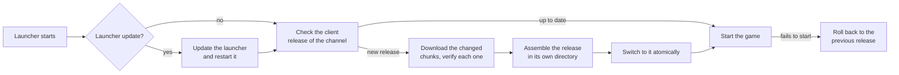

# 21 — Launcher and automatic updates

> **Status:** planned for M4 ([19](19-roadmap.md#m4--networking-and-server)). Decision recorded in
> [ADR-0019](adr/0019-launcher-and-automatic-updates.md).

## 1. Goals

| Goal | How it is met |
|------|---------------|
| Client and server update on their own | Two products, each with its own releases, version and channel; a new client never waits for a server release, nor the other way round (§2) |
| Players stay compatible with servers | The launcher updates the client **before** the game starts; client and server only need the same protocol major ([08 §10](08-networking.md#10-versioning)) |
| Automatic and quiet | No question to answer: check, download and switch happen on their own, with visible progress and log lines |
| Servers never cut a match | A dedicated server updates at start, or when it is empty or between maps, as its operator's policy says (§3) |
| Small downloads | Only the content that changed is fetched, whatever version the installation comes from (§5) |
| Robust | Every step survives a crash or a power cut; a broken update never leaves the game or the server unusable (§6) |
| Secure | Nothing runs that the project did not sign; old or frozen metadata is refused (§4) |
| Predictable | Every outcome is a typed state with a visible message; there is no silent fallback (§7) |

## 2. Two products, updated independently

| Product | What it updates | Who applies it |
|---------|-----------------|----------------|
| `client` | `nextLauncher`, `next` (which includes the listen server), the client's data and the free content (`openContent`) | The launcher, on every start (§3.1) |
| `server` | `nextds` and the server's data | The server itself, by its operator's policy (§3.2) |

- Each product has its own releases, version numbers and channels (`stable`, `beta`), and its
  own signed manifest (§4). A client release that fixes the HUD ships without a server
  release; a server release that fixes RCON ships without a client one.
- **Compatibility is the protocol, not the release:** every release states the
  `ProtocolVersion` it speaks ([08 §10](08-networking.md#10-versioning)). Client and server of any
  release connect while their protocol majors match; a minor difference is compatible by
  definition. When a change needs a new major, the project ships a release of **both** products
  with it, and each side picks it up through its own update; meanwhile the handshake answers
  `RejectReason::ProtocolMismatch{server, client}`, which tells which side is behind.
- An install may hold both products (a player who also runs a server); each keeps its own
  versions and switches on its own.

## 3. The flows

### 3.1 Client: update first, then play



- The **launcher** (`nextLauncher`) is the program players open. It updates itself first (a
  new launcher is staged, then the old one hands over to it), then the client, and only then
  starts `next` with the arguments it received.
- **Pre-download:** while the game runs, the launcher fetches the next client release of the
  channel in the background, at low priority and under a bandwidth cap; at the next start the
  switch is immediate.
- **Offline, or the update server unreachable:** a typed state (`UpdateState::Unreachable`)
  shown with its cause. Single player and LAN start the installed release; online play then
  depends on the server's protocol major, which the handshake checks.

### 3.2 Server: automatic, never during a match

- `nextds` checks the server release of its channel at start, applies an update before it
  opens the game port, and checks again periodically while it runs (`sv_update_interval`).
- A release found while running is downloaded and assembled in the background; the switch
  happens at the moment the operator's policy allows, announced in the log, to RCON and to
  the players (`sv_update_policy`):

| Policy | When a running server switches to a downloaded release |
|--------|--------------------------------------------------------|
| `empty` (default) | When no player is connected, or at the next map change with no player |
| `mapchange` | At the next map change, after a warning to the players |
| `notify` | Never on its own: the log and RCON report it, and the operator applies it (`update` command) |
| `off` | Never checks |

- The switch is a restart of `nextds` on the new release with the same command line; the
  previous release stays for rollback, as on the client.

## 4. Security

The update metadata follows the principles of The Update Framework (TUF), per product:

- **Signed metadata:** each release has a manifest (product, version, `ProtocolVersion`,
  files, their BLAKE3 hashes and sizes) signed with Ed25519 by a release key kept offline. A
  short-lived timestamp, signed by a separate online key, tells which manifest is current for
  each product and channel.
- **Rollback and freeze protection:** an installation stores the highest version it has
  accepted per product and refuses an older one, and refuses a timestamp past its expiry.
- **Every byte verified:** a chunk is used only if its hash matches the signed manifest;
  mirrors and CDNs are therefore untrusted transport.
- **Key rotation:** a new key is introduced by metadata signed with the old one; a
  compromised online key cannot publish a release.
- Nothing runs or loads before its verification.

## 5. Downloading only what changed

- Release files are split into **content-defined chunks**, addressed by their BLAKE3 hash
  (the same content addressing as `nxbake`, [06](06-assets-and-resources.md)). The manifest
  lists the chunks of each file.
- An update builds the new release from the chunks the installation already has (in its
  releases and in its cache, shared by both products) and downloads only the missing ones.
  A small change costs a small download from **any** older release, without one patch per
  pair of versions.
- Downloads run in parallel, resume after an interruption and respect a bandwidth limit.

## 6. Installing atomically

```
<install>/
├── nextLauncher(.exe)
├── client/
│   ├── current        # names the active client release; replaced with an atomic rename
│   └── releases/      # e.g. 1.4.2/ (previous, kept for rollback) and 1.5.0/ (active)
├── server/
│   ├── current
│   └── releases/
└── chunks/            # content-addressed cache, shared by both products
```

- A release is assembled in its own directory and verified completely before the switch; the
  switch is one atomic rename of that product's `current`.
- The previous release stays until the new one has started successfully. If it fails to
  start, the switch goes back and the failure is reported (`UpdateState::RolledBack`).
- Interrupted at any point, the next start resumes from the last completed step: nothing is
  half-installed.
- Local data (`content.toml`, configs, demos, the user's mods, the server's configs and logs)
  lives outside `releases/` and is never touched by an update.

## 7. States and failures

Each product reports one of `UpdateState::{UpToDate, Downloading, Verifying, Installing,
Pending, Updated, RolledBack, Unreachable, Rejected}` (`Pending`: a server release downloaded
and waiting for its policy), and failures are typed (`UpdateError::{SignatureInvalid,
MetadataExpired, VersionRollback, HashMismatch, DiskFull, NetworkFailure}`), each with its
detail ([02 §6](02-coding-standards.md#6-typed-errors)). A rejected update is never installed
and never retried silently.

## 8. Scope

- **Updated:** the launcher, the client, the dedicated server, the engine's data and the free
  content (`openContent`).
- **Never touched or distributed:** the user's Counter-Strike 1.6 installation and any Valve
  asset ([ADR-0015](adr/0015-free-content-and-optional-original-assets.md)), and the user's or
  operator's own files.
- **Installed by a package manager** (a Linux distribution, Flatpak, a server container
  image): the package manager or the image updates, and the built-in updater is off for that
  product.
- Mods and server resources follow their own path: resource download from servers
  ([06](06-assets-and-resources.md)) and, later, the mod portal (M8).
